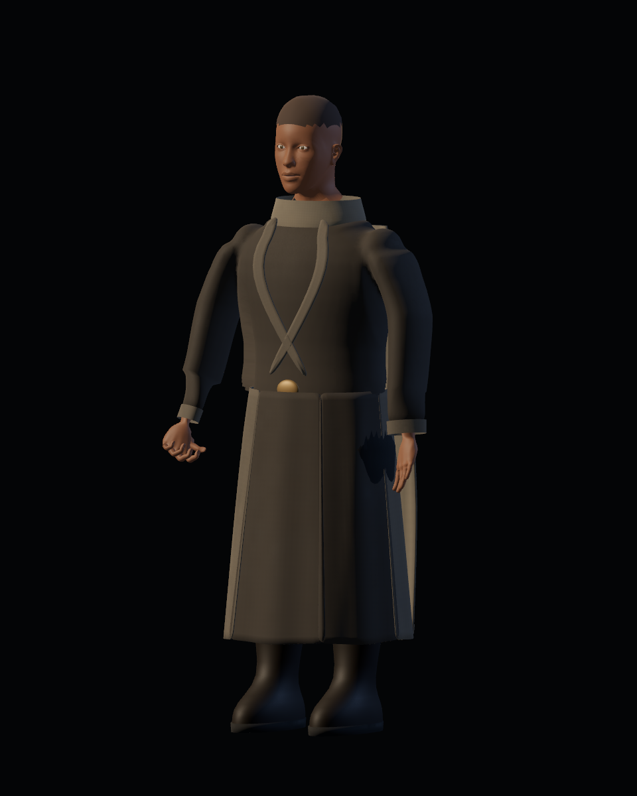
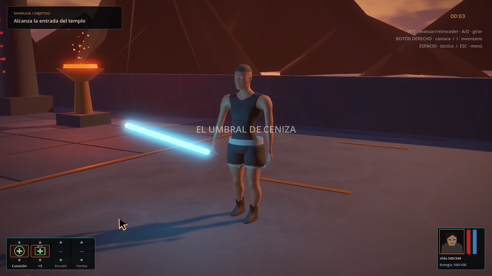
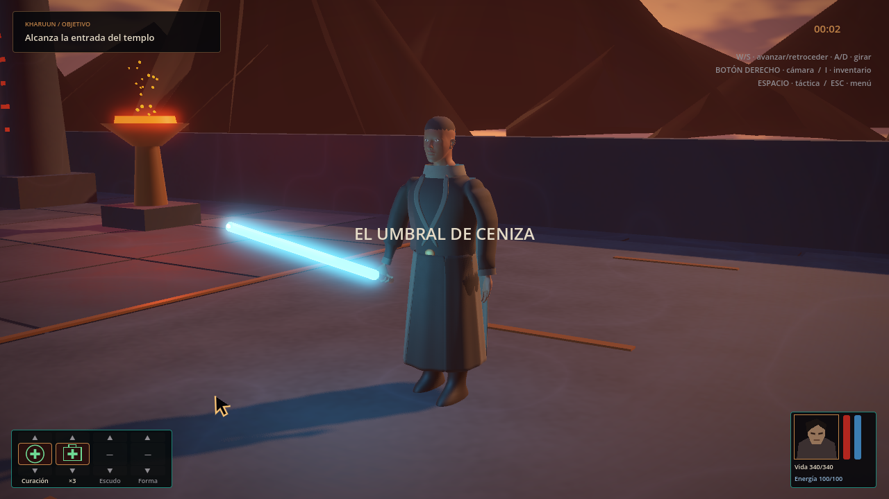

# Personaje y vestuario — candidata de producción

20-10-2026. Evidencia real de Godot 4.7.2, Vulkan Forward+, Radeon RX 6600. El alcance aprobado está en [#34](https://github.com/Dioniss97/ShadowsOfKharuun/issues/34); trabajo y aceptación en [#35–38](https://github.com/Dioniss97/ShadowsOfKharuun/issues/35) y sus sub-issues. Esta galería conserva evidencia; el estado operativo se mantiene en GitHub.

## Apariencias del último pase regional

| Sin uniforme | Uniforme completo |
|---|---|
|  |  |

La fuente editable adapta anatomía MakeHuman CC0 fijada en el repositorio. Ropa, materiales y rig se producen en Blender. Equipar cambia el conjunto corporal y el calzado; retirar restaura toda la apariencia base. Los guantes completos siguen previstos en #45; estas imágenes aún conservan manos descubiertas.

El GLB y sus cifras actuales están en el [informe de exportación](export_report.json). El pase 07 usa SHA-256 `92d7addb1532f877e097681c17eee29d3be54310f1d411922fc7a6af6b93cddb`: 6.529.820 bytes, 76 huesos, 44 piezas editables, 58.027 vértices y 114.568 triángulos sumando ambas apariencias; no todos se dibujan simultáneamente.

## Comparativas por región

Todas usan el mismo encuadre, iluminación y tiempo de acción dentro de cada pareja. Son capturas del GLB ejecutado en Godot, no renders Blender ni imágenes generadas.

| Pase | Cambio y evidencia |
|---|---|
| [03](iterations/quality_02/) | Hombros, mangas y mapas propios de color/rugosidad 512² para piel, tejido y cuero. |
| [04 — manos](iterations/quality_04/README.md) | 30 articulaciones de dedos, volumen de mano, continuidad del pulgar y empuñadura; 42 vistas por versión. |
| [05 — brazos](iterations/quality_05/README.md) | Sección menos aplanada, flexión de codos y continuidad de normales/UV del antebrazo; 38 vistas por versión. |
| [06 — torso](iterations/quality_06/README.md) | Cobertura anatómica, camiseta con contornos interpolados, cuello y plano pectoral; 28 vistas por versión. |
| [07 — piernas](iterations/quality_07/README.md) | Sección de piernas, calzado/solape y orientación de suelas; 62 vistas por versión, incluyendo andar, correr, giro y derrota. |

## Inventario y templo

I abre el inventario durante la partida. Equipar/Retirar sincroniza personaje y vista 3D; I, ESC o Volver cierran. El juego conserva la pausa táctica previa. La UI se captura a 1280×720.

| Base en el templo | Uniforme en el templo |
|---|---|
|  |  |

Estas vistas fijan la posición y usan una cámara de inspección dentro del nivel. No sustituyen la revisión jugable a distancia normal. Las imágenes de integración corresponden al pase 07. `studio/` todavía conserva la galería general del pase 04, identificada por su [informe](studio/report.json).

## Evidencia técnica y sus hashes

- [Vestuario sin render](integration/logic_report.json): 28 comprobaciones, 0 fallos, pase 07.
- [Vestuario GPU](integration/gpu_report.json): 32 comprobaciones, 0 fallos, pase 07; entradas reales, cobertura, movimiento, arma/palma y orientación de suelas.
- [Misión del pase 07](iterations/quality_07/mission_headless.json): 213 comprobaciones headless, 0 fallos.
- [Importación limpia anterior](integration/clean_import_report.json): pase 04, 26/0. No certifica automáticamente los GLB posteriores.
- [Misión completa anterior](integration/regression_report.json): pase 04, 213 headless/238 GPU sin fallos en ejecuciones finales, recorrido automático hasta victoria. Se conserva también su primer intento GPU con un fallo W+D y posteriores repeticiones satisfactorias; causa indeterminada.

Cada informe registra su alcance; las comparativas regionales conservan informes de sus propios hashes. La importación limpia y la regresión GPU completa se repetirán al fijar el conjunto final. Automatización y capturas no son QA humana.

## Movimiento, coste y límites

Faldón y capa usan quince cadenas secundarias y ocho cápsulas SpringBone en torso, cintura, brazos superiores y piernas. Es dinámica ósea en tiempo real, sin solver de tela por vértices ni autocolisión completa. La cobertura combina ocultación de regiones interiores, ajuste de prendas y colisionadores locales; no prueba ausencia de clipping en todas las poses.

El informe GPU recoge 30 intervalos de presentación por vista, mediana/p95, llamadas de dibujo, primitivas y memoria de texturas. Son muestras cortas de esta máquina; incluyen CPU/render/presentación y, en inventario, su vista 3D y la escena subyacente. No aíslan el coste del personaje ni garantizan FPS en otras máquinas.

Quedan la construcción final de shorts/cintura, ajuste del uniforme y guantes, dinámica, presentación del inventario y QA integrada de los pases siguientes. La calidad artística, proporciones, cobertura y movimiento requieren aceptación humana antes de entregar. No se declara alcanzada la calidad visual final ni se publica una versión estable.

Reproducción y referencias técnicas: [pipeline Blender–Godot](../../../tools/blender/CHARACTER.md).
