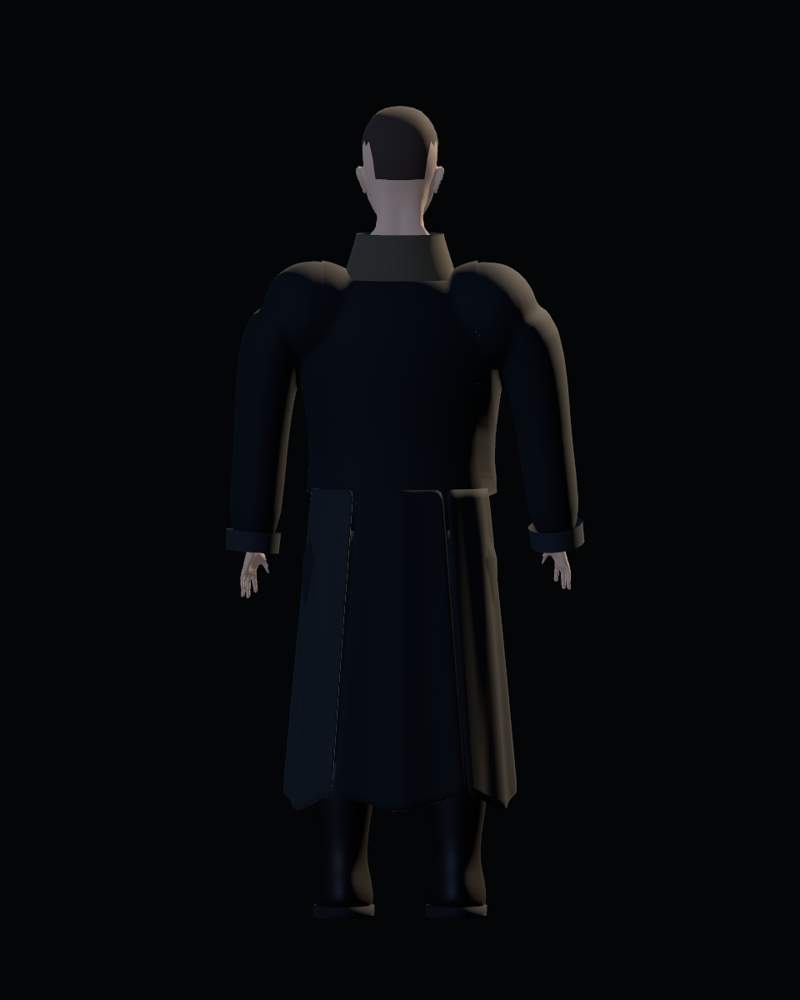
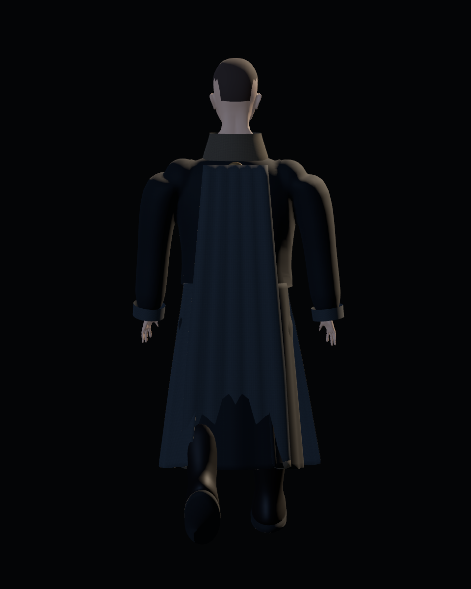
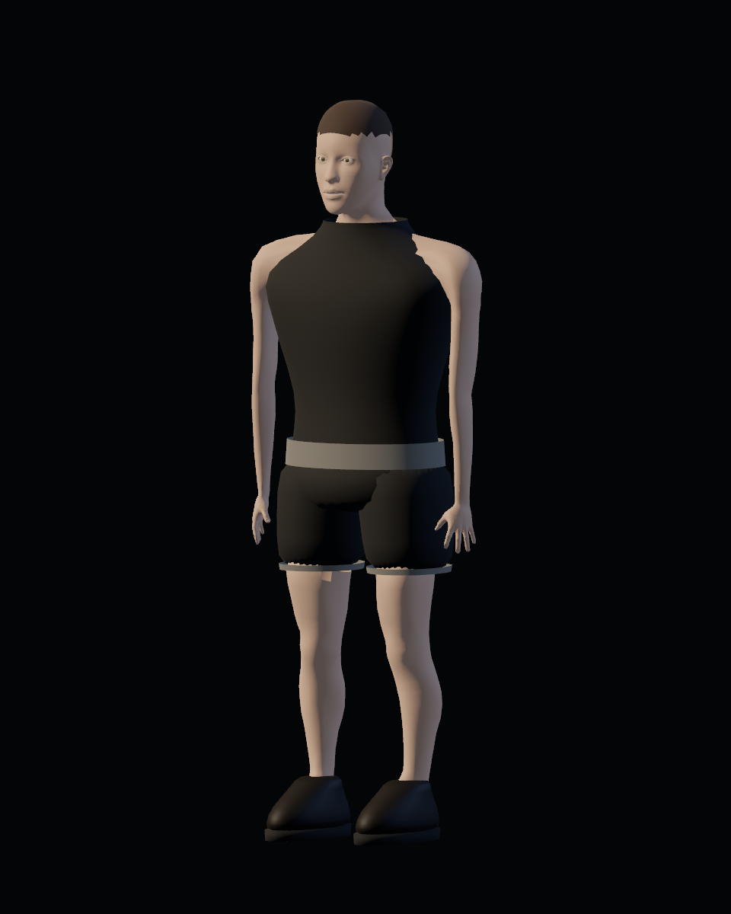
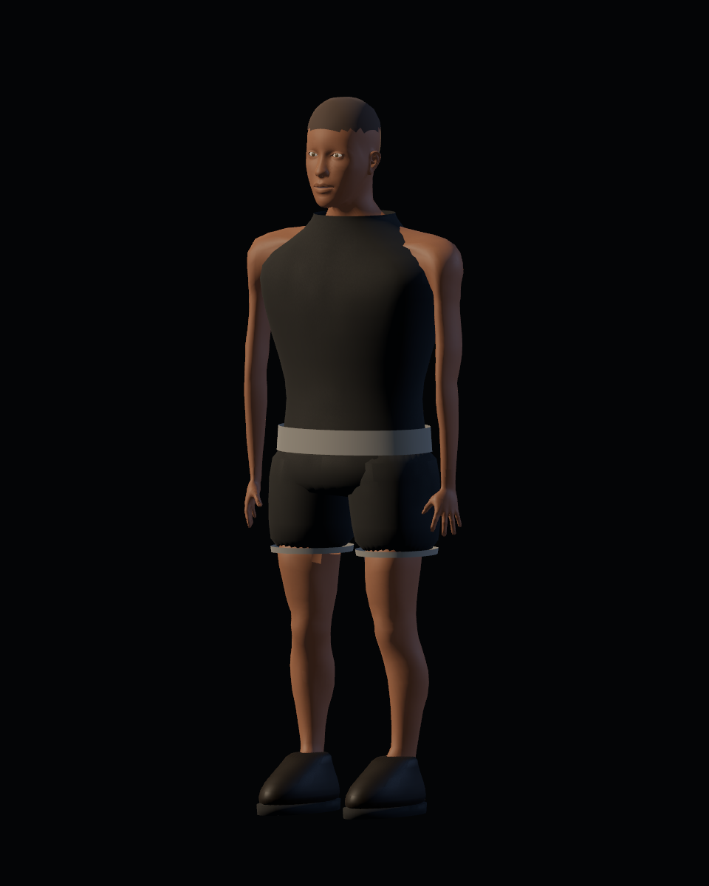
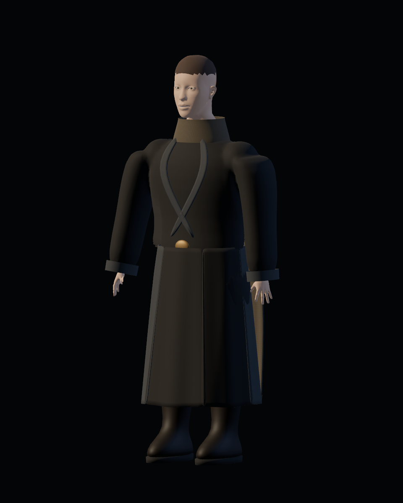
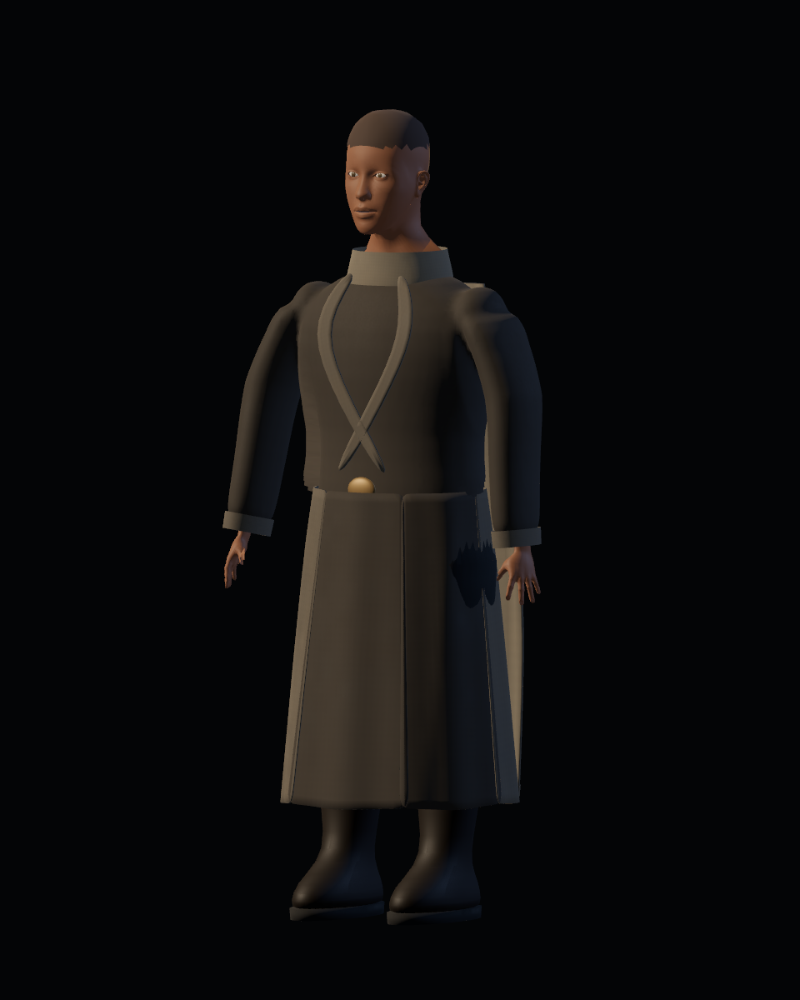
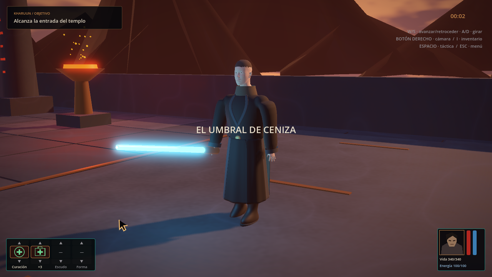

# Personaje y vestuario — primera candidata integrada

20-10-2026. Capturas auténticas de Godot 4.7.2, Vulkan Forward+, Radeon RX 6600. Tras manos y brazos (#40–41), el pase actual corresponde a torso, hombros y cuello [#42](https://github.com/Dioniss97/ShadowsOfKharuun/issues/42), dentro de #35. El conjunto sigue en revisión para #35–38; alcance aprobado #34.

## Apariencias

| Sin uniforme equipado | Uniforme completo |
|---|---|
|  |  |

Las capturas generales de estudio todavía corresponden al pase 04. Las vistas regionales actuales están en la comparativa 06; inventario y templo ya usan el modelo del pase 06.

La fuente editable adapta anatomía CC0 de MakeHuman y contiene ropa, materiales y rig producidos con Blender. El conjunto cambia túnica, prendas inferiores, cinturón y botas. Cabeza y manos se conservan. Al retirarlo reaparece el conjunto base completo, incluido su calzado.

La túnica ahora incluye una capa posterior integrada, sin ranura independiente. Reduce el volumen de los hombros, define pliegues más amplios y conserva un borde interior visible. La captura de caminata desde atrás permite revisar su oscilación dentro de Godot:

| Reposo | En movimiento |
|---|---|
|  |  |

| Vista integrada base | Vista integrada uniforme |
|---|---|
|  |  |

Estas vistas del templo congelan la posición y usan una cámara de inspección dentro del nivel real. Las vistas de `studio/` son del GLB en un estudio de Godot, a 960×1200. Hay frontal, posterior, tres cuartos, andar y gesto de poder para ambas apariencias. No son renders Blender ni imágenes generadas.

## Iteración de calidad 03

La anatomía reduce la anchura exterior del hombro de forma gradual; la túnica integra hombreras menos abultadas, mangas con transición de volumen hasta el puño y un cuello algo más bajo. Los materiales generados ahora llevan mapas empaquetados de color y rugosidad de 512²: variación moderada para la tela y el cuero, más tenue para la piel. La paleta de la túnica se aclaró para hacer legibles sus paneles bajo la iluminación del nivel. El objetivo fue mejorar la lectura de silueta, articulación y materiales antes de sumar microdetalle, siguiendo recomendaciones de profesionales sobre forma, proporción y rugosidad.

| Cuerpo base, antes | Cuerpo base, después |
|---|---|
|  |  |

| Uniforme, antes | Uniforme, después |
|---|---|
|  |  |

| En el templo, antes | En el templo, después |
|---|---|
|  |  |

Esta revisión 03 usó el GLB `e57bad1ffba8b9113f6bea5b5204191a06db86ef8b90c14fe595359356eae352` (5.958.144 bytes, 46 huesos, 45.981 vértices, 90.616 triángulos). Sus comparativas se conservan como historial.

## Iteración de calidad 04 — manos y muñecas

La [comparativa regional](iterations/quality_04/README.md) contiene 42 vistas antes y 42 después con las mismas cámaras e iluminación: reposo, guardia, ataque y poder, ambas apariencias. Las manos conservan mejor su volumen, incorporan 30 articulaciones de dedos y tienen poses de agarre y poder. Se corrigieron el corte del pulgar entre regiones de apariencia y la recesión accidental del antebrazo. La empuñadura del jugador mide 4 cm de diámetro y sigue la palma posada.

GLB de la revisión 04: `6e016ac872f5398e4fd532b65f17705d94d54e1fe03cc93ed49c82aef6739623` (6.701.868 bytes, 76 huesos, 56.329 vértices, 111.472 triángulos). Vestuario: 26 comprobaciones headless y 30 GPU, cero fallos. Importación con caché vacía: 26/0. La aceptación artística y la revisión humana de clipping continúan pendientes.

## Iteración de calidad 05 — brazos y codos

La [comparativa 05](iterations/quality_05/README.md) muestra 38 vistas por versión: sección del brazo menos aplanada, flexión de los codos existentes y continuidad de normales/UV en la frontera del antebrazo. Espada y origen de poderes siguen las manos posadas.

GLB del pase 05: `5c11fe876735adc6b628ddd8a2304d9ad3f3eca6583dbc32d049f4f378d5864a`, 6.514.460 bytes. Se mantienen huesos y geometría del pase 04. Vestuario 27 headless/31 GPU y misión 213 headless, sin fallos. La importación limpia y la última regresión GPU completa de misión conservadas corresponden al pase 04; no prueban por sí solas este hash.

## Iteración de calidad 06 — torso, hombros y cuello

La [comparativa 06](iterations/quality_06/README.md) contiene 28 vistas por versión. La camiseta se deriva de la anatomía con contornos interpolados, superficie alisada y espesor; la cobertura retrae solo piel oculta con una transición gradual. El cuello conserva continuidad entre roles y la cabeza baja 2,5 cm conservando su forma.

GLB actual `adbcb05d209516139242b4cb2faa3a1b9fbeb12c5ce256b542aaa9b63f3c235d`: 6.557.408 bytes, 76 huesos, 57.845 vértices y 114.696 triángulos. Vestuario 27 headless/31 GPU y misión 213 headless, sin fallos. Caché vacía y misión GPU completa anteriores: pase 04. Informes de este pase junto a sus capturas.

## Inventario

Se abre con I durante la partida; Equipar/Retirar cambia a la vez el personaje real y la vista 3D. I, ESC o Volver cierran. El juego se pausa y conserva la pausa táctica anterior. Las capturas del inventario son de la UI real a 1280×720.

## Evidencia técnica

- [Exportación](export_report.json): hash del GLB, 4 grupos de apariencia, 44 piezas editables, 76 huesos y geometría total de ambas apariencias. Este total no equivale a todos los triángulos visibles simultáneamente.
- [Prueba de entradas sin render](integration/logic_report.json): pase 06, 27 comprobaciones, 0 fallos.
- [Prueba con GPU](integration/gpu_report.json): pase 06, 31 comprobaciones, 0 fallos, capturas y mediciones por vista.
- [Importación limpia](integration/clean_import_report.json): pase 04 con caché `.godot` vacía, 26 comprobaciones, 0 fallos.
- [Estudio](studio/report.json): motor y hash del GLB del pase 04 representado.
- [Regresión completa del pase 04](integration/regression_report.json): 213 comprobaciones headless y 238 con GPU; misión, combate, pausas, diálogo, cámara, derrota/reinicio y recorrido automático hasta victoria. La [regresión headless del pase 05](iterations/quality_05/mission_headless.json) conserva 213/0. Los informes distinguen ejecución automática de QA humana.

Reproducir con [las instrucciones del pipeline](../../../tools/blender/CHARACTER.md). La suite de vestuario usa `--wardrobe-capture`; el argumento `--demo-capture` pertenece a la regresión histórica y debe ejecutarse en otro proceso.

## Coste observado y límites

El GLB ocupa 6,56 MB decimales; su hash y cifras exactas están en el informe de exportación. El informe GPU incluye 30 intervalos de presentación por vista, mediana/p95, llamadas de dibujo, primitivas y memoria de texturas. Son muestras cortas de esta máquina y configuración; incluyen CPU, renderizado y presentación. Las mediciones con inventario incluyen su vista 3D y la escena subyacente; no aíslan el coste exclusivo del personaje ni certifican FPS de otras máquinas.

El faldón y la capa utilizan quince cadenas de huesos secundarios en total y ocho cápsulas SpringBone en torso, cintura, brazos superiores y piernas. La prueba separa 45 pasos en reposo del desplazamiento real; ambas prendas reaccionan y sus poses siguen finitas. Es dinámica secundaria por huesos: no hay solver de tela por vértices, autocolisión completa ni colisión de `PhysicsServer3D`. Las regiones interiores cubiertas se ocultan; los colisionadores reducen penetraciones localmente, pero la cobertura debe seguir revisándose visualmente en acciones y transiciones.

## Revisión artística y jugable

La aceptación humana está pendiente. Deben valorarse anatomía/cabeza, acabado de prendas y materiales frente al Vigía, movimiento del faldón, encuentros de cuello/axilas/cintura/dobladillos y comportamiento al correr, girar, atacar y lanzar poderes. Las formas y texturas de esta primera candidata todavía necesitan esa evaluación; no se declara alcanzada la calidad artística final.

Esta galería conserva evidencia de la candidata. El estado de trabajo y la aceptación se mantienen en GitHub Issues.
