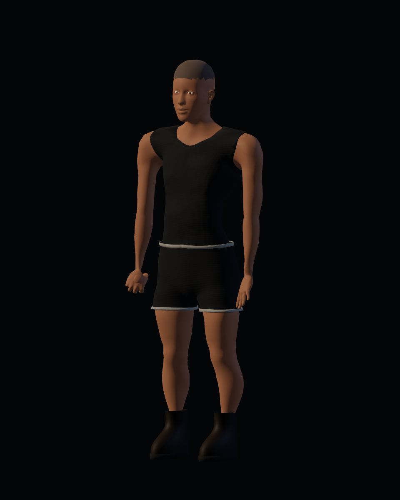
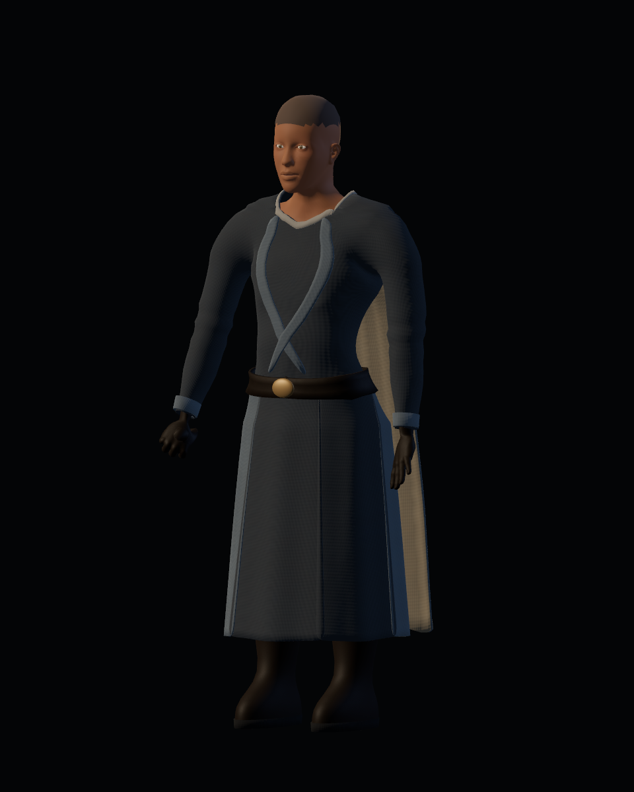
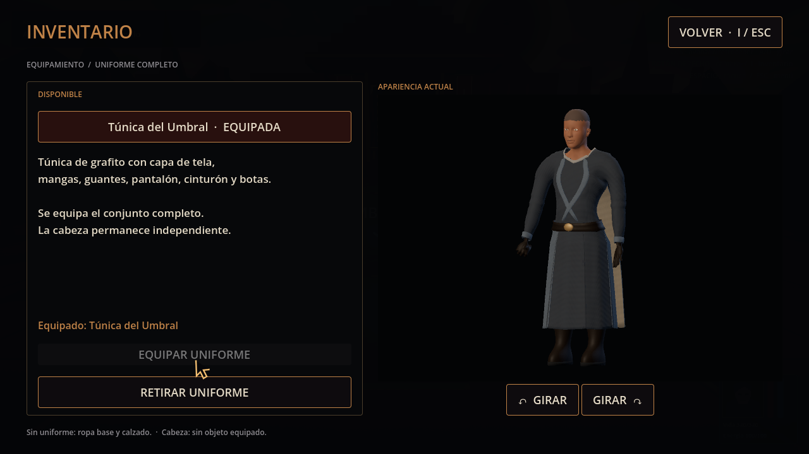
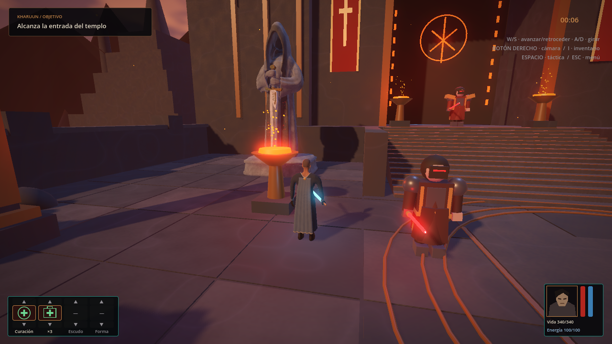
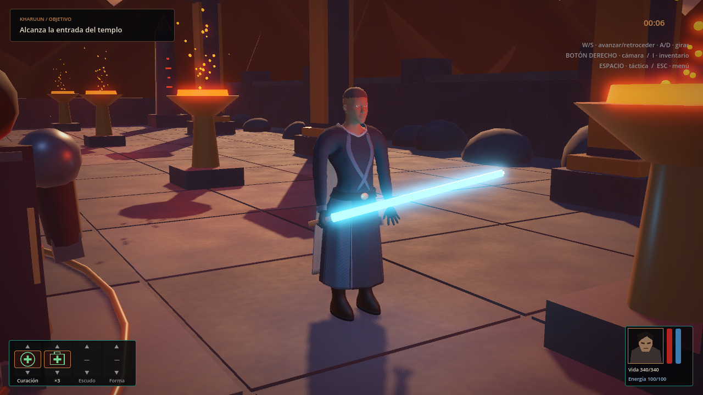
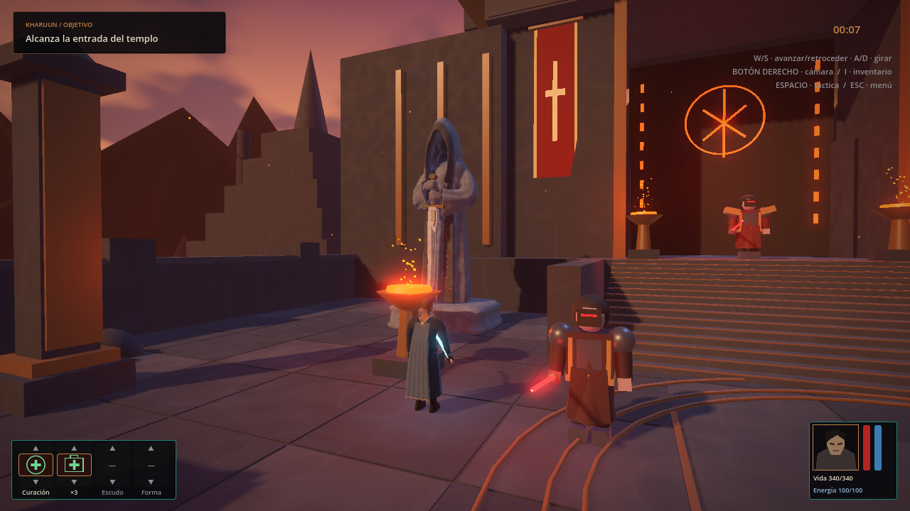

# Personaje y vestuario — candidata de producción

20-10-2026. Evidencia de Godot 4.7.2, Vulkan Forward+, Radeon RX 6600. Alcance aprobado [#34](https://github.com/Dioniss97/ShadowsOfKharuun/issues/34); producción en [PR #39](https://github.com/Dioniss97/ShadowsOfKharuun/pull/39). El estado operativo y la aceptación viven en GitHub. La candidata no es una entrega estable.

Para probar esta candidata desde el checkout de producción: `tools/logs/production-050/PLAY.bat` respecto al workspace principal. El PLAY.bat de main continúa mostrando la estable 0.4.0.

## Evaluación anatómica posterior — 21-10-2026

[Comparación Blender Studio/MakeHuman y diagnóstico del óvalo](base_model_comparison_20261021/README.md) · [Prueba autorizada de rig Blender Studio en Godot](studio_rig_trial/README.md). El ensayo tiene fuente, GLB y visor propios (`tools/STUDIO_TRIAL.bat`); no sustituye las apariencias jugables inferiores. Mejora el reposo y hombros; el agarre aún requiere refinar rig/pesos y la interpolación abierta/cerrada falla. La evidencia técnica no equivale a aceptación artística.

## Apariencias actuales

| Sin uniforme | Uniforme completo |
|---|---|
|  |  |

Anatomía MakeHuman CC0 fijada y adaptada en Blender; ropa, rig y materiales propios. Equipar cambia túnica, mangas, guantes, pantalón, cinturón, botas y capa en un solo conjunto. Retirar restaura camiseta/shorts/calzado y manos base. Cabeza y sus accesorios quedan aparte.

GLB actual de la candidata: `e12260519daa0fd36c124aa567aa5845def1ba7f394b81f1e45b7b50495a48d3`: 9,918,988 bytes, 76 huesos, 41 piezas editables, 64,052 vértices y 126,980 triángulos sumando ambas apariencias. Cuatro roles exportados; las dos apariencias no se dibujan a la vez. [Exportación](export_report.json).

## Comparaciones por región

Parejas con cámara, iluminación y protocolo comunes; GLB/render Godot reales. Cada carpeta conserva su hash histórico.

| Pase | Evidencia |
|---|---|
| [03](iterations/quality_02/) | Primer ajuste de hombros y mapas de color/rugosidad. |
| [04 — manos](iterations/quality_04/README.md) | Dedos articulados, palma/pulgar y empuñadura; 42 vistas por versión. |
| [05 — brazos](iterations/quality_05/README.md) | Sección, flexión de codos y costura de normales/UV; 38 vistas por versión. |
| [06 — torso](iterations/quality_06/README.md) | Camiseta anatómica, hombros/cuello/cobertura; 28 vistas por versión. |
| [07 — piernas](iterations/quality_07/README.md) | Sección, calzado y contrapose de suelas; 62 vistas por versión. |
| [08 — ropa base](iterations/quality_08/README.md) | Shorts, cintura y dobladillos continuos; 62 vistas por versión. |
| [09 — uniforme](iterations/quality_09/README.md) | Prendas anatómicas, guantes y normales textiles/cuero; 70 vistas por versión. |
| [10 — movimiento](iterations/quality_10/README.md) | Anclaje de capa, separación de faldón y amortiguación; 40 vistas por versión. |
| [11 — inventario](iterations/quality_11/README.md) | Encuadre, relleno, giro y retorno a pausa previa. |

| [12 — correcciones tras auditoría](iterations/quality_12/README.md) | Orientación de dedos/agarre, anatomía, confección, atlas de piel, trama y materiales Godot explícitos. |
| [13 — hombros, axilas y agarre](iterations/quality_13/README.md) | Aducción graduada de brazos, unión bajo la axila, agarre reajustado y suites repetidas en una importación limpia. La aceptación artística sigue pendiente. |
| [14 — proporciones del torso y unión de brazos](iterations/quality_14/README.md) | Torso base y prendas algo más anchos, axila/hombrera más pequeñas y brazos más próximos al cuerpo. Vestuario GPU/headless y misión headless aprobados; aceptación artística pendiente. |

## Inventario

I abre el inventario en juego; equipar/retirar sincroniza las prendas completas del jugador y su vista 3D. Los giros solo afectan a la vista. I/ESC/Volver conservan la pausa táctica previa. Capturas a 1280×720; [base](integration/inventory_base.png) y [giro](integration/inventory_rotated.png).

## Templo y Vigía

| Cámara jugable, posición fijada | Inspección cercana, luz del templo |
|---|---|
|  |  |

El visor final usa la escena y luz reales sin cambiar materiales ni la escala del Vigía. Las posiciones se fijan para comparar; no es una partida humana. Se conserva también la [apariencia base en cámara jugable](integration/final/base_game_camera.png). Las vistas de estudio, inventario, templo y dinámica final comparten el GLB actual; sus informes explican las cámaras y el alcance.

## Comprobaciones finales

| Suite | Comprobaciones | Fallos | Informe |
|---|---:|---:|---|
| Vestuario headless | 35 | 0 | [Lógica](integration/logic_report.json) |
| Vestuario GPU | 40 | 0 | [GPU y métricas](integration/gpu_report.json) |
| Reimportación vacía + vestuario headless | 35 | 0 | [Importación limpia](integration/clean_import_report.json) |
| Misma copia limpia + vestuario GPU | 40 | 0 | [GPU limpia](integration/clean_import_gpu_report.json) |
| Misión headless | 213 | 0 | [Misión](integration/mission_headless.json) |
| Misión GPU, recorrido automático hasta victoria | 238 | 0 | [Misión GPU](integration/mission_gpu.json) |

[Procedencia y hashes de fuentes](integration/final_provenance.json), [regresión resumida](integration/regression_report.json), [cámaras del templo](integration/final/report.json), [estudio](studio/report.json). Esos informes conservan la validación de calidad 12; las rondas actuales tienen [registros separados](iterations/quality_13/README.md) y [calidad 14](iterations/quality_14/README.md). La copia limpia de calidad 13 se creó sin `.godot`, se importó con editor y pasó ambos recorridos.

## Movimiento, coste y límites

Faldón y capa usan quince cadenas SpringBone y ocho cápsulas corporales. Primera fila de capa anclada a espalda, transición gradual y holgura posterior para evitar el faldón observado a través de ella. El vuelo al andar se redujo con rigidez, gravedad y arrastre; la [comparación 10](iterations/quality_10/README.md) registra parámetros, trayectoria y métricas. Es dinámica secundaria por huesos, sin solver textil por vértices ni autocolisión.

El informe GPU registra medianas/p95 de treinta intervalos por vista, draw calls, primitivas y memoria. Incluye CPU, render y presentación; inventario mantiene su vista 3D y la escena subyacente. No aísla el coste del personaje ni garantiza FPS en otros equipos. El visor de dinámica usa además reloj fijo y capturas; sus intervalos no son un benchmark de juego.

## Aceptación humana pendiente

Las comparaciones permiten revisar proporciones, materiales, cobertura, caída de tela y lectura respecto al Vigía. Se mantiene pendiente valorar esos puntos en movimiento y en una partida real, incluyendo posibles intersecciones entre paneles. No se certifica ausencia de clipping en cualquier pose ni acabado artístico definitivo. Las issues permanecen abiertas y PR #39 en borrador hasta registrar esa aceptación.

[Pipeline y reproducción](../../../tools/blender/CHARACTER.md).
