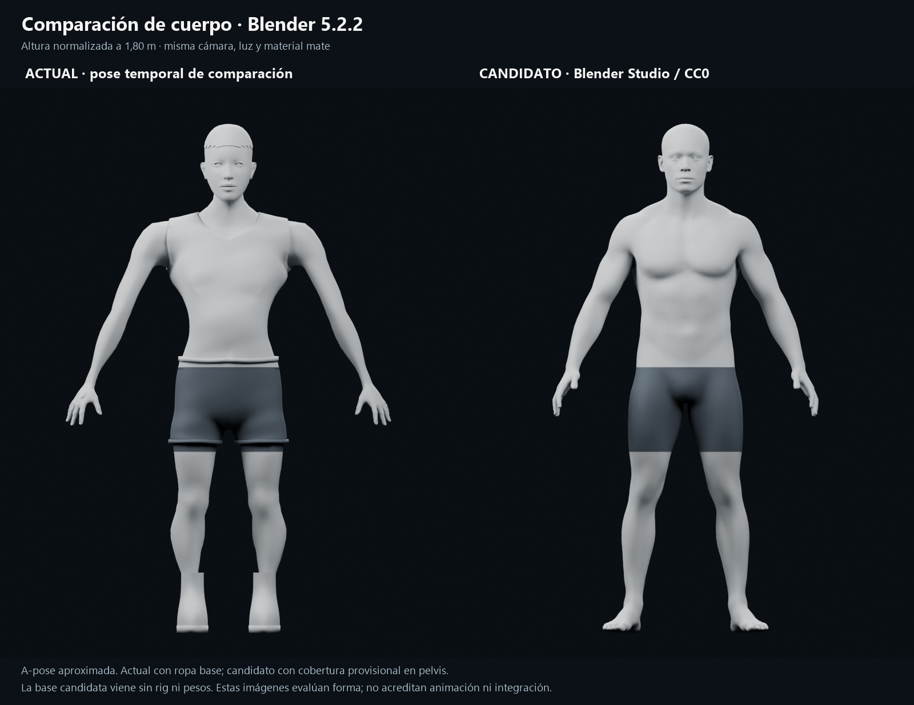
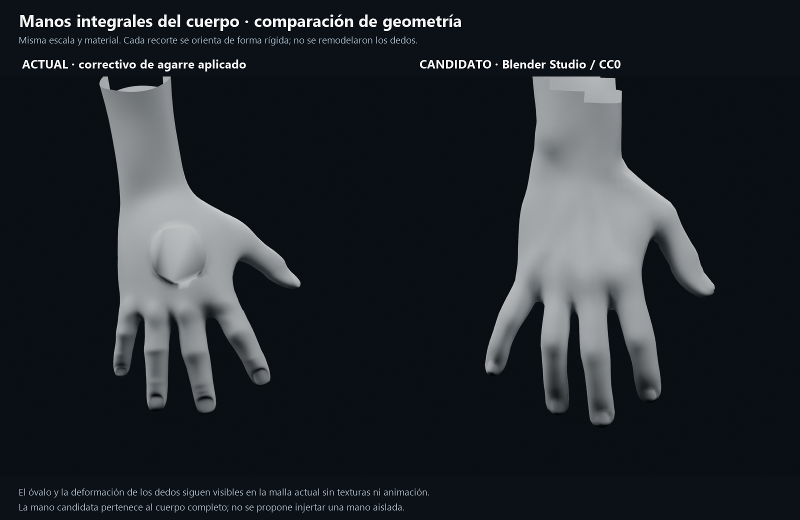
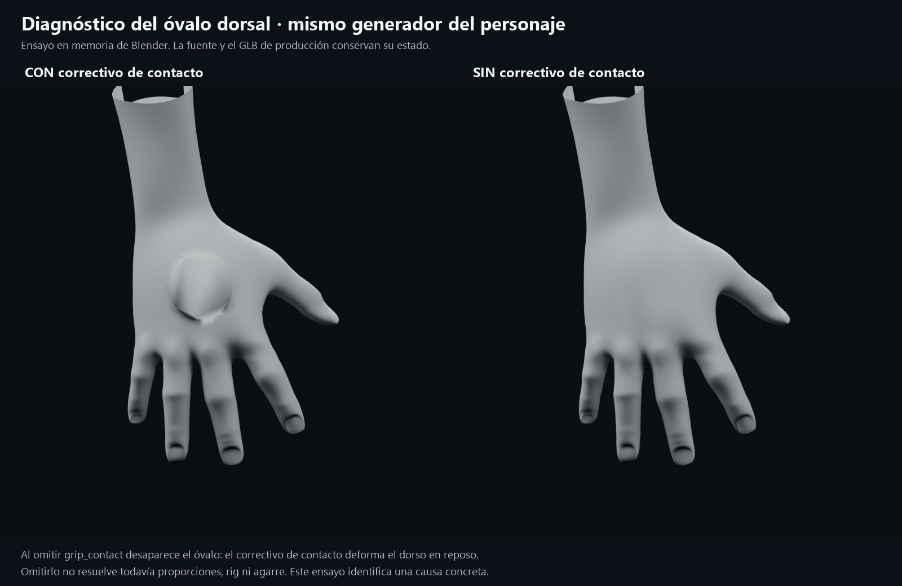

# Comparación de base corporal — 21-10-2026

Evaluación autorizada por el usuario tras rechazar la postura, las manos y las proporciones de la candidata. **La sustitución de la base sigue siendo una propuesta.** Este trabajo genera evidencia de Blender y un diagnóstico; no cambia el personaje, su GLB, el rig de juego ni sus materiales. Seguimiento y aceptación en [#48](https://github.com/Dioniss97/ShadowsOfKharuun/issues/48), dentro de [#35](https://github.com/Dioniss97/ShadowsOfKharuun/issues/35) y la PR #39.

## Comparación visible

El actual conserva la ropa base para mostrar la superficie que ve el jugador. El candidato es el cuerpo masculino realista completo de Blender Studio; sus manos forman parte de esa misma malla. La zona pélvica usa una máscara oscura provisional. Esta máscara no representa un diseño de ropa.

Todas las figuras se normalizan a 1,80 m y usan las mismas cámaras, luces y arcilla mate. La lámina corporal usa una **A-pose aproximada**: los hombros del actual se giran temporalmente 22° para acercar su postura a la del candidato. No se cambian sus proporciones y no se igualan exactamente piernas, dedos o rotación de antebrazos. Las poses nativas completas también se conservan en los PNG individuales. No es una comparación de deformaciones animadas equivalentes.

Se observa una transición hombro–pecho más continua y un volumen torácico más natural en el candidato. El actual conserva una sisa y un bloque de hombro dominantes respecto al torso, aun con materiales uniformes. La ropa del actual oculta parte de la anatomía: estas vistas comparan su apariencia visible, no dos cuerpos desnudos equivalentes.

Los recortes de mano se extraen de los respectivos cuerpos y se giran rígidamente para acercar su orientación. Se mantienen la escala y la geometría de los dedos; no se les aplica una pose nueva. Los bordes abiertos del recorte de muñeca son límites de la vista de estudio, no cortes nuevos en los assets. Las caras opuestas y vistas oblicuas están en los PNG individuales.

La mano actual presenta dedos alargados, transiciones poco naturales y un óvalo dorsal. La candidata conserva una palma, base del pulgar y nudillos más convincentes en reposo. Su aspecto en flexión y con el sable todavía no está demostrado.

## Causa comprobada del óvalo

La reconstrucción experimental ejecuta el mismo `create_character.py` en una escena vacía y se detiene **antes** de llamar a `grip_contact`, generar el atlas o guardar/exportar. Al omitir únicamente el correctivo de contacto, el óvalo desaparece. La geometría se examina en reposo y con material neutro: el defecto no depende de las texturas ni de las luces del juego.

El correctivo permanente de `grip_contact_fit.json`, aplicado por `character_surfaces.py`, produjo esa deformación del dorso al ajustar la mano al mango. Cumplir una distancia de no penetración no valida la forma anatómica. Desactivar el correctivo en producción tampoco resolvería por sí solo el agarre o las otras deformaciones; este ensayo identifica la causa sin introducir una corrección incompleta en el juego.

La postura visible añade otro trabajo independiente: `KhCharacterRig._pose_fingers` aplica giros de muñeca de ±90° y una flexión fija distinta por mano. Por ello, sustituir la malla sin revisar reposo, ejes, pesos y poses no garantiza una postura cómoda. La relación exacta de cada giro con la deformación debe revisarse con el candidato riggeado.

## Recursos comparados

| Recurso | Procedencia y estado real |
|---|---|
| Actual | `adventurer.blend` de `e0c341d`. Ya deriva de MakeHuman CC0; retarget, cambios de proporciones, ropa, pesos y correctivos propios. Conserva su rig de producción. |
| MakeHuman original | hm08 fijado en `vendor/makehuman`, commit `a8bc2d54ff0ac92e78ff71431b1023eda42bf482`. Se eliminan helpers de la lectura OBJ y se subdivide una vez. Es una referencia diagnóstica del origen, no un segundo personaje masculino terminado. |
| Blender Studio | Human Base Meshes v1.4.1, colección **Body Male - Realistic**, autor **Dan Ulrich**. La metadata del asset indica **CC0**, descripción «Realistic scan data model with multiresolution details». Malla base de **10.582 vértices**, sin Armature y con **0 grupos de vértices**. Se evalúa con un nivel Multires; ojos separados incluidos. |

El paquete de Blender contiene también un esqueleto **como modelo anatómico**. No es un rig de animación listo para el juego. El cuerpo candidato necesita un rig, pesos, poses de mano y adaptación de prendas antes de poder usarse en producción.

[Distribución oficial y licencia del paquete](https://www.blender.org/download/demo-files/#assets) · [archivo exacto descargado](https://download.blender.org/demo/asset-bundles/human-base-meshes/human-base-meshes-bundle-v1.4.1.zip) · [criterios de Blender Studio para una base humana](https://studio.blender.org/training/realistic-human-research/use-of-base-meshes/).

SHA-256 del ZIP: `811f43accbb31a88266d932f8f5563b2d13586fca0ba2693aad1f5fe582b3515`.

Se preservan la metadata CC0 de la colección y el README del paquete en [el informe](comparison_report.json). La distribución completa y el candidato se mantienen en `tools/logs/base-model-comparison/vendor/`, fuera de los assets del juego. No se incorpora un rig Rain ni otro asset del paquete por compartir archivo.

## Recomendación propuesta

Evaluar el cuerpo completo de Blender Studio como nueva base, conservando sus proporciones y manos, con un rig y pesos adecuados a esa anatomía. Primero demostrar reposo relajado, flexión de hombro/codo, mano abierta y agarre del sable desde varios ángulos. Después ajustar la ropa base y el uniforme completo; aplicar la paleta, los materiales y el nivel de detalle propios del juego.

Evitar que un correctivo permanente de contacto altere la mano abierta. El agarre debe resolverse con pose y, si hace falta, un correctivo ligado a esa pose, comprobando simultáneamente anatomía y contacto. Mantener los tiempos y eventos del combate existente al adaptar la presentación.

La identidad visual puede conservarse mediante proporciones elegidas, silueta del uniforme, paleta, escala de detalle y materiales propios. Descargar una buena base anatómica no obliga a adoptar sus texturas o una apariencia fotográfica. La dirección artística y la integración siguen pendientes de aceptación humana.

## Reproducción y límites

- Blender **5.2.2 LTS**, Cycles CPU, 24 muestras y denoise; tres luces de área, cámara ortográfica, AgX, material común sin mapas.
- [Script de render](render_comparison.py) y [composición de láminas](compose_boards.ps1). El script descubre la raíz por `project.godot`; busca el ZIP y el paquete extraído en `tools/logs/base-model-comparison/`.
- Con el paquete descargado y extraído en esa carpeta: `blender --background --factory-startup --python-exit-code 1 --python art/references/character/base_model_comparison_20261021/render_comparison.py`. Añadir `-- current_common_apose` para la pose temporal de comparación. Después ejecutar `compose_boards.ps1`.
- [Informe de modelos, metadata, cámaras y lista de capturas](comparison_report.json). El análisis del óvalo usa la rama sin correctivo, sin guardarla ni exportarla.
- Son renders de evaluación, no capturas del candidato en Godot, validación del rig ni prueba de juego. No se declara aceptación artística, ausencia de clipping ni entrega de una base nueva.
