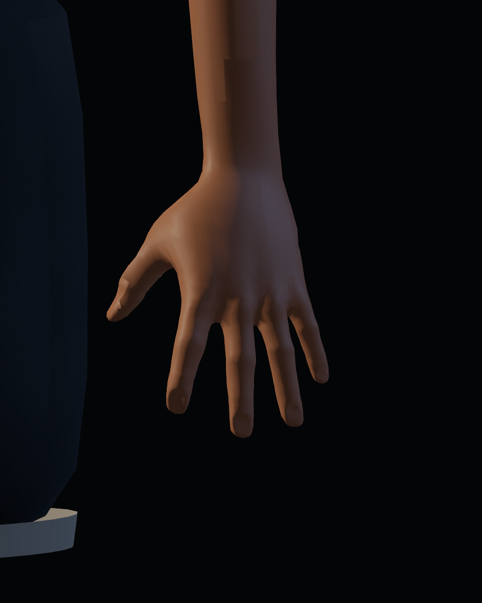
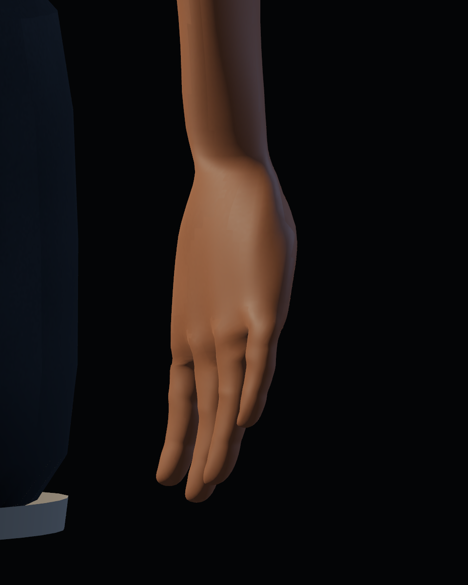
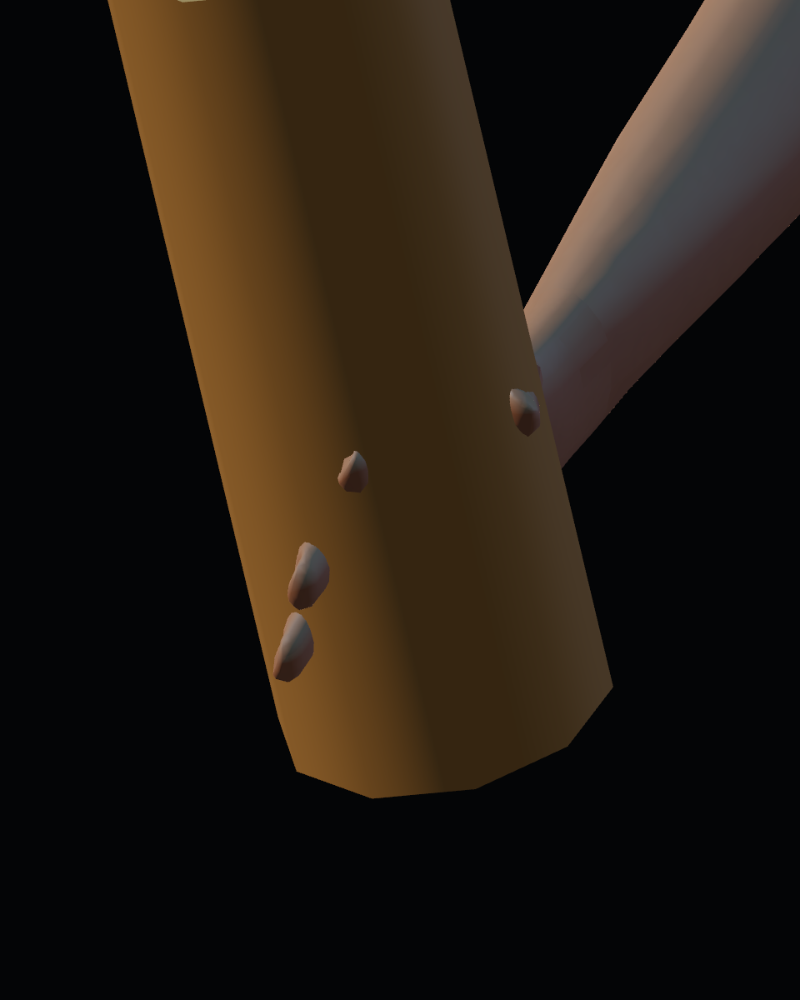
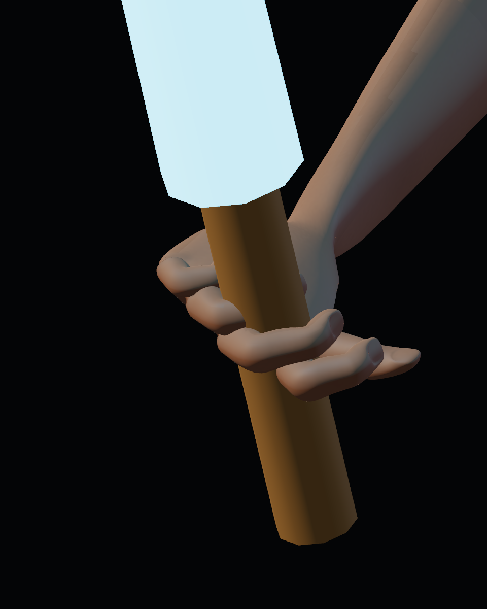
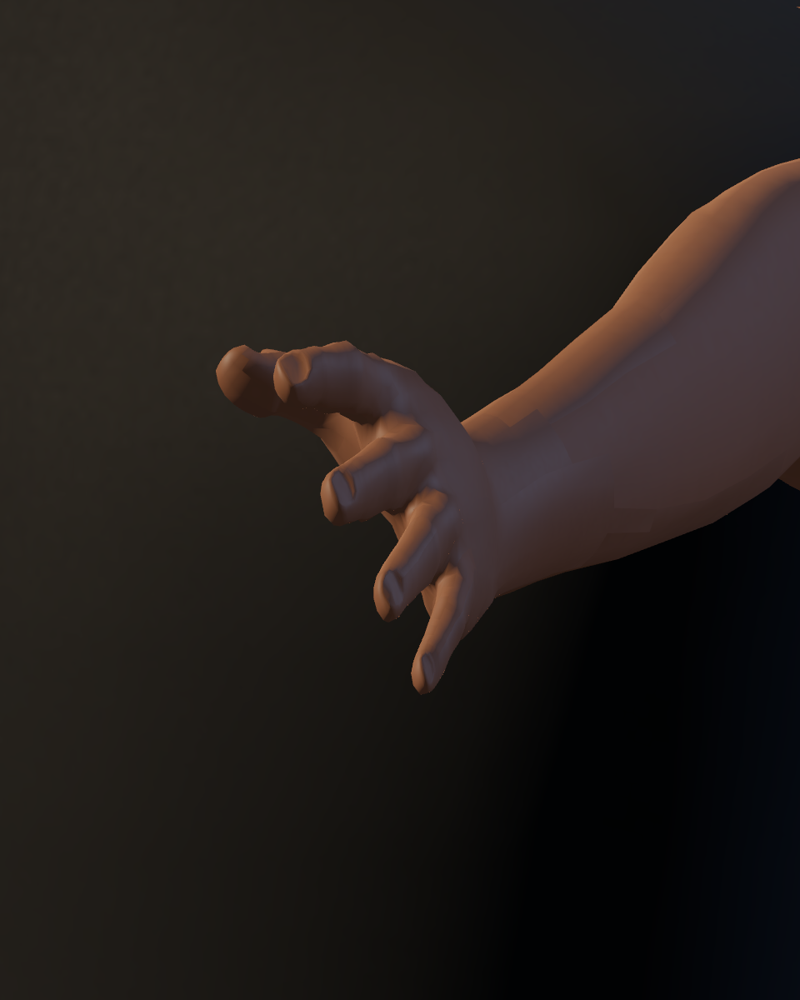
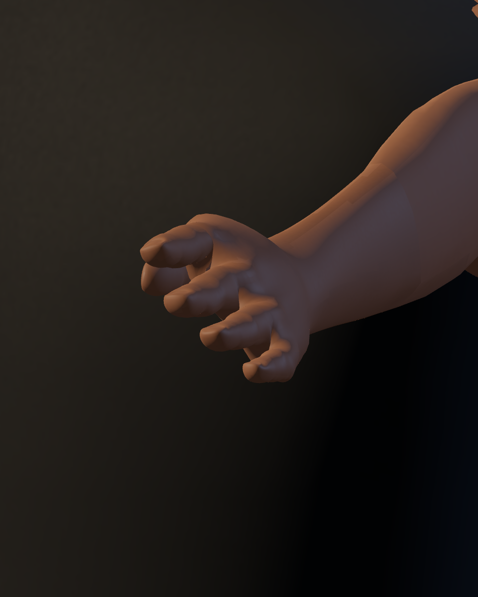

# Calidad 04 — manos y muñecas

20-10-2026. Primer pase regional de [#40](https://github.com/Dioniss97/ShadowsOfKharuun/issues/40), dentro de [#35](https://github.com/Dioniss97/ShadowsOfKharuun/issues/35) y la [PR #39](https://github.com/Dioniss97/ShadowsOfKharuun/pull/39). Evidencia técnica de una candidata; la aceptación visual humana se registra en la issue.

## Comparación real en Godot

Ambas carpetas se generaron con `tools/blender/preview_detail.gd`: 42 capturas por versión, 960×1200, cámaras, luz y tiempos de acción iguales. `before/` representa el GLB y scripts de animación de `30a6e66`; `after/` usa esta revisión. La comparación incluye los cambios de forma y de pose.

| Mano izquierda en reposo, antes | Después |
|---|---|
|  |  |

| Agarre en guardia, antes | Después |
|---|---|
|  |  |

| Poder con mano izquierda, antes | Después |
|---|---|
|  |  |

## Cambios

- Palma y dedos conservan su sección al desplazar la mano hacia la muñeca del rig jugable. La compresión transversal general del cuerpo ya no aplasta la mano.
- Treinta articulaciones nuevas, tres por dedo: flexión de agarre derecho, reposo izquierdo y extensión durante poderes. No hay acciones jugables nuevas.
- Subdivisión de un nivel solo en manos; pesos suavizados sobre la topología original y cuatro influencias normalizadas por vértice. La frontera del antebrazo conserva sus coordenadas.
- La selección de manos se hace tras retargetear: la máscara anterior cortaba el pulgar y lo repartía entre regiones con deformaciones distintas. La recesión de torso cubierto ya no estrecha accidentalmente el antebrazo.
- La empuñadura del jugador pasa de 10 a 4 cm de diámetro y sigue el centro de la palma posada; la geometría de armas de los NPC se conserva.

Se mantienen los mapas propios de piel y la topología anatómica MakeHuman CC0. Este pase no incorpora un nuevo set de texturas ni remodela brazos, hombros, torso o prendas.

## Exportación y comprobación

GLB antes: `e57bad1ffba8b9113f6bea5b5204191a06db86ef8b90c14fe595359356eae352`.

GLB después: `6e016ac872f5398e4fd532b65f17705d94d54e1fe03cc93ed49c82aef6739623`: 6.701.868 bytes, 76 huesos, 44 piezas editables, cuatro grupos de apariencia, 56.329 vértices y 111.472 triángulos sumando ambas apariencias.

Vestuario: 26 comprobaciones sin render y 30 con GPU, cero fallos. Importación con caché vacía: 26/0. Las comprobaciones nuevas revisan articulaciones importadas, geometría realmente ponderada a los dedos, normalización de pesos, anclaje de empuñadura y retorno del gesto de poder. La regresión y sus informes están en la [galería principal](../../README.md).

El [primer intento GPU de misión](mission_gpu_attempt_1.json) terminó con 238 comprobaciones y un fallo de desplazamiento al mantener W+D; el recorrido automático hasta victoria pasó. El [bloque de movimiento repetido aisladamente](movement_retry.json) pasó 17/17 sin cambiar controlador ni prueba. Una segunda ejecución completa pasó 238/238; la suite headless pasó 213/213. No se ha demostrado la causa del fallo intermitente; los resultados se conservan para no ocultarlo.

## Límites de la revisión

Las capturas permiten revisar continuidad del pulgar, silueta, muñeca y agarre. Quedan detalles de nudillos, separación de dedos y contacto del pulgar que deben valorarse visualmente; no se declara ausencia universal de intersecciones. Se aprecia una transición de sombreado en el antebrazo y las regiones de brazos y ropa todavía requieren sus pases específicos. La articulación no incluye colisión física entre dedos y arma.

Referencias técnicas: [roll de huesos en Blender](https://docs.blender.org/manual/en/latest/animation/armatures/bones/editing/bone_roll.html), [deformación con armadura](https://docs.blender.org/manual/en/latest/modeling/modifiers/deform/armature.html) y [poses de Skeleton3D](https://docs.godotengine.org/en/4.7/classes/class_skeleton3d.html). Las guías sustentan la técnica; la aceptación de la forma corresponde a la revisión artística del juego.
