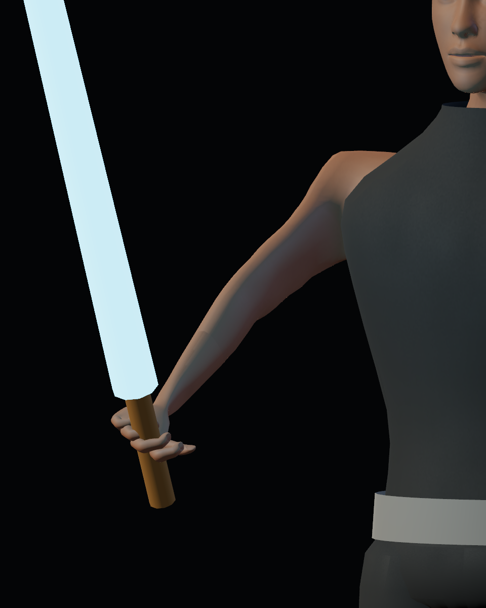
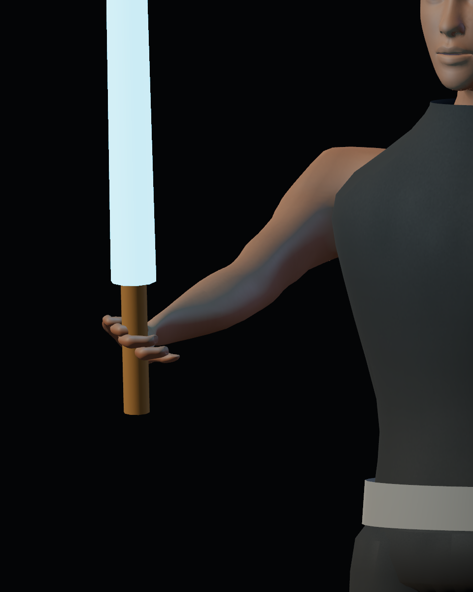
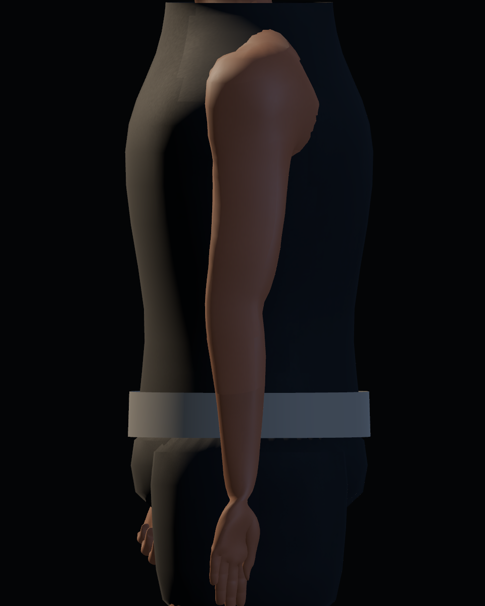
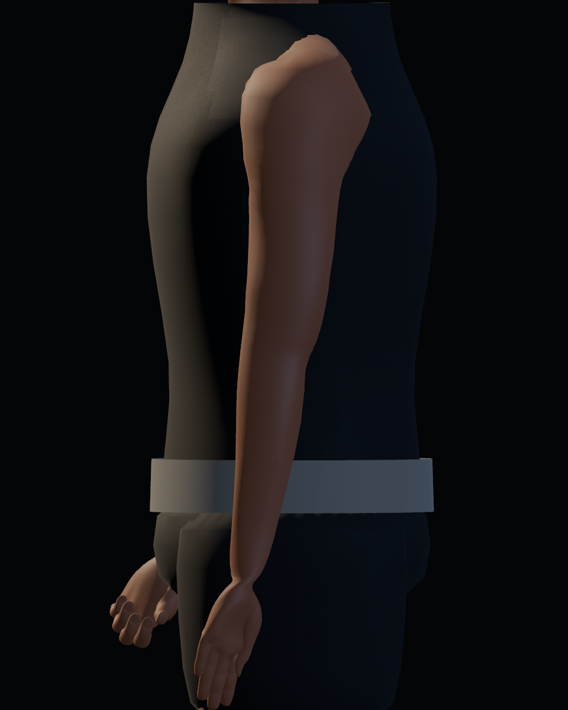

# Calidad 05 — brazos y codos

20-10-2026. Pase regional de [#41](https://github.com/Dioniss97/ShadowsOfKharuun/issues/41), tras las manos de #40. La aceptación artística humana sigue en la issue. Ambas carpetas contienen 38 capturas reales de Godot con `preview_detail.gd --region=arm`, misma cámara, iluminación, resolución y tiempo de acción. `before/` usa el GLB y runtime de `adfa3c9`; `after/` incorpora esta revisión.

| Guardia, antes | Después |
|---|---|
|  |  |

| Perfil izquierdo, antes | Después |
|---|---|
|  |  |

## Ajustes

- Se conserva el eje del brazo y se compensa su compresión transversal, con máscara de pesos anatómicos y transiciones graduales en muñeca y deltoides. Medición en la fuente a z=1,10 m: ancho de 4,8 a 8,0 cm, profundidad de 8,2 cm. A z=1,30 m: de 4,7 a 8,0 cm, profundidad de 10,8 cm. Son secciones de esta malla, no medidas de referencia universal.
- Los huesos de antebrazo existentes aportan flexión moderada en reposo, guardia, ataque y poder. No se añaden huesos ni acciones. Se mantienen sus tiempos y eventos jugables.
- La espada sigue posición de palma y orientación del antebrazo. El marcador de origen de poderes sigue la palma izquierda posada.
- La frontera entre las dos regiones de visibilidad recibe normales compartidas. Se encontró también una discontinuidad de UV: las piezas muestreaban zonas diferentes de los mismos mapas. Ahora comparten proyección XZ para la variación tenue de color/rugosidad; no es un layout para pintar detalles anatómicos.

## Exportación y evidencia

GLB: `5c11fe876735adc6b628ddd8a2304d9ad3f3eca6583dbc32d049f4f378d5864a`, 6.514.460 bytes. Se mantienen 76 huesos, 44 piezas, 56.329 vértices y 111.472 triángulos en fuente. La unificación de UV reduce duplicados de exportación sin quitar geometría.

Vestuario: 27 comprobaciones headless y 31 con GPU, sin fallos. Incluye comparación de normales/UV de vértices coincidentes del antebrazo importado, anclaje de arma y origen de poder, además del ciclo de equipamiento. Los informes de este pase se conservan en esta carpeta. La prueba de importación limpia y la última regresión GPU completa de misión anteriores corresponden al hash del pase 04; no se extrapolan a este GLB.

## Límites

La silueta y la continuidad del antebrazo mejoran en las vistas revisadas. Los hombros, axilas, cuello y bordes de ropa base conservan problemas visibles que corresponden a los pases siguientes. La ropa del uniforme todavía requiere ajuste final y guantes. No se declara la anatomía terminada ni ausencia universal de clipping. La valoración de proporciones y deformaciones necesita revisión humana.
