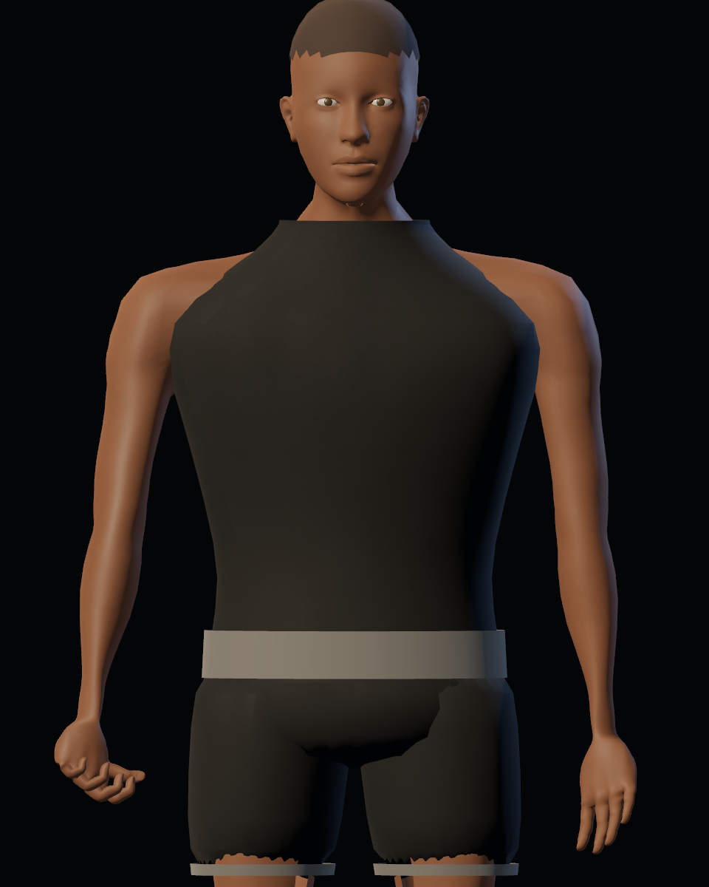
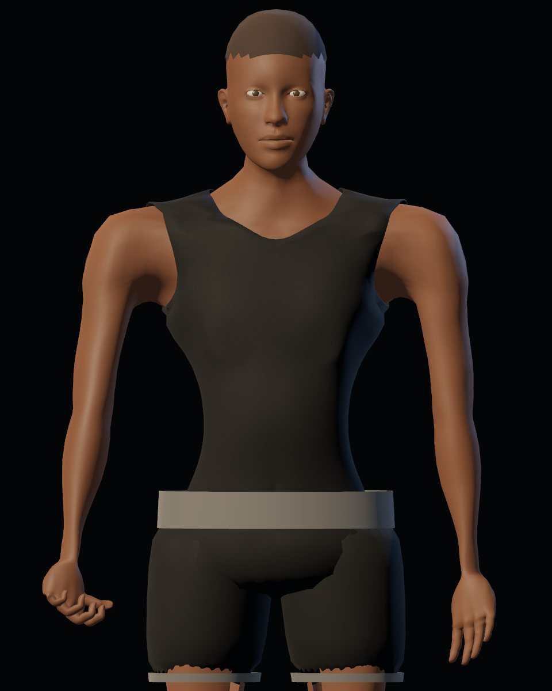
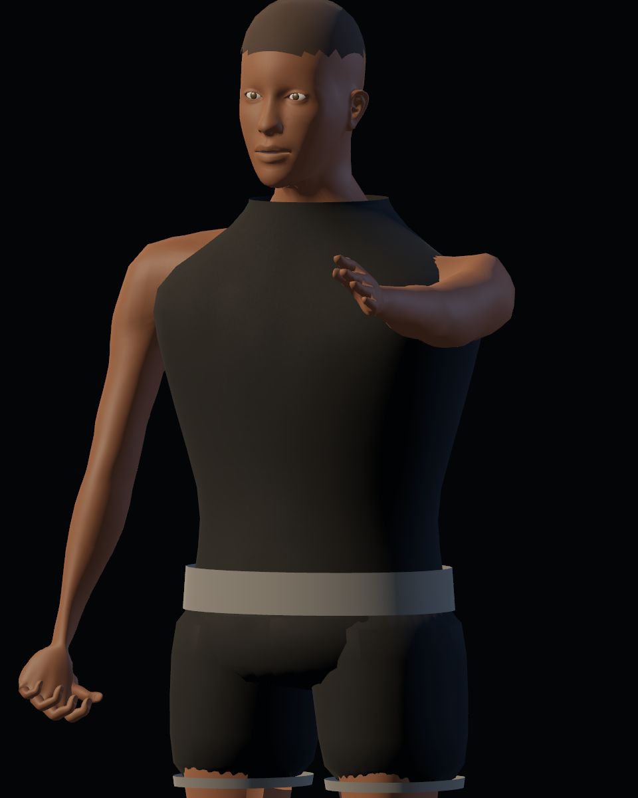
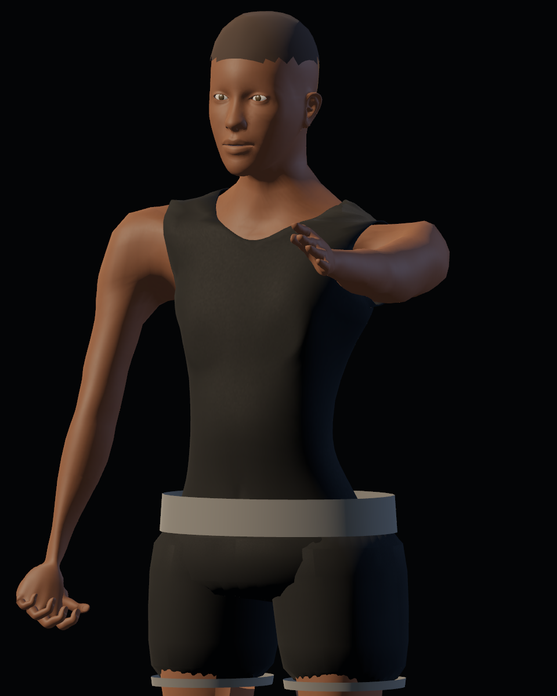

# Calidad 06 — torso, hombros y cuello

20-10-2026. Pase de [#42](https://github.com/Dioniss97/ShadowsOfKharuun/issues/42), tras #40–41. `preview_detail.gd --region=torso` genera 28 capturas por versión con cámaras, luz, resolución y tiempos de acción iguales. Antes: GLB/runtime de `c379646`; después: esta revisión. Aceptación artística humana pendiente en la issue.

| Base anterior | Base revisada |
|---|---|
|  |  |

| Poder anterior | Poder revisado |
|---|---|
|  |  |

## Cambios y causas

- Se sustituye la camiseta tubular que se cruzaba con los hombros por una superficie derivada de la anatomía. Se recortan escote y sisas interpolando geometría y pesos, en vez de seleccionar caras enteras. El contorno se suaviza y proyecta sobre el cuerpo con transferencia baricéntrica de pesos, y recibe 3 mm de espesor.
- El torso conserva su volumen anatómico y un plano pectoral más moderado. La antigua compresión rectangular de piel se sustituye por una recesión de hasta 12 mm exclusivamente dentro de la camiseta, con transición gradual hacia su contorno.
- El cuello conserva anchura en la unión de las dos piezas de visibilidad y comparte normales/UV. La cabeza se desplaza 2,5 cm hacia abajo para acortar el cuello conservando su forma; el reparto cabeza/cuerpo se basa en influencia ósea para mantener la mandíbula completa al equipar uniforme.
- Se descartan fragmentos desconectados que podía producir el recorte bajo la mandíbula. La camiseta sigue siendo una sola superficie conectada antes de añadir espesor.

## Exportación y evidencia

GLB `adbcb05d209516139242b4cb2faa3a1b9fbeb12c5ce256b542aaa9b63f3c235d`: 6.557.408 bytes, 76 huesos, 44 piezas, 57.845 vértices y 114.696 triángulos en fuente. Se conservan cuatro roles exportados.

Vestuario: 27 comprobaciones headless y 31 GPU; misión: 213 headless, sin fallos. Informes de esta revisión en esta carpeta. La última importación limpia y regresión GPU completa de misión anteriores corresponden al pase 04; no se extrapolan a este hash.

## Límites

Se revisaron frontal, espalda, perfil, tres cuartos, guardia, ataque y poder. No se declara ausencia universal de intersecciones. El contorno todavía conserva el presupuesto geométrico de la anatomía fuente; su acabado fino se valora humanamente. Shorts, calzado, guantes, cuello del uniforme y ajuste final de prendas requieren sus pases posteriores. Esta revisión no completa #44 ni #45.
