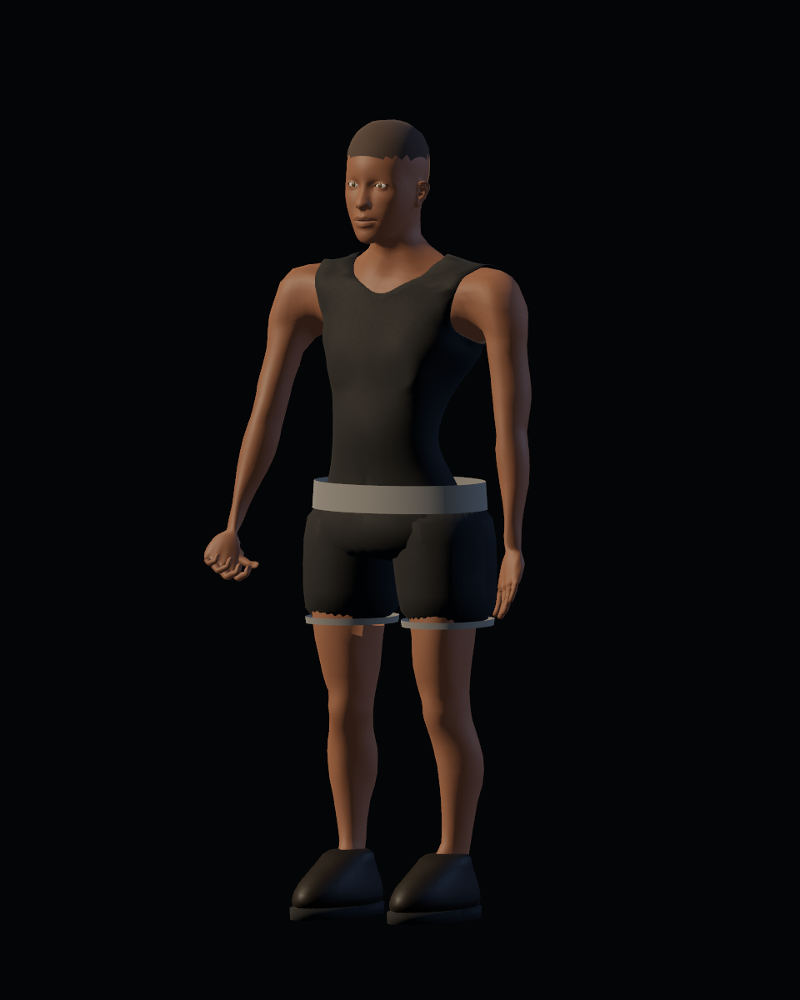
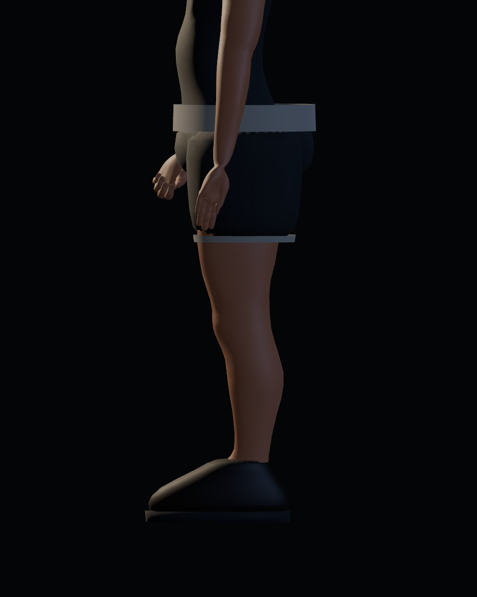
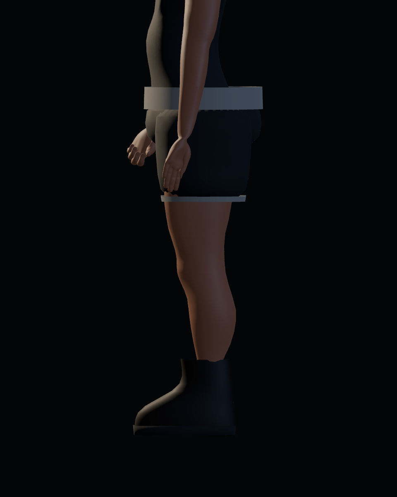

# Calidad 07 — cadera, piernas y pies

20-10-2026. Pase de [#43](https://github.com/Dioniss97/ShadowsOfKharuun/issues/43). `preview_detail.gd --region=leg` genera 62 capturas por versión, con iguales cámaras, luz y tiempos: reposo, guardia, ataque, poder, andar, correr, giro y derrota. Antes: GLB/runtime de `265ab1d`; después: esta revisión. Las poses de estudio aíslan el rig; el desplazamiento real se comprueba además con el controlador de producción.

| Proporciones anteriores | Revisadas |
|---|---|
|  |  |

| Perfil anterior | Revisado |
|---|---|
|  |  |

## Ajustes

- El warp local recupera sección de muslo/pantorrilla y se desvanece hacia cadera y pie. A z=0,38 m el ancho pasa de 10,9 a 12,7 cm, con 14,3 cm de profundidad; a z=0,74 m, de 14,6 a 16,8 cm, con 20,8 cm de profundidad. Medidas de la fuente, no una referencia anatómica universal.
- Se conserva el eje y los huesos. Los shorts provisionales acompañan el ajuste transversal para mantener cobertura; su construcción final corresponde a #44.
- El calzado base reduce longitud/anchura y recibe un solape de tobillo hasta z=0,245 m. Se oculta el pie interior y se retrae gradualmente la piel cubierta. La anatomía completa permanece en la referencia oculta de Blender.
- El borde superior del calzado sigue la espinilla, la suela sigue el pie. El tobillo compensa el giro de cadera/rodilla durante la zancada existente; no se introduce IK, bloqueo de pie al suelo ni locomoción nueva.

## Evidencia y límites

GLB `92d7addb1532f877e097681c17eee29d3be54310f1d411922fc7a6af6b93cddb`: 6.529.820 bytes, 76 huesos, 44 piezas, 58.027 vértices y 114.568 triángulos. Vestuario 28 headless/32 GPU y misión 213 headless, sin fallos. La comprobación nueva valida la orientación de las suelas durante movimiento real; no certifica contacto físico con el suelo.

Las vistas revisadas mejoran volumen y solape de tobillo. Quedan bordes/intersecciones de los shorts y acabado de cintura que debe resolver #44; no se declara el estado base terminado. La última importación limpia y misión GPU completa anteriores corresponden al pase 04. Aceptación artística humana pendiente.
