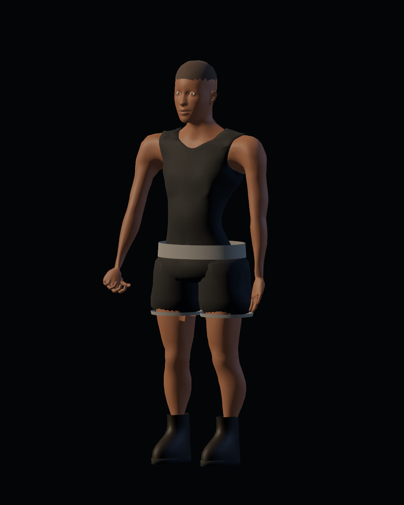
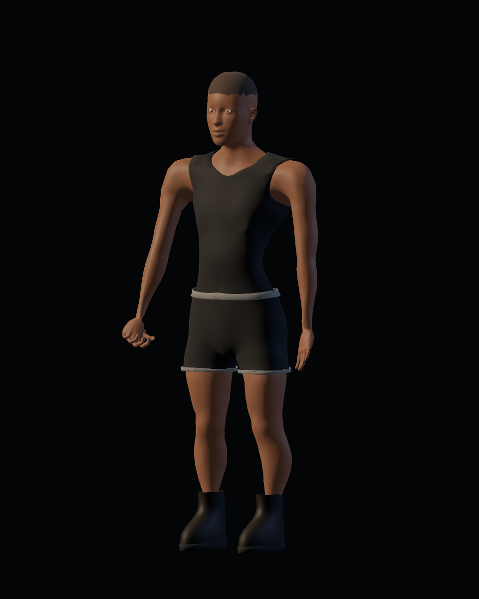
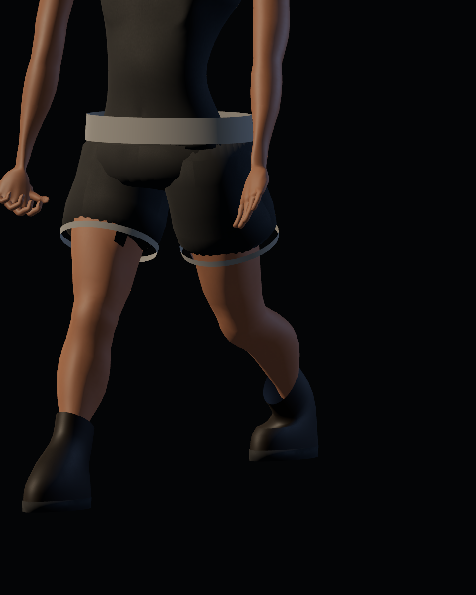
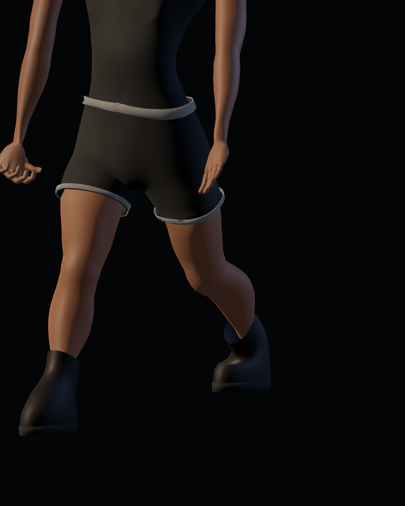

# Calidad 08 — ropa base

20-10-2026. Pase de [#44](https://github.com/Dioniss97/ShadowsOfKharuun/issues/44), tras los primeros pases anatómicos. `preview_detail.gd --region=leg` conserva 62 capturas por versión con las mismas cámaras, luz y tiempos. Antes: GLB/runtime de `9b23884`; después: esta revisión. La aceptación artística humana del conjunto sigue pendiente.

| Ropa base anterior | Revisada |
|---|---|
|  |  |

| Zancada anterior | Revisada |
|---|---|
|  |  |

## Cambios

- Shorts continuos derivados de la anatomía, con holgura, superficie alisada y espesor. Sustituyen las piezas de cadera y dos perneras que se atravesaban entre sí.
- Cintura y dobladillos recortados con contornos interpolados y pesos compartidos. Se conserva una banda por cada pierna; no flotan como los aros anteriores. Una primera franja por material de cara producía dientes y se sustituyó por bandas ajustadas.
- Pelvis y muslos conservan su continuidad bajo la ropa. Se retiran los cortes de caras y la antigua compresión rectangular; la piel cubierta se retrae suavemente usando el mismo contorno que define el pantalón.
- Camiseta y calzado mantienen los ajustes de los pases 06–07. Equipar/retirar sigue sustituyendo todo el conjunto base.

El generador de prendas se comparte con la camiseta; transfiere pesos al recortar y proyectar. No se añaden estados de equipamiento ni prendas seleccionables independientes.

## Evidencia y límites

GLB `0fd9285f725eefe64c72626d84cc0acd2c866d8ca67eae3cde6df7148611ad29`: 6.609.484 bytes, 76 huesos, 41 piezas editables, 58.936 vértices y 116.700 triángulos. Vestuario: 28 headless/32 GPU; misión: 213 headless, sin fallos. Los informes propios se conservan en esta carpeta.

Las vistas revisadas corrigen las intersecciones gruesas y los bordes de cintura/muslos. El acabado fino y las proporciones siguen sujetos a valoración humana; no se promete ausencia universal de clipping. La última importación limpia y misión GPU completa anteriores siguen siendo del pase 04, hasta la QA integrada final. Uniforme y guantes continúan en #45.
