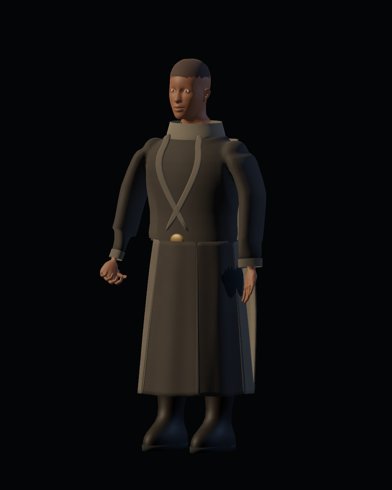
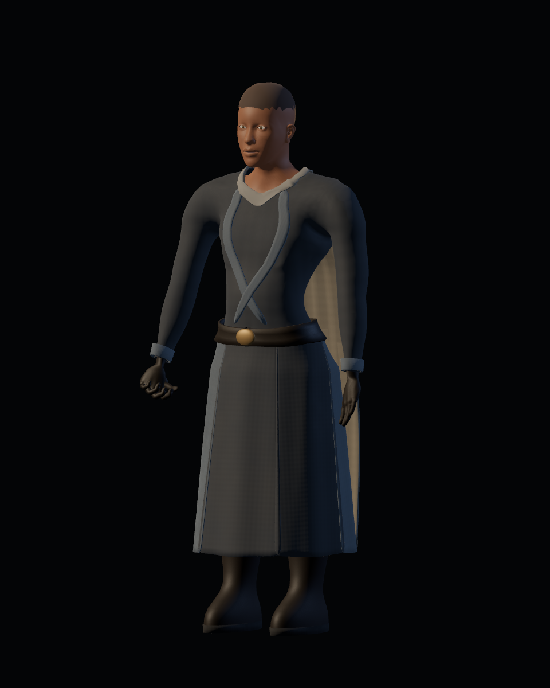
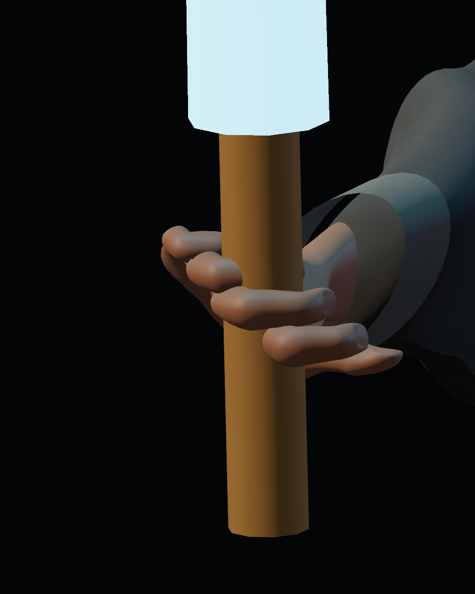

# Calidad 09 — uniforme completo y guantes

20-10-2026. Pase de [#45](https://github.com/Dioniss97/ShadowsOfKharuun/issues/45), conforme a D37. Las carpetas `torso/` y `hands/` conservan 28 y 42 vistas por versión, respectivamente, con igual cámara, luz y tiempo de acción. Antes: GLB/runtime de `a7c8baa`; después: esta revisión. La aceptación artística humana permanece pendiente.

| Uniforme anterior | Revisado |
|---|---|
|  |  |

| Agarre anterior, manos descubiertas | Guantes del conjunto |
|---|---|
|  |  |

## Ajustes

- Chaqueta de mangas largas, cuello, pantalón y cinturón derivados de la anatomía con holguras y pesos transferidos. Se sustituye la construcción abultada de hombros/mangas.
- Guantes de cuero con las mismas treinta articulaciones de dedos, alisando pequeños detalles antes de subdividir. Las manos descubiertas se incluyen en BaseOutfit y se ocultan al equipar; los guantes pertenecen a UniformOutfit. HeadVisible conserva cabeza y cuello independientemente.
- Puños con vuelta geométrica, botas ajustadas al pantalón y paleta grafito/pizarra con cuero y bronce contenido.
- Solapas y hebilla proyectadas sobre las prendas, con pesos transferidos. Se conserva el espesor de las solapas moviendo juntas ambas capas; una de ellas se eleva ligeramente en el cruce para evitar superficies coincidentes.
- Faldón ajustado al cinturón y borde superior/cierre de capa al dorso de la chaqueta. El cuello siempre visible se extiende hasta la abertura para evitar el hueco que producía ocultar toda la región interior.
- Normales tangentes propias de 512² para tejido y cuero, de intensidad tenue. Complementan color/rugosidad; la piel mantiene sus mapas anteriores. Godot verifica texturas normales activas y datos de tangentes reales.

## Evidencia técnica

GLB `f2c59ca94be60f491175e48970b63dc676a44c53c70e7bc558b3cc860b96c159`: 8.636.588 bytes, 76 huesos, 41 piezas, 63.854 vértices y 126.584 triángulos sumando ambas apariencias. Se mantienen cuatro roles de exportación.

Vestuario: 29 comprobaciones headless y 33 GPU; misión: 213 headless, sin fallos. La prueba de pesos inspecciona tanto manos base como guantes, y el ciclo real de equipar/retirar conserva la cabeza y restaura todo el estado base. Informes propios en esta carpeta. Importación limpia y misión GPU completa anteriores: pase 04, hasta la QA final.

## Límites y siguiente revisión

Las vistas revisadas muestran cobertura y articulación; los contornos conservan el presupuesto de la fuente y necesitan valoración humana de acabado. La dinámica de faldón/capa, sus transiciones y posibles intersecciones se revisan específicamente en #46. No se declara ausencia universal de clipping ni aceptación final.
