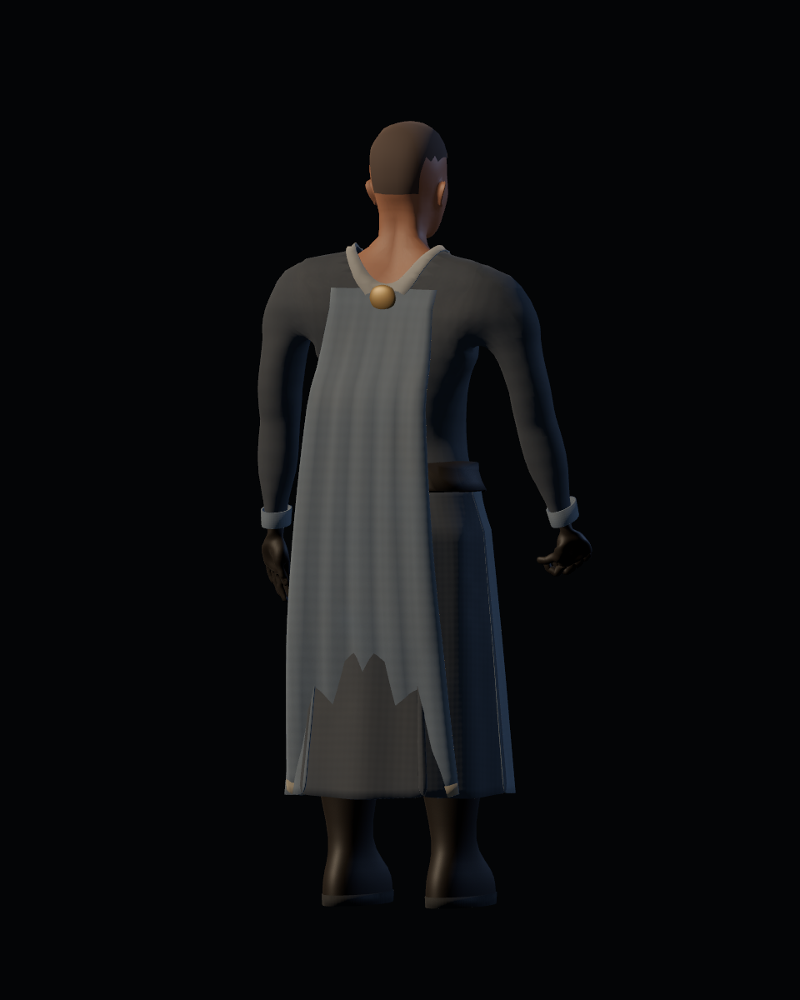
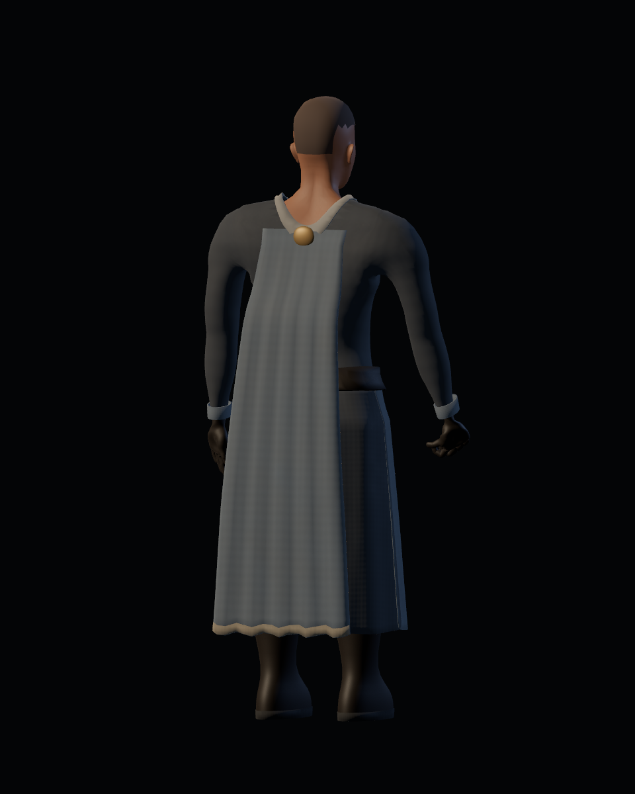
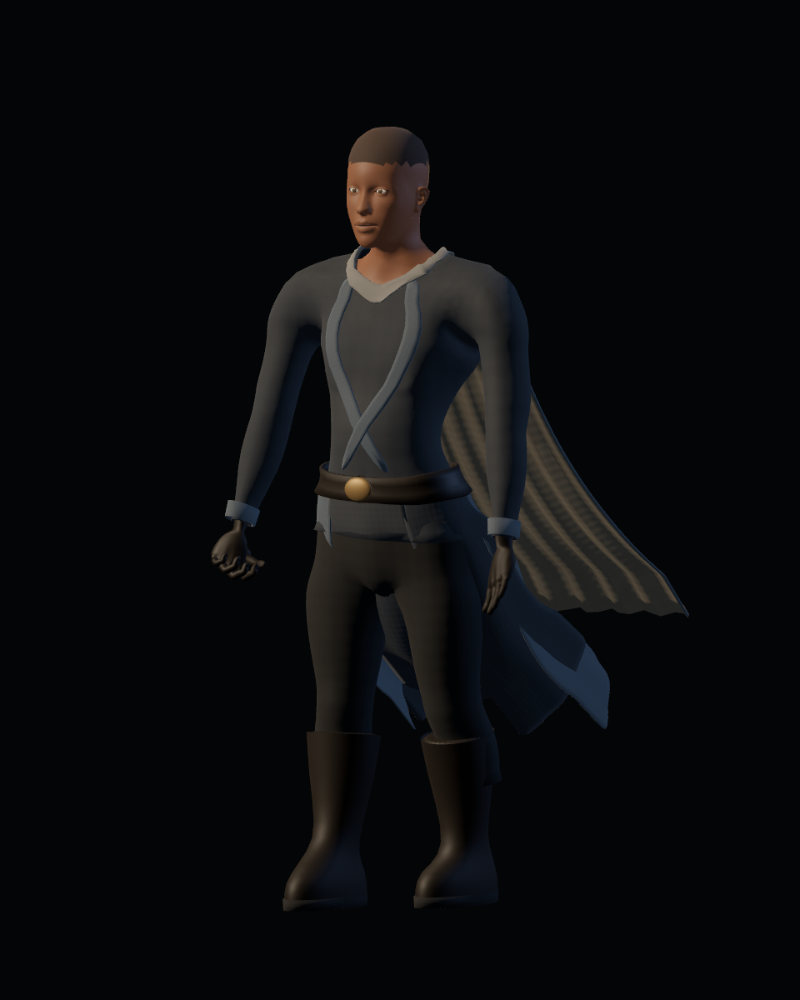
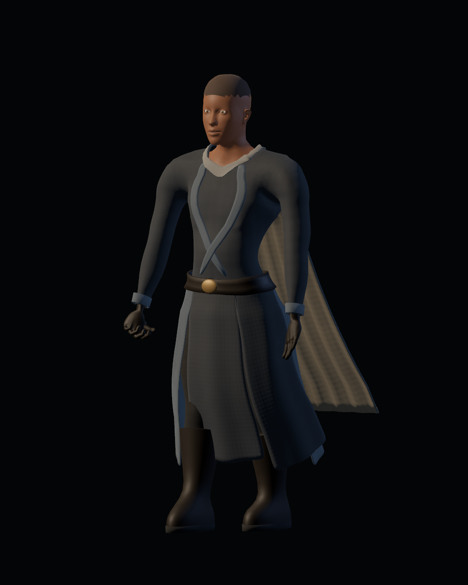

# Calidad 10 — movimiento y cobertura

20-10-2026. Pase de [#46](https://github.com/Dioniss97/ShadowsOfKharuun/issues/46). Cuarenta vistas antes y cuarenta después con el mismo protocolo. Antes: GLB/runtime de `06f9cef`; después: GLB `03a36eec3adfe803aa5b6ce14c8e8bae1b3a8a156869f5b3219ef061d0734bb2` y runtime identificado por SHA en el informe. Aceptación humana pendiente.

| Detención anterior: faldón a través de la capa | Holgura posterior corregida |
|---|---|
|  |  |

| Vuelo anterior al andar | Respuesta más contenida |
|---|---|
|  |  |

## Revisión y correcciones

- El cierre se mantenía fijo mientras toda la tela recibía pesos de cadenas. Primera fila fijada a spine y transición suave de unos 22 cm hacia la simulación; prueba de pesos reales del GLB importado.
- Se observó el faldón atravesando el bajo de la capa al detenerse. El bajo anterior quedaba dentro de su envolvente posterior. Se añade holgura gradual de hasta 16 cm y se realinean las cadenas. La vista de detención revisada conserva el borde continuo.
- Los faldones se elevaban excesivamente al andar. Rigidez 10,5/7 para faldón/capa, arrastre 0,88, gravedad 1,2/0,65 y fuerza externa por velocidad 0,006. El máximo respecto al inicio de andar baja de 1,183 a 0,641 rad; no representa un límite impuesto a todas las poses. Las ocho cápsulas y radios se conservan tras revisar cobertura; no resuelven colisión entre prendas.

## Protocolo y evidencia

`tools/blender/preview_motion.gd`: reposo, andar 3,6 m/s, carrera 6,6 m/s, giro de 180°, guardia, ataque, poder y detención de tres segundos. Traza controlada de la raíz y acciones de producción; el controlador real se prueba aparte en `wardrobe_runner.gd`. Ocho estados, 810 pasos físicos, todas las cadenas finitas. Los informes capturan poses finales en `modification_processed` para evitar medir la pose reinicializada anterior al modificador.

Vestuario: 30 headless/34 GPU, cero fallos; misión: 213 headless, cero fallos. Informes propios en esta carpeta. Cada versión conserva sus imágenes, hash GLB y hash LF del runtime.

Las medianas de intervalo por estado observadas están entre 6.02 y 6.06 ms; p95 entre 6.16 y 6.27 ms en esta GPU. Son intervalos de presentación de un visor de estudio con reloj fijo y pausas de captura, sin aislar CPU/GPU ni el coste del personaje. Las métricas de la escena real están en gpu_report.json; no son garantía de FPS.

## Límites

Las capturas revisadas muestran mejor separación y menor vuelo. La amplitud, caída, posibles intersecciones entre paneles y continuidad durante transiciones necesitan revisión humana en juego. No se añadió solver de malla ni autocolisión. SpringBone sigue siendo la técnica candidata; no hay cambio de enfoque que requiera comparar otro solver. La aceptación visual y jugable permanece pendiente.
