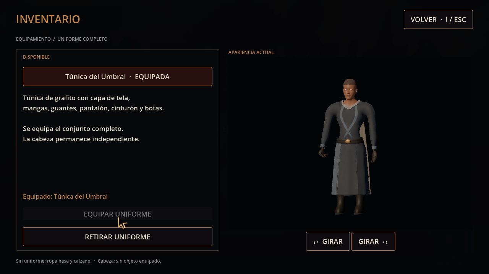
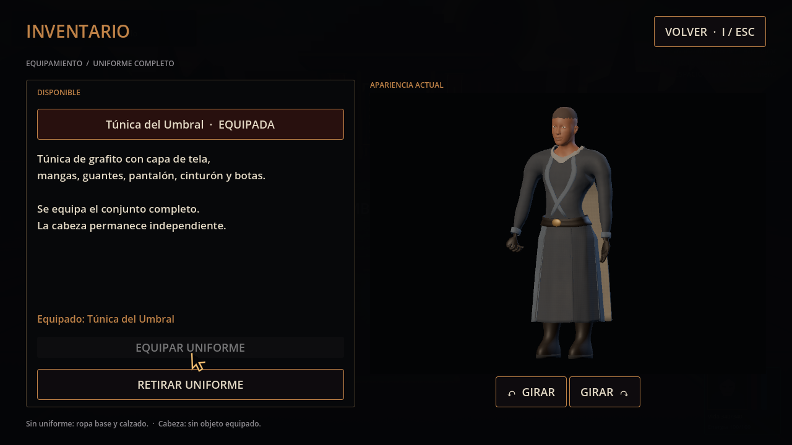
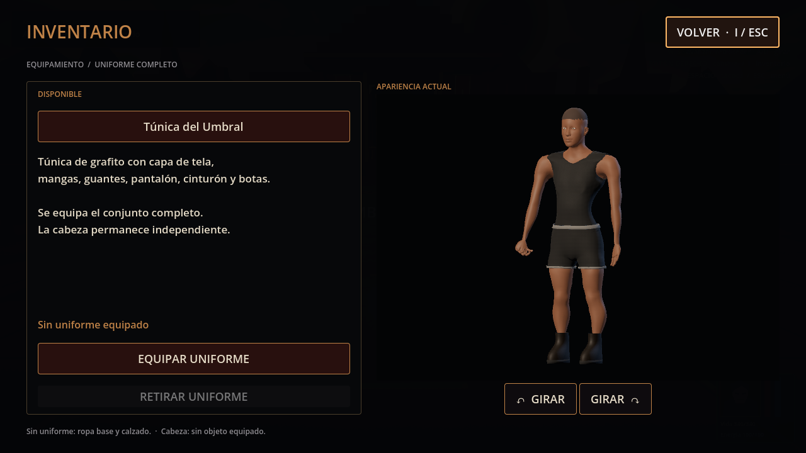
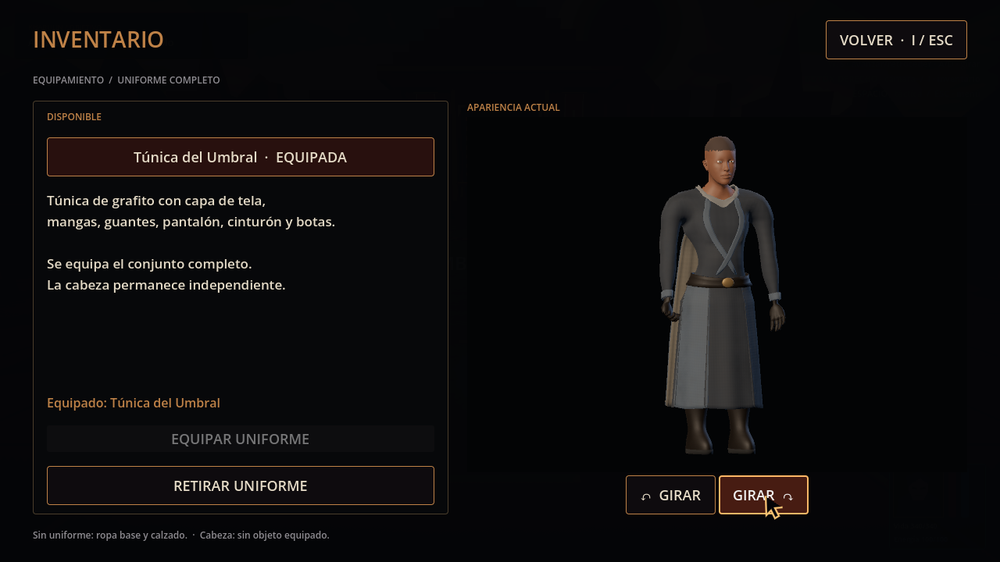

# Calidad 11 — vista del inventario

20-10-2026. Pase de [#47](https://github.com/Dioniss97/ShadowsOfKharuun/issues/47). Mismo GLB `03a36eec3adfe803aa5b6ce14c8e8bae1b3a8a156869f5b3219ef061d0734bb2` y prendas en ambas versiones; cambia la presentación existente. Antes: `691b549`. Después: encuadre más próximo, inicio a −0,45 rad y relleno frío. UI a 1280×720.

| Encuadre anterior | Vista revisada |
|---|---|
|  |  |

| Apariencia base | Giro de la previsualización |
|---|---|
|  |  |

## Cambios y evidencia

La cámara ortográfica pasa de tamaño 2,45 a 2,15 y enfoca a 0,97 m: cabeza y suelas conservan margen y el cuerpo ocupa más espacio. La luz fría de relleno permite leer mangas, guantes, cuero y capa; el giro inicial muestra su perfil. Se conserva la misma disposición de paneles y el catálogo de un conjunto completo.

Vestuario: 33 comprobaciones headless y 38 GPU, cero fallos. Se incluyen clics reales en giro y giro inverso sin cambiar la orientación del jugador, Volver, I/ESC, equipar/retirar completo y retorno a la pausa táctica previa. Cinco capturas forman parte de la suite GPU. Informes antes/después y lógica en esta carpeta; la misión headless de 213/0 usa el mismo GLB/runtime de combate y está enlazada como evidencia compatible, sin atribuirla a una prueba específica de esta presentación.

Una primera captura GPU mostró la UI incompleta sin fallos funcionales registrados. La repetición aislada de la suite produjo las cinco capturas completas y 38/0; causa no determinada. No se cambió la lógica de interacción para forzar el resultado. Las imágenes aquí conservadas corresponden a esa repetición.

La legibilidad, estética y comodidad del encuadre necesitan aceptación humana. La automatización comprueba flujos y sincronización; no certifica la calidad artística.
