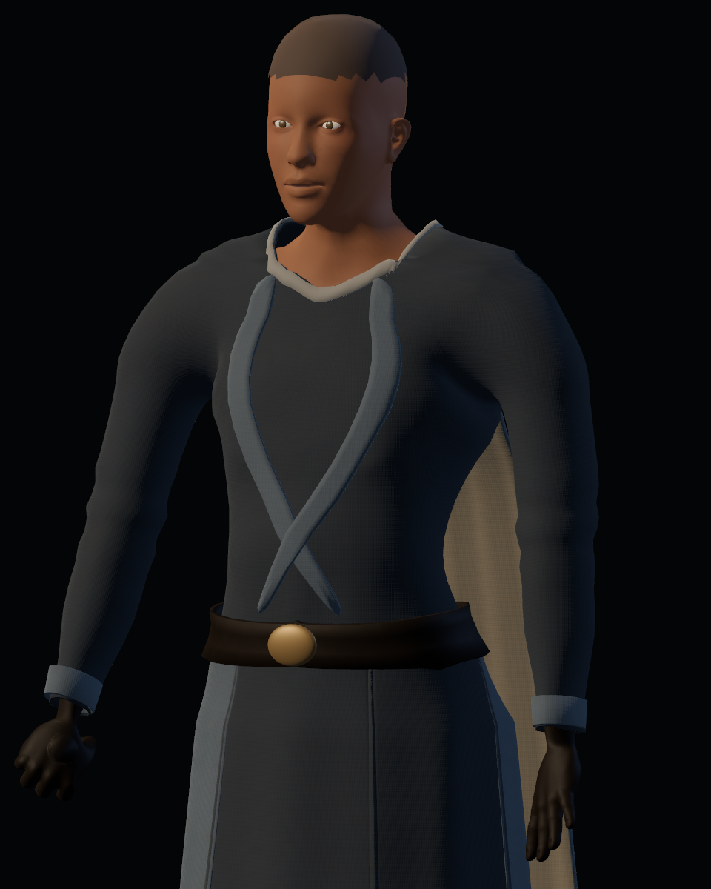
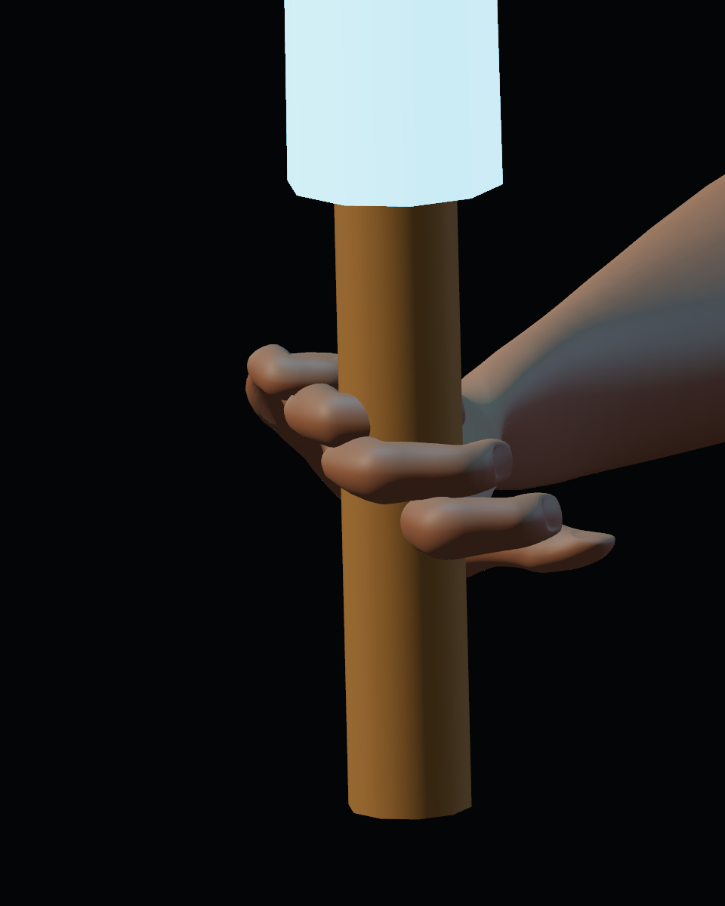
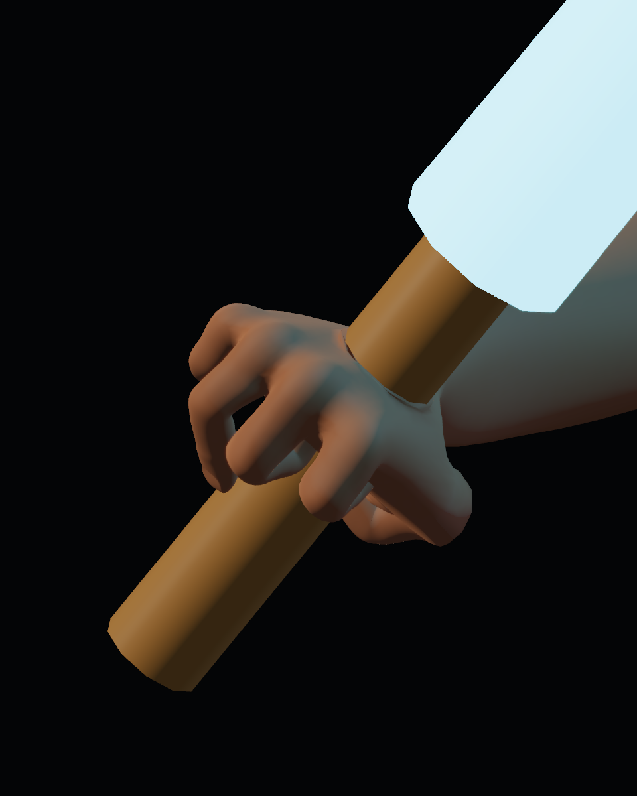

# Calidad 12 — correcciones tras la auditoría

20-10-2026. Producción autorizada tras la [investigación](../../reviews/2026-10-20/README.md). Revisión de #40–48 en PR #39; aceptación artística pendiente.

## Cambios realizados

- **Agarre:** falanges y muñecas conservan su orientación local de reposo al aplicar la animación. Flexión por dedo y oposición del pulgar; el arma sigue un marco de la mano completa. Correctivo localizado en reposo para palma y guante, en `art/source/characters/grip_contact_fit.json`. No añade un solver de contacto por frame.
- **Anatomía:** ajustes contenidos de cintura, profundidad del deltoides y transición de muñecas; misma base anatómica CC0 y proporciones generales.
- **Confección:** sisa base con contorno geométrico interpolado, holgura de chaqueta, pliegues amplios en torso/codos/rodillas. Cuello, cintura y dobladillos se construyen desde los bucles del borde de la prenda y se ajustan a su superficie con espesor.
- **Piel:** conserva el atlas UV anatómico original y recibe mapas propios de color/rugosidad/normal de 1024². Variaciones localizadas suaves, sin texturas externas. Los roles usan el mismo nombre de capa `UVMap` para conservarla al agrupar y exportar.
- **Tela:** coordenadas compartidas por escala física, baldosa de 32 cm y trama aproximada de 2,5 mm; menos variación de color gruesa y normales textiles contenidas.
- **Godot:** receta explícita compartida tras importar: especular .32 piel, .22 tejido y .30 cuero; SSS de piel .06 en Forward+. Corrige la diferencia medida entre controles Blender y material importado.

## Comparación reproducible

Cámaras y luces idénticas a la auditoría. Los informes de cada carpeta identifican el GLB y la fuente de animación. Movimiento: trayectoria controlada, no partida humana.

| Antes | Después |
|---|---|
|  |  |
|  |  |
|  |  |

Vistas finales: [manos](after/hand/), [torso](after/body/), [piernas y ropa base](after/leg/), [movimiento y capa](after/motion/). El índice general muestra estudio, inventario y templo actuales. Los materiales del Vigía y la luz del templo se conservan.

## Mediciones y límites

[Sonda del importado](import_and_grip.json), con su [script](inspection.gd.txt). Muestreo CPU del mango cilíndrico de radio 20 mm: pasa de 1179 vértices base / 1449 de guante a cero vértices con penetración superior a 0,5 mm, en reposo, guardia y ataque de ambas apariencias. Incluye duplicados UV; no prueba intersección de todos los triángulos ni naturalidad del agarre. El correctivo usa margen de 1,5 mm y depende de esta geometría/pose: el exportador rechaza un ajuste si cambia demasiado la superficie de origen.

La prueba de continuidad de antebrazo compara todas las variantes normal/UV en ambos sentidos. Una costura del atlas tiene varias coordenadas válidas por posición; comparar solo el último duplicado producía un falso fallo. Blender confirma las mismas variantes en ambas piezas.

Suites técnicas, hashes y procedencia finales en el [índice](../../README.md). Una primera ejecución GPU de vestuario terminó con excepción nativa Windows `0xC0000374` tras iniciar TTS; causa no determinada. La repetición aislada pasó 40/0 sin cambios funcionales para forzar el resultado.

La revisión visual permite comparar cambios, pero requiere valoración humana de manos, hombros, confección y acabado. El pulgar, el espaciado de dedos y la silueta del guante siguen siendo simplificados; el cuello tiene aún un contorno algo irregular en el acercamiento y la periodicidad de la trama es visible en estudio. Cabello y cara conservan su diseño previo. SpringBone sigue siendo dinámica ósea con cápsulas, sin autocolisión textil universal. Esta ronda no constituye calidad final ni versión estable.
