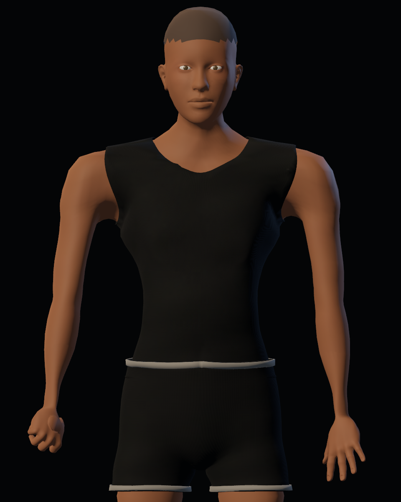
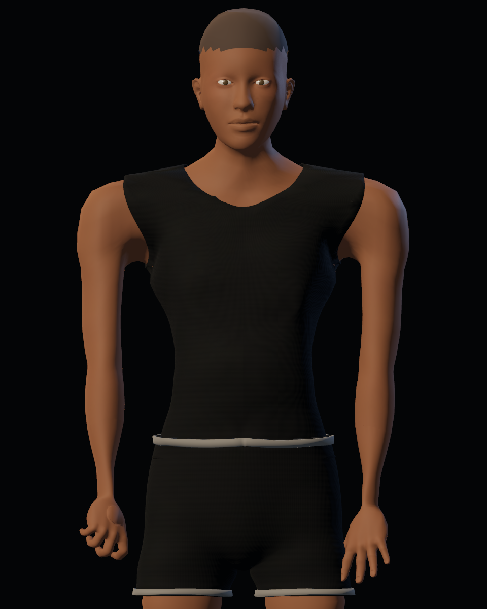
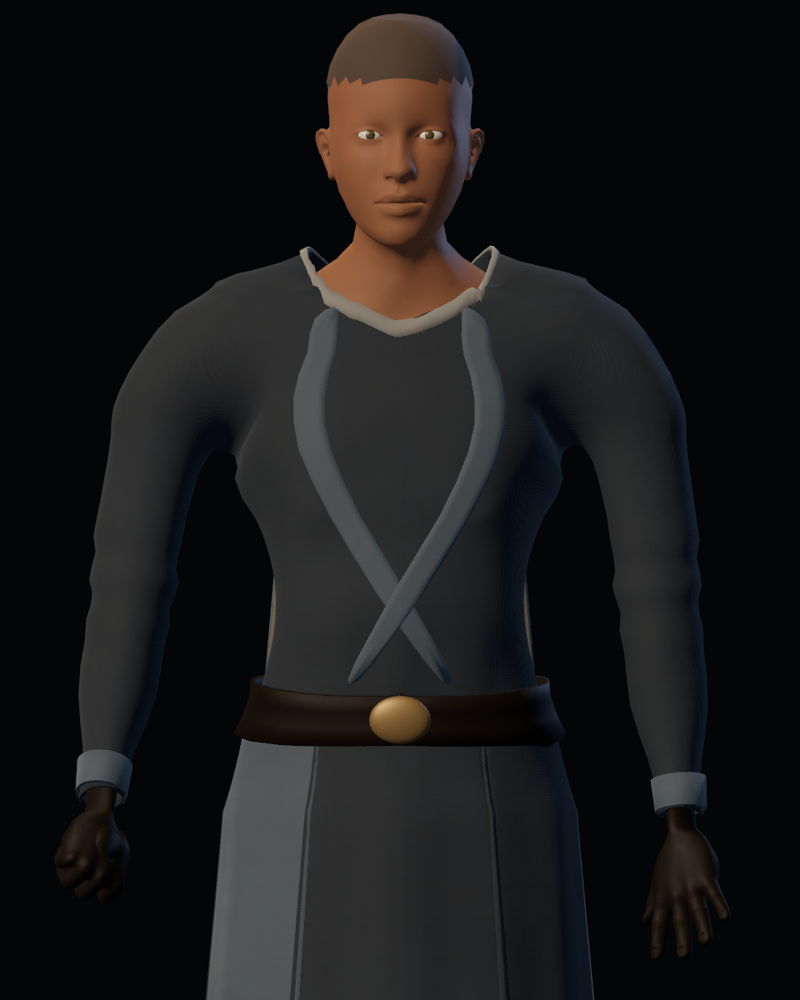
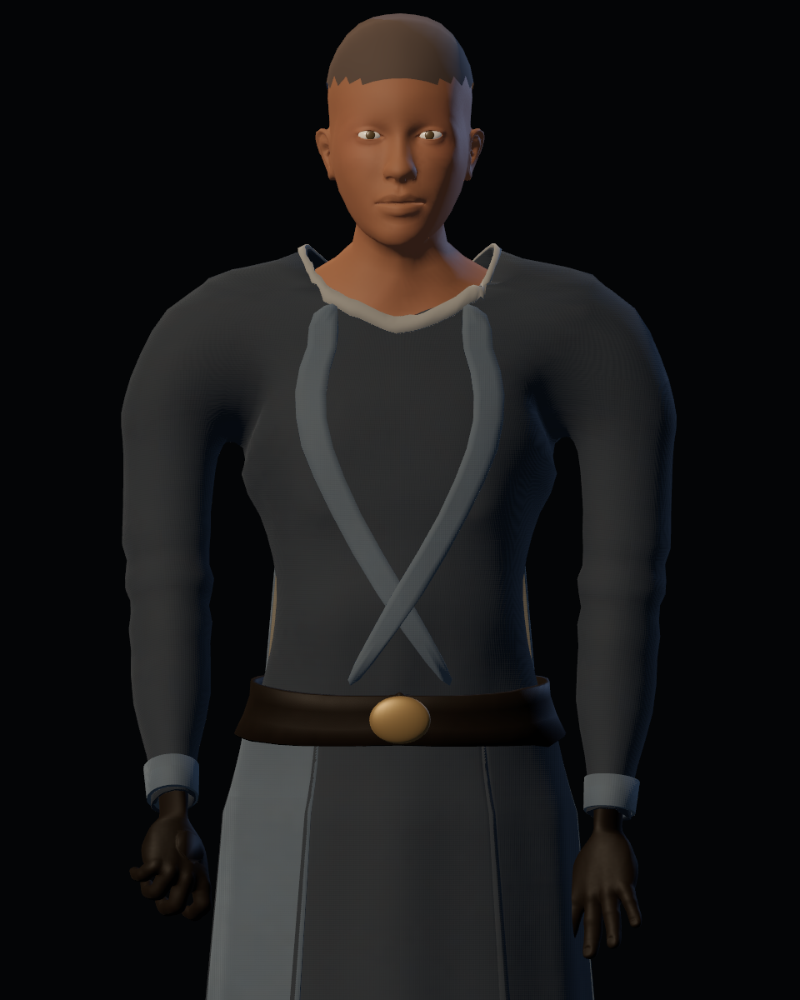
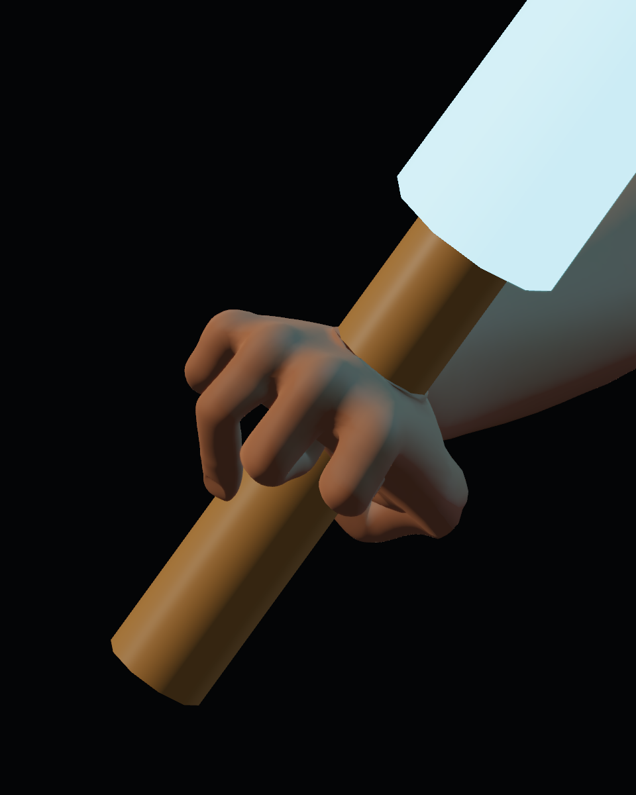
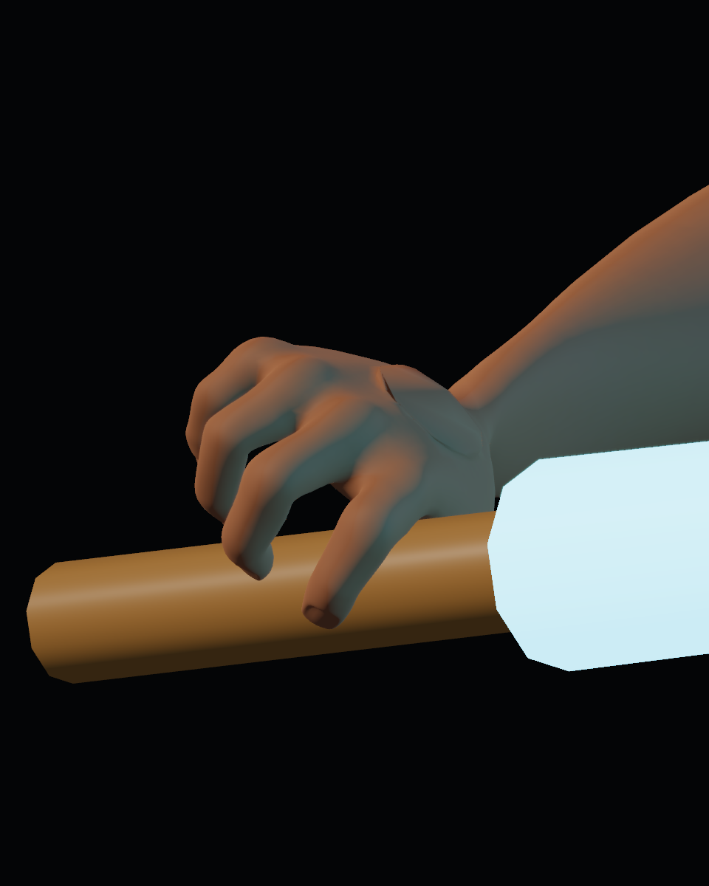

# Calidad 13 — hombros, axilas y agarre

20-10-2026. Pase de producción sobre la candidata 0.5.0 en la rama aislada. Mejora técnica y visual registrada; aceptación humana pendiente.

## Cambios

- **Brazos:** aducción de hasta 0,16 radianes cuando cuelgan; la corrección se desvanece al levantar el brazo para combate o poderes. Esto reduce la silueta abierta de la pose de reposo sin alterar el reloj ni las poses de ataque.
- **Axilas:** una pequeña pieza de tela por lado se une por remallado al torso y la manga. La captura aún muestra sombra oscura en la axila; hay que valorar el resultado en la cámara de juego.
- **Mano del sable:** flexión más coherente entre falanges y ajuste renovado de contacto para la nueva orientación. El marco de la empuñadura mantiene el sable de 4 cm en la mano. Se conservan tanto la corrección anterior como los puntos adicionales de esta calibración.

## Comparación

Las vistas usan las mismas cámaras, luces y protocolo; solo cambia el GLB/pose.

| Antes | Después |
|---|---|
|  |  |
|  |  |
|  |  |

Más vistas: [42 de manos](after/hand/report.json) y [28 de torso](after/torso/report.json), en reposo y poses de juego, con mano base y guante.

## Validación

GLB: `190a7e0559669550cb5b22f094c3ea3d778c99762aef57138a49ee4b9f3d584e`, 76 huesos, 41 piezas, 64.018 vértices y 126.912 triángulos.

| Suite | Comprobaciones | Fallos |
|---|---:|---:|
| Vestuario headless | 35 | 0 |
| Vestuario GPU | 40 | 0 |
| Importación limpia + vestuario headless | 35 | 0 |
| Misma copia limpia + vestuario GPU | 40 | 0 |
| Misión headless | 213 | 0 |
| Misión GPU | 238 | 0 |

La sonda de agarre mide un radio mínimo de 20,85 mm contra el límite de 19,5 mm en reposo, guardia y ataque, con apariencia base y uniforme. [Resumen](integration/report.json), [informe del vestuario GPU](integration/wardrobe_gpu.json), [importación limpia](integration/clean_import_gpu.json), [misión GPU](integration/mission_gpu.json).

## Límites visibles

El agarre ya supera la comprobación geométrica, pero eso no demuestra una mano anatómicamente acabada: todavía se ven dedos gruesos y puntas romas en los primeros planos. El brazo se acerca al torso, y la zona oscura bajo la manga necesita revisión en movimiento y en cámara de juego. No se cierra la issue artística ni se marca este pase como versión estable.
