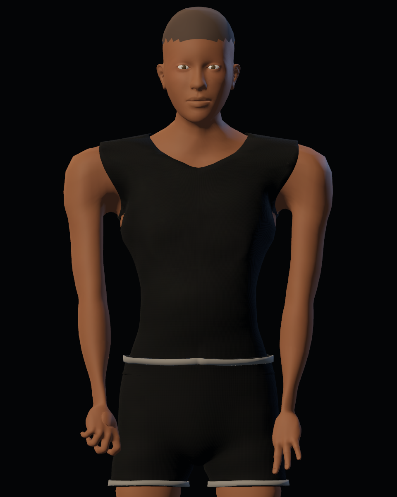
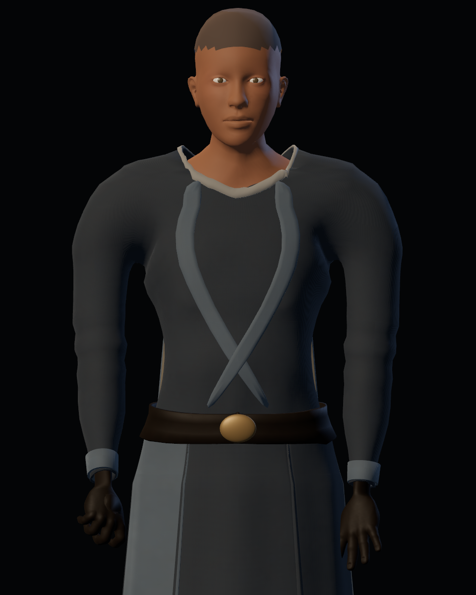
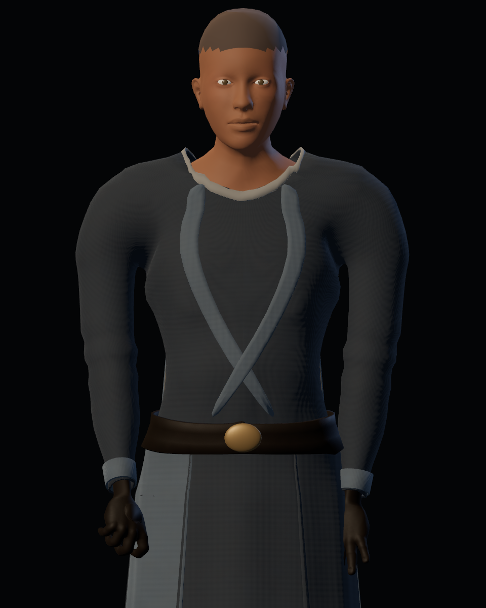

# Calidad 14 — proporciones del torso y unión de brazos

20-10-2026. Revisión solicitada tras observar hombros demasiado separados, axila voluminosa y un torso demasiado estrecho. Comparación a cámara e iluminación fijas sobre la candidata 0.5.0. La aceptación artística sigue pendiente.

## Cambios

- El pecho y la cintura ganan algo de anchura y profundidad en la anatomía, con el ajuste limitado a los pesos del torso y desvanecido hacia hombros y caderas.
- La camiseta interior y la túnica amplían sus perfiles de caja torácica y cintura para que la anatomía se vea a través de la ropa. Se reduce algo el ancho de hombros en las prendas.
- Se reducen las piezas de hombro y axila de la túnica para quitar el bulto que creaba el puente de tela.
- El ajuste de reposo acerca los brazos hasta 0,22 radianes y se desvanece al elevarlos. Se revisó que las manos no queden metidas en la cadera.

## Comparación

| Estado publicado | Proporciones revisadas |
|---|---|
|  |  |
|  |  |

Se tomaron 28 vistas posteriores con anatomía base y túnica, incluyendo reposo, guardia, ataque, lanzamiento, ambos lados y espalda. [Índice de capturas y hash](after/torso/report.json). Las cámaras y la luz son las mismas que en el estado anterior.

## Validación

GLB `e12260519daa0fd36c124aa567aa5845def1ba7f394b81f1e45b7b50495a48d3`, 9.918.988 bytes, 76 huesos, 41 piezas, 64.052 vértices y 126.980 triángulos.

| Suite | Comprobaciones | Fallos |
|---|---:|---:|
| Vestuario headless | 35 | 0 |
| Vestuario GPU, con capturas de inventario/templo | 40 | 0 |
| Misión headless | 213 | 0 |

[Capturas integradas e informes](integration/report.json). El recorrido GPU de misión de este pase quedó incompleto antes de imprimir su resumen; no se presenta como aprobado. La última ejecución completa de esa suite pertenece al pase anterior.

## Límites visibles

La proporción del torso y la distancia de los brazos mejoran frente a la captura anterior. El uniforme aún tiene volumen en la parte alta de las mangas y la axila conserva una sombra marcada. La forma anatómica de las manos y el acabado de piel/ropa no cambian en este pase. Revisar en el juego y registrar aceptación o nuevos defectos en la issue #48; este pase no es una versión estable.
