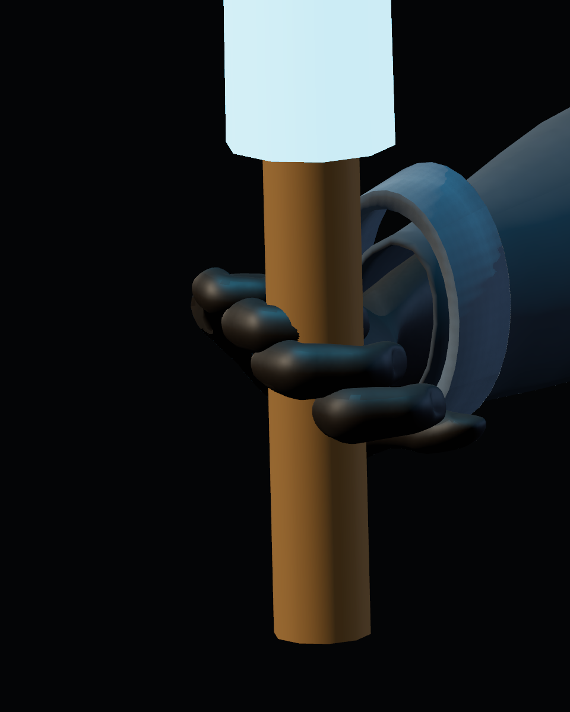
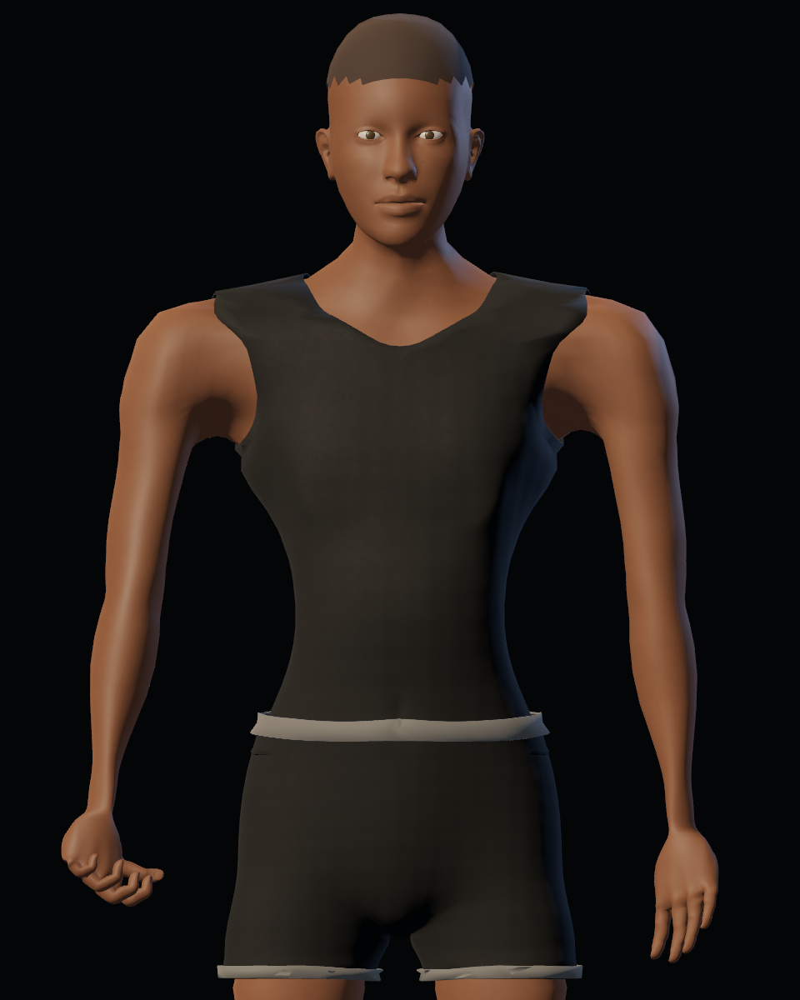
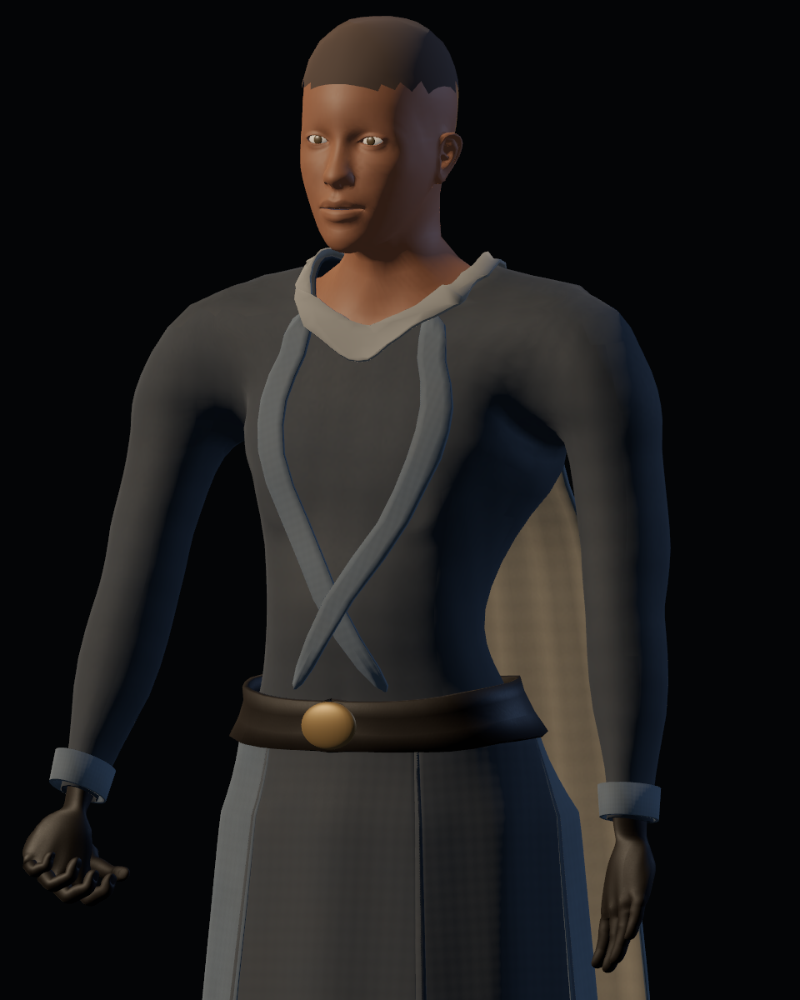
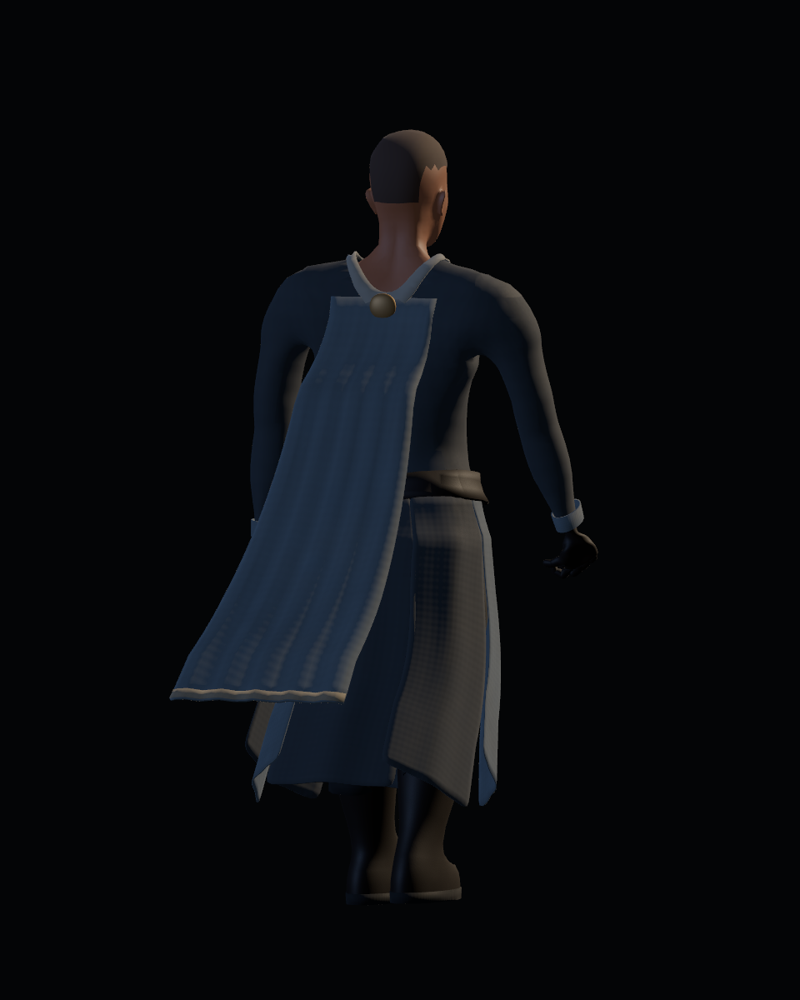

# Auditoría visual e investigación del personaje

20-10-2026. Petición del usuario: revisar capturas, aspecto plástico de piel/ropa, anatomía y posible penetración del sable, e investigar estrategias antes de otra producción. **Las soluciones de este informe son propuestas.** No se han aplicado al personaje, a sus materiales ni a la lógica del juego. El registro operativo de aceptación continúa en [#48](https://github.com/Dioniss97/ShadowsOfKharuun/issues/48).

## 1. Qué versión se está viendo

La carpeta principal `C:/proyectos-personales/ShadowsOfKharuun` está en `main`, commit `f7af77a`, con `config/version="0.4.0"`. Su `PLAY.bat` ejecuta Godot con `--path "%~dp0."`: abre el proyecto de la carpeta donde reside ese lanzador. En esa copia no existe el GLB del nuevo personaje.

La candidata está en `tools/logs/production-050`, rama `codex/0.5.0-character-equipment`, revisión examinada `94119ad`, versión `0.5.0-dev`. Su `PLAY.bat` y ejecutable portátil están presentes. Para probarla, abrir **el PLAY.bat de esa carpeta**. Publicar commits en una PR no modifica el proyecto de la carpeta principal. Esta separación debió explicarse con más claridad al entregar la candidata.

GLB examinado: `03a36eec3adfe803aa5b6ce14c8e8bae1b3a8a156869f5b3219ef061d0734bb2`. La [procedencia](provenance.json) conserva las versiones/rutas y hashes de fuentes. No se ha fusionado la candidata ni cambiado el lanzador habitual.

## 2. Capturas nuevas y defectos observados

Se han generado **172 capturas GPU nuevas** mediante las herramientas existentes, con Godot 4.7.2, Forward+, RX 6600: [manos, 42](hands/report.json), [torso, 28](body/report.json), [piernas, 62](legs/report.json) y [movimiento, 40](motion/report.json). Todas corresponden al mismo GLB. Son visores de inspección con poses de producción y, en movimiento, trayectoria controlada de raíz; no una partida humana. Las [vistas del templo](../../integration/final/report.json) ya existentes usan este mismo GLB y sirven como contexto de iluminación real.

| Agarre con guante | Hombros, axilas y ropa base |
|---|---|
|  |  |

| Uniforme, material y forma | Tela en carrera |
|---|---|
|  |  |

| Hallazgo | Evidencia / grado de certeza | Posible solución para otra producción |
|---|---|---|
| Dedos en forma de ganchos y mango atravesado | Visible con mano y guante; la medición de vértices confirma penetración. | Crear la pose alrededor del mango real, con cierre distinto por dedo, oposición del pulgar y pesos revisados. |
| Hombros abultados, axila muy hundida y transición brusca | Visible en reposo y poder. El rig carece de clavícula; compresión regional y pesos automáticos son causas que deben aislarse. | Revisar silueta/planos anatómicos en material gris; corregir articulaciones, topología y pesos antes de más subdivisión. |
| Muñecas estrechas y mano poco ahuecada | Visible en las vistas de mano/cuerpo. La mano derecha conserva cierre incluso cuando se oculta el arma para inspección. | Ajustar volumen de muñeca/palma y separar pose de reposo de la pose de agarre. |
| Camiseta con hombro en punta, escote y sisas duros | Visible en frontal y gesto de poder; la cobertura no equivale a un contorno bien construido. | Reconstruir bordes y costuras con espesor consistente y deformación probada. |
| Chaqueta como segunda piel | Sigue pecho, axilas y brazo casi sin holgura; la fuente deriva la prenda del cuerpo con offset y alisado. | Diseñar volumen de prenda y pliegues de tensión/compresión en hombro, codo, cintura y rodilla. |
| Piel lisa y uniforme; tela poco diferenciada | Confirmado en capturas y estructura material; falta detalle anatómico de superficie. | Texturas propias por zonas y materiales calibrados en Godot, con escala de detalle coherente. |
| Dobladillos/cintura rugosos, puños rígidos y botas con forma de bloque | Visibles en detalles de piernas, muñeca y cuerpo. | Revisar geometría de cantos, costuras, construcción del calzado y continuidad antes del desgaste superficial. |
| Faldones como paneles y capa que se dobla en franjas | Visibles en giro/carrera. Poses finitas no garantizan caída convincente. | Diseñar primero el paño en reposo, luego revisar distribución de pesos/cadenas y muestrear transiciones y separaciones entre prendas. |

La lectura de cintura/cadera/pantorrilla también necesita una comparación anatómica consistente. No se fijan proporciones nuevas solo por una vista: hacen falta frontal, perfil, espalda y poses con la misma cámara.

## 3. Agarre: por qué las pruebas anteriores no bastaban

`check_hands()` comprueba huesos, cuatro pesos normalizados, continuidad de UV/normales y que el mango de 4 cm esté centrado en un offset de palma. **No comprueba contacto ni penetración de la superficie.** Esos resultados funcionales anteriores no permiten declarar el agarre correcto.

En `character_rig.gd`, los dedos derechos 2–5 reciben la misma flexión por segmento `[0.95, 1.25, 0.85]`. El pulgar recibe `[0.55, 0.70, 0.40]`, sin una oposición particular. `_fit_grip()` centra el mango en la mano, pero no adapta la pose a su superficie. Los pesos proceden de cercanía a segmentos y suavizado automático; necesitan revisión por dedo y por pose.

La [sonda del importado](import_and_grip.json) reconstruye cada vértice deformado con la suma ponderada de `pose_global * inverse_bind * vertex`, lo transforma al espacio local del mango y mide distancia radial dentro de su altura. El control de consistencia en reposo respecto a la malla original da un error máximo de unos **0,043 mm**.

Se conserva el [código de inspección como texto](inspection.gd.txt). Para repetirlo, copiarlo a `tools/logs/research_inspect_20261020.gd` y ejecutar Godot con `--headless --path . --script res://tools/logs/research_inspect_20261020.gd`. Solo instancia el modelo, lee materiales/skin y escribe el informe de diagnóstico. El [extracto de materiales glTF](gltf_materials.json) permite contrastar los parámetros anteriores a la importación.

En reposo encuentra **1.179 vértices de mano base y 1.449 de guante a más de 0,5 mm dentro del cilindro**, con penetración radial máxima aproximada de 19,4 mm. Guardia y ataque dan resultados similares. Hay duplicados por UV; las cifras no son número de defectos independientes ni superficie afectada. Es cálculo CPU del skin importado, no lectura del buffer deformado de GPU; coincide con el defecto visible. El método tampoco detectaría todas las intersecciones posibles entre triángulos si sus vértices quedasen fuera.

Propuesta: modelar/revisar la mano alrededor del mango real desde todas las direcciones, ajustar cada dedo y el pulgar, revisar ejes de flexión y pesos, y probar también el guante con su espesor. Añadir después comprobaciones de penetración, separación y contacto, además de inspección 360°. El tutorial original de [Demeter Dzadik en Blender Studio](https://studio.blender.org/training/blender-fundamentals-45-lts/blender_4-5_lts_rigging_skeleton/) explica la alineación de huesos y roll; el [manual de deformación](https://docs.blender.org/manual/en/5.0/animation/armatures/skinning/parenting.html) advierte de influencias automáticas que requieren edición.

## 4. Materiales: diagnóstico del aspecto plástico

### Lo comprobado en fuente, GLB y Godot

- La rugosidad ya es alta: tela 0,86–0,92 y piel 0,66 en la fuente. Los mapas sí llegan. Godot muestra factor de rugosidad 1 **multiplicando la textura del canal G**, no una superficie uniforme de rugosidad 1.
- Blender configura `Specular IOR Level` 0,18 para tejido y 0,28 para piel/cuero. El GLB contiene `KHR_materials_specular` con factores 0,36/0,56. La sonda real devuelve `metallic_specular=0.5` en todos los materiales. La [implementación del importador de Godot 4.7](https://github.com/godotengine/godot/blob/4.7-stable/modules/gltf/gltf_document.cpp) y su [registro de extensiones](https://github.com/godotengine/godot/blob/4.7-stable/modules/gltf/register_types.cpp) concuerdan con esa pérdida del ajuste en este pipeline.
- La piel tiene color y rugosidad con ruido genérico; carece de mapa normal, máscaras anatómicas y SSS. Un mismo tratamiento se extiende por cara, brazos, nudillos y labios.
- Tela/cuero incorporan normales, pero muy tenues, con fuerza 0,35. La mera presencia del mapa no acredita que el detalle tenga escala o intensidad adecuadas.
- Cada prenda pasa por `Smart Project` de forma independiente. La piel se sobrescribe con una proyección XZ compartida. Eso ayudó a una costura, pero no es un layout preparado para pintar anatomía ni mantiene la dirección/escala física del hilo en todos los paños.
- No hay sheen textil en fuente/GLB. No se debe asumir que añadir un control en Blender reproducirá su efecto en Godot.

**Inferencia:** el aspecto de plástico combina superficies demasiado lisas, grandes reflejos continuos, falta de confección, detalle uniforme y diferencias de importación. El valor especular 0,5 no es por sí solo un error físico ni una explicación completa; bajar todos los reflejos a cero tampoco define un tejido. La [documentación de materiales de Godot](https://docs.godotengine.org/en/4.7/tutorials/3d/standard_material_3d.html) separa rugosidad, normales y dispersión bajo la superficie. [Metallic Specular](https://docs.godotengine.org/en/4.7/classes/class_basematerial3d.html#class-basematerial3d-property-metallic-specular) necesita calibración, no una copia literal del número de Blender.

**Pendiente de aislar:** posible incoherencia entre la intención de generar color lineal, el PNG y su lectura sRGB. Antes de cambiar la paleta, comparar una muestra plana Blender → PNG → Godot con valores conocidos. No se declara confirmado un fallo de gamma ni se usa para justificar un cambio de color.

### Estrategia propuesta de texturizado propio

1. Preparar muestras pequeñas de piel, tejido mate, forro, cuero y bronce en luz neutra y en el templo. Comparar siempre en Godot y junto al acabado del Vigía.
2. Fijar recetas explícitas de material para lo que el intercambio no conserva, mediante recursos/presets o un [postimport reproducible](https://docs.godotengine.org/en/4.7/tutorials/assets_pipeline/importing_3d_scenes/import_configuration.html#using-import-scripts-for-automation). Elegirlo tras la prueba acotada.
3. Separar forma grande en malla, detalle medio en pliegues/costuras y microdetalle de fibra/poro. Mantener sus escalas legibles a la distancia del juego.
4. UV por costuras, con orientación del hilo, damero de distorsión y densidad coherente. Atlas anatómico compartido antes de dividir roles de visibilidad; máscara de pliegues/costuras/desgaste distinta de la trama repetible.
5. Crear albedo, rugosidad y normales propios. Color contenido en la paleta aprobada; variaciones con causa: zonas de piel, compresión de tela, costuras y roce del cuero. Evitar ruido homogéneo por toda la superficie.
6. Hornear pliegues finos y detalle esculpido a normales tangentes; conservar en geometría lo que cambia el contorno. Blender documenta el flujo de [baking a texturas](https://docs.blender.org/manual/en/latest/render/cycles/baking.html), incluidos márgenes de islas.
7. Evaluar SSS suave para piel solo tras calibrar forma/color/rugosidad. Debe comprobarse en el renderizador usado y evitar una apariencia de cera. Sheen o shader adicional solo si una prueba demuestra una mejora necesaria; [KHR_materials_sheen](https://github.com/KhronosGroup/glTF/tree/main/extensions/2.0/Khronos/KHR_materials_sheen) describe una respuesta de fibra distinta del brillo base.

## 5. Estrategias de modelado investigadas

- **Forma antes de detalle:** referencias ortográficas y revisión del cuerpo en gris; aislar compresión del cuerpo, posición de articulaciones y pesos. [Blenderella, Angela Guenette](https://studio.blender.org/training/blenderella/) estructura anatomía y retopología para deformación. Su versión de Blender es antigua; aquí se aprovecha el método artístico.
- **Ropa como prenda:** partir del volumen actual puede servir de base, pero necesita holgura, sujeciones y pliegues diseñados. [Body & Outfit Sculpting, Julien Kaspar](https://studio.blender.org/training/stylized-character-workflow/chapter/5d384eb4a5b8f5c2c32c8505/) desarrolla cuerpo y prendas; no se propone copiar su estilo.
- **Pliegues con referencias:** [Design Sculpting](https://studio.blender.org/training/realistic-human-research/design-sculpting/) y [Reprojection & Sculpt Layers](https://studio.blender.org/training/realistic-human-research/reprojection-sculpt-layers/) separan diseño, costuras y capas de superficie. Adaptar su flujo al presupuesto del juego.
- **Herramientas de tela offline:** [Cloth Filter](https://docs.blender.org/manual/en/latest/sculpt_paint/sculpting/tools/cloth_filter.html) permite fijar regiones mediante máscaras y obtener pliegues. Puede ayudar a esculpir la forma de reposo; no reemplaza automáticamente la dinámica del juego.
- **Deformación correctiva acotada:** primero forma, articulaciones y pesos; si persiste el fallo, valorar clavícula/metacarpal o correctivo local. [Corrective Smooth](https://docs.blender.org/manual/en/5.0/modeling/modifiers/deform/corrective_smooth.html) sirve en Blender, pero no se debe asumir que el modificador se ejecuta en Godot: un correctivo exportable exige preparación y comprobación propias.

Las fuentes son documentación y material original de Blender Studio, Godot y Khronos. Algunas aperturas de Blender/Studio devolvieron HTTP 402; se contrastaron sus contenidos indexados disponibles. No se ha visto ni completado un curso entero ni se atribuye a estos autores la aprobación de este modelo.

## 6. Texturas que harían falta

**No hace falta traer ni comprar un pack ahora.** El siguiente avance depende de forma, UV y calibración. La opción preferente es una biblioteca pequeña propia que comparta paleta, escala de detalle y grado de desgaste con los demás objetos.

Como referencia opcional serían útiles fotografías de tela mate, costuras y cuero bajo luz difusa, con escala conocida. Si al preparar el detalle de piel hiciesen falta sellos, Blender Studio ofrece stamps de Kent Trammell en su investigación de humanos realistas. También existen fuentes CC0 como [Poly Haven](https://polyhaven.com/license); su licencia permite derivación, pero no hace falta importar sus materiales para conseguir coherencia artística. No se han descargado ni incorporado texturas externas.

## 7. Orden sugerido, todavía sin producción

| Fase propuesta | Resultado que revisar antes de continuar |
|---|---|
| 0. Acceso a candidata y calibración pequeña | Ruta/versión inequívoca; muestras de material con intercambio y color verificados. |
| 1. Anatomía y agarre | Cuerpo legible en gris, hombro/axila/codo/muñeca sin colapsos; dedos y pulgar envolviendo el mango real, mano y guante en 360° y acciones. |
| 2. Confección y bordes | Holgura y pliegues con sentido; sisas, escote, puños, cintura, bajos y calzado sin picos ni discontinuidades gruesas. |
| 3. UV y materiales propios | Trama consistente, piel por zonas, cuero distinto de tela; comparación neutra/templo/Vigía a distancia cercana y jugable. |
| 4. Movimiento y aceptación conjunta | Recorrer acciones/transiciones y revisar contactos, separaciones, luz, inventario y coste real. Registrar defectos o aceptación humana. |

No se han creado nuevas issues ni aprobado automáticamente estas soluciones. Las pruebas anteriores siguen siendo evidencia funcional histórica; el resultado de esta revisión aporta defectos visuales concretos que impiden considerar acabado el personaje.
