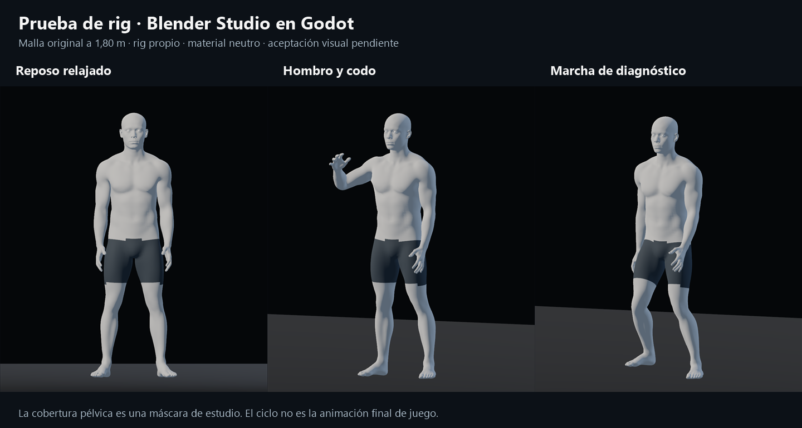
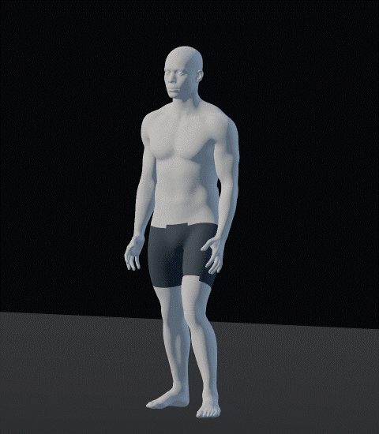
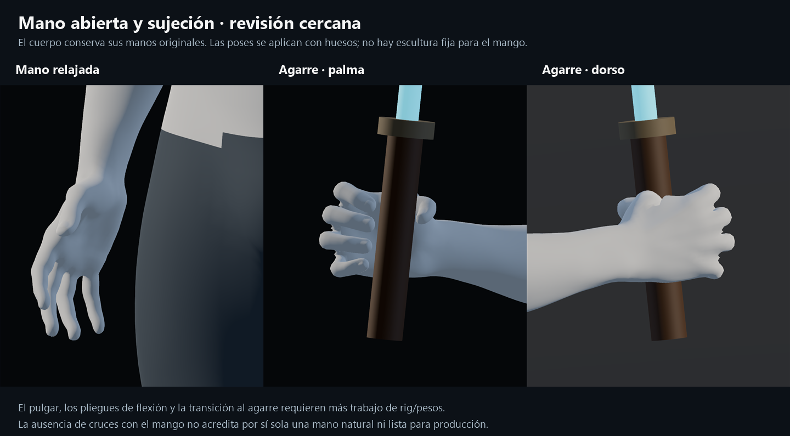

# Prueba de rig Blender Studio — 21-10-2026

El usuario autorizó esta prueba después de valorar mejor la [comparación anatómica](../base_model_comparison_20261021/README.md). Se ha riggeado el cuerpo masculino realista completo de Blender Studio y exportado a un visor aislado de Godot. Seguimiento y aceptación en [#35](https://github.com/Dioniss97/ShadowsOfKharuun/issues/35) y [#48](https://github.com/Dioniss97/ShadowsOfKharuun/issues/48), PR #39 en borrador.

**Resultado de la evaluación:** la base mejora el reposo y la continuidad de torso/hombros. Recomiendo conservarla para la siguiente iteración. **El agarre de este rig aún no está listo para producción:** necesita refinar oposición del pulgar, pliegues y pesos de la mano. No se considera aprobada la apariencia ni terminada la adaptación al juego.

## Cuerpo y movimiento

| Parte | Observación y límite |
|---|---|
| Reposo | Brazos más próximos al torso, transición pectoral/deltoides más natural y muñecas sin el giro fijo de 90° del adaptador anterior. Se conserva la proporción original; no se ha ensanchado el cuerpo para ocultar una sisa. |
| Hombro y codo | La pose de flexión conserva continuidad visible en las vistas frontal, lateral, posterior y oblicua. Falta estudiar extremos de combate y cargas de vestuario. |
| Mano abierta | Conserva palma, nudillos y pulgar del cuerpo original. No tiene el óvalo del correctivo antiguo. |
| Marcha | Ciclo sobre el sitio con IK de dos huesos: apoyo mínimo entre 0,26 y 2,56 mm sobre el plano y sin penetración en las 32 muestras. El gesto es rígido y algo flexionado de rodillas; no es una animación final de caminar/correr. |
| Giro | Rotación del modelo durante el ciclo, útil para inspeccionar la deformación desde otras orientaciones. No prueba navegación ni el controlador jugable. |

La cobertura oscura de pelvis es una asignación provisional de material con borde escalonado, no ropa interior terminada. El material gris sin mapas y la luz sin sombras se usan para estudiar forma y pesos. No demuestran acabado de piel, tejido ni coherencia final con el Vigía.

## Mano y agarre: resultado parcial explícito

La pose cerrada se ha ajustado con articulaciones, sin esculpir permanentemente la mano para el mango. El GLB importado da **0 vértices y 0 triángulos penetrantes** respecto a un mango de radio 19 mm, con tolerancia de 0,5 mm; la sonda abarca **4.189 vértices** de mano derecha y registra 43 próximos a la superficie del mango.

Esa comprobación **no aprueba la forma de la mano**. Los primeros planos siguen mostrando pulgar poco convincente, pliegues duros y distribución mejorable de los dedos al cerrar. La sujeción requiere más trabajo de rig/pesos y revisión visual. No se han comprobado autocolisiones de los dedos ni contacto con guardia/hoja.

Además se muestreó una interpolación directa de ángulos entre abierto y cerrado, con el mango fijo en la mano. **Esa interpolación falla:** hay penetraciones en 16 de las 21 muestras, con hasta **18,4 mm** de profundidad de vértice. No es una animación válida de agarrar o equipar. Por eso el visor presenta mano relajada y pose cerrada como estados separados. Los `grip_close_*.png` y `grip_samples` conservan el diagnóstico completo; los 32 controles básicos aprobados no cuentan esos cruces como resueltos.

Un experimento de recolocar el pivote del pulgar y extender pesos sobre la eminencia tenar produjo pliegues y autocruces peores; se retiró. El ensayo conserva el rig más limpio en reposo. El siguiente trabajo de mano debe resolver articulación/oposición y suavidad de pesos con revisión desde palma y dorso, antes de dar por válida la transición o añadir guantes.

## Evidencia técnica

- Blender **5.2.2 LTS**; Godot **4.7.2**, Forward+, GPU AMD Radeon RX 6600.
- Cuerpo evaluado a Multires 1: **42.342 vértices**, altura 1,80 m, **53 huesos**, máximo cuatro influencias normalizadas y ningún vértice corporal sin peso. Los dos ojos se exportan como piezas separadas ligadas a cabeza.
- GLB del ensayo SHA-256: `2db4764e84f34e60cdfd23d9a5ec213541d3267977d7e8af98442c5e1a360ad6`.
- [Exportación y landmarks](export_report.json), [sonda de ajuste Blender](grip_fit_report.json), [comprobación headless](logic_report.json), [capturas/comprobación GPU](gpu_report.json).
- Headless y GPU: **32 controles básicos, 0 fallos**, con alcance explícito: estructura importada, binds/pesos, finitud de poses, contacto de sujeción final, apoyo del ciclo y restauración de reposo. `diagnostic_grasp_interpolation_clear=false` conserva el fallo de interpolación; no se presenta como una suite de animación completa.
- **48 capturas GPU** de A-pose/reposo/hombro, mano abierta, cierre diagnóstico/sujeción, 16 fases de marcha y cuatro de giro. [Visor capturado](viewer.png), dos láminas y GIF derivados sin modificar las formas ni las proporciones de los renders.

No se ha repetido la regresión de misión/combate: este ensayo no cambia su actor ni sus scripts. El `.blend` y GLB jugables conservan los SHA-256 previos `e71910f6…` y `e1226051…` respectivamente. El candidato todavía no usa la ropa base/uniforme, capa dinámica ni eventos del combate real. La aceptación humana y la adopción definitiva siguen pendientes.

## Abrir y reproducir

Ejecutar `tools/STUDIO_TRIAL.bat` en la rama candidata. En esta máquina: `C:/proyectos-personales/ShadowsOfKharuun/tools/logs/production-050/tools/STUDIO_TRIAL.bat`. Permite elegir poses, marcha y giro, orbitar, acercar y examinar la mano. No se abre desde el `PLAY.bat` estable de la carpeta principal.

[Instrucciones técnicas](../../../../tools/blender/STUDIO_TRIAL.md) · [Procedencia CC0, autor y fuente fijada](../../../source/characters/studio_trial/PROVENANCE.md) · [Ficha canónica del cuerpo](../../../../docs/design/catalog/characters/cuerpo-aventurero.md).
