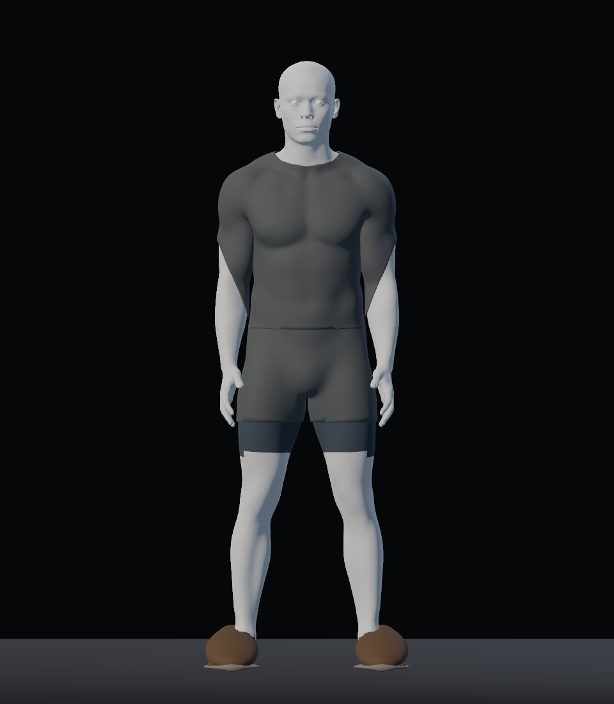
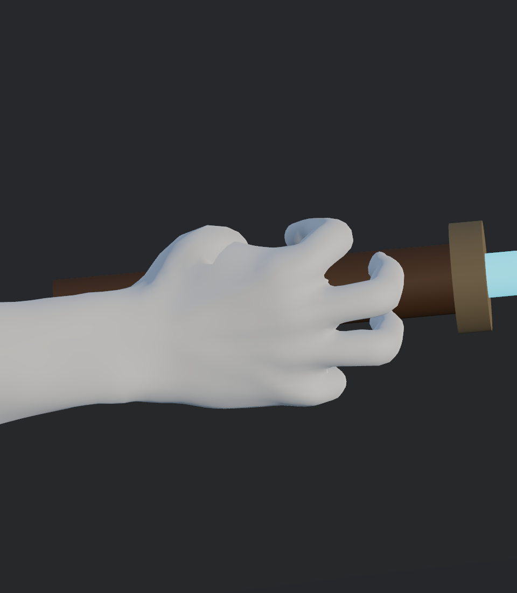

# Ensayo de rig y vestuario base Blender Studio — 21-10-2026

Prueba aislada autorizada por el usuario tras revisar la [comparación anatómica](../base_model_comparison_20261021/README.md). La candidata usa el cuerpo masculino realista de Blender Studio, con rig propio, sin sustituir el personaje jugable. Seguimiento: [#35](https://github.com/Dioniss97/ShadowsOfKharuun/issues/35), [#40](https://github.com/Dioniss97/ShadowsOfKharuun/issues/40) y [#48](https://github.com/Dioniss97/ShadowsOfKharuun/issues/48); [PR #39 en borrador](https://github.com/Dioniss97/ShadowsOfKharuun/pull/39).

## Lectura actual

La nueva base mejora el reposo y la continuidad de torso/hombros. El paso acordado es terminar la pose de agarre y validar ropa base/calzado antes de diseñar una túnica con movimiento. **Esto sigue siendo un ensayo**: la calidad visual no está aceptada y no se ha integrado en la misión.

| Área | Resultado y límites |
|---|---|
| Reposo y proporciones | Brazos más próximos al torso y transición hombro/pecho más continua que en la base rechazada. Proporciones del asset conservadas y escala uniforme a 1,80 m. |
| Hombro/codo | La flexión diagnóstica conserva continuidad visible en varias vistas; quedan por revisar extremos de combate y ropa en movimiento. |
| Mano abierta | Conserva la geometría integral de la fuente, sin el óvalo dorsal del correctivo anterior. La forma todavía necesita valoración visual. |
| Agarre | El mango sigue el eje de la palma. La pose cerrada pasa la sonda geométrica; la imagen por sí sola no demuestra una mano natural ni el agarre en cámara de juego. |
| Marcha y giro | Ciclo sobre el sitio con IK de dos huesos y soporte de suelo dentro de tolerancia numérica de 0,1 mm. Son diagnósticos, no locomoción final ni controlador jugable. |
| Ropa base y zapatos | Camiseta, shorts y zapatos cerrados son prototipos de ajuste con materiales lisos. Los zapatos aún requieren limpiar detalles de dedos/contorno. No hay aún conjunto uniforme terminado, cambio equipable, capa de tela ni simulación. |

## Mano y sable

La pose se calcula articulando la mano; no se esculpe el mango dentro de la palma. En el GLB importado, la sonda comprueba **21 muestras** entre mano abierta y cierre: en cada muestra registra 0 vértices penetrantes y 0 triángulos que crucen el cilindro del mango (radio 19 mm, tolerancia 0,5 mm). En el cierre, 58 de 4.189 vértices muestreados quedan próximos a la superficie. Las 21 comprobaciones de cierre y una cobertura completa de la mano se incluyen en los **32 controles Godot, 0 fallos**.

Esto corrige una medición anterior que no era válida: mezclaba dos marcos de transformación, usaba 0,58 m donde correspondía el 58 % del largo de la mano y orientaba el mango cruzando los nudillos. Los antiguos resultados de 16/21 muestras penetrantes y hasta 18,4 mm quedan **sustituidos**, no son evidencia del rig actual.

La prueba no comprueba autocruces entre dedos, colisión con guardia/hoja, animación real de recoger/equipar, guantes ni contacto bajo todas las luces/cámaras. La interpolación abierta/cerrada es una pose diagnóstica con mango fijo; no es una animación de gameplay. **Aceptación visual humana pendiente.**

## Ropa base y calzado

La camiseta y los shorts se derivan de superficies del cuerpo, con pesos transferidos al mismo esqueleto. Los zapatos son volúmenes cerrados separados, ligados a los huesos de pie, para tapar la forma de los dedos. Es un primer ajuste geométrico: materiales planos, sin mapas propios de piel/tela/cuero ni personalización. La captura lateral ayuda a ver que el zapato cubre el largo del pie; en frontal aún parece demasiado redondeado y algunos detalles cercanos a la suela requieren revisión.

El cuerpo original se conserva bajo las prendas. No se ha comprobado una matriz de ocultación/intersección de todas las superficies en todas las poses. Próximo orden recomendado: ajustar visualmente la mano en agarre, refinar el zapato/cobertura, aceptar la silueta de la ropa base y después desarrollar el uniforme completo. La túnica con físicas se aborda al final, con el rig y el patrón de prendas ya revisados.

## Evidencia técnica

- Blender **5.2.2 LTS**; Godot **4.7.2**, Forward+, GPU AMD Radeon RX 6600.
- Cuerpo a Multires 1: **42.342 vértices**, 1,80 m; rig propio de **53 huesos**, máximo cuatro influencias normalizadas. Los ojos originales son piezas separadas ligadas a cabeza.
- GLB de este ensayo SHA-256: `51b2088b693b31bf215c51bf22aa150a0beafc6b1dc125f356cc1afe9b43ea4c`.
- [Exportación y landmarks](export_report.json), [sonda de ajuste Blender](grip_fit_report.json), [controles Godot](logic_report.json), [informe de capturas GPU](gpu_report.json).
- Verificación Godot: **32 controles, 0 fallos**. Alcance: importación/estructura, binds, finitud de poses, sonda del agarre, soporte del ciclo y restauración de reposo. No comprueba misión ni acciones jugables.
- El informe GPU registra 48 vistas, pero se observó escritura PNG intermitente en el lote. Las capturas clave incrustadas arriba se abrieron e inspeccionaron; no se presenta el lote completo como visualmente revisado.
- En este worktree están modificados solo los recursos de ensayo y herramientas, salvo `assets/models/environment/vigia_umbral.glb.import`, un cambio local ajeno que se preserva. El actor estable no se modifica.

## Abrir y reproducir

Ejecutar `tools/STUDIO_TRIAL.bat` en la rama candidata. En este equipo está en `C:/proyectos-personales/ShadowsOfKharuun/tools/logs/production-050/tools/STUDIO_TRIAL.bat`, no en el `PLAY.bat` estable. Permite cambiar poses, caminar/girar, orbitar y acercarse a la mano.

[Instrucciones del ensayo](../../../../tools/blender/STUDIO_TRIAL.md) · [Procedencia CC0 y fuente fijada](../../../source/characters/studio_trial/PROVENANCE.md) · [Ficha canónica del cuerpo](../../../../docs/design/catalog/characters/cuerpo-aventurero.md).

La adopción definitiva, los materiales finales, el uniforme equipable, la tela dinámica y la aceptación humana siguen pendientes. No hay reemplazo de producción, merge, etiqueta ni release.
