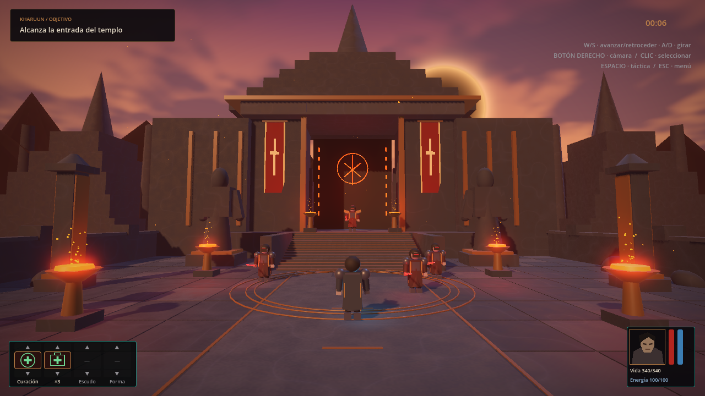
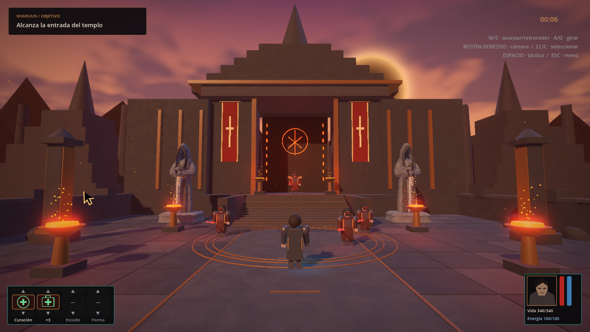
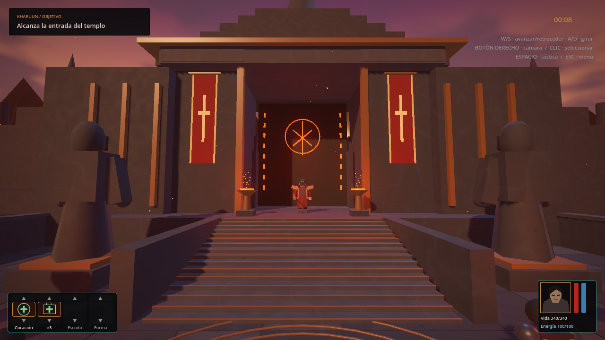
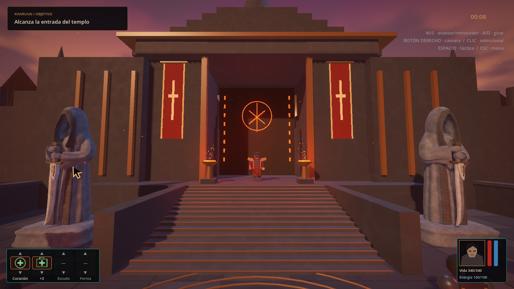
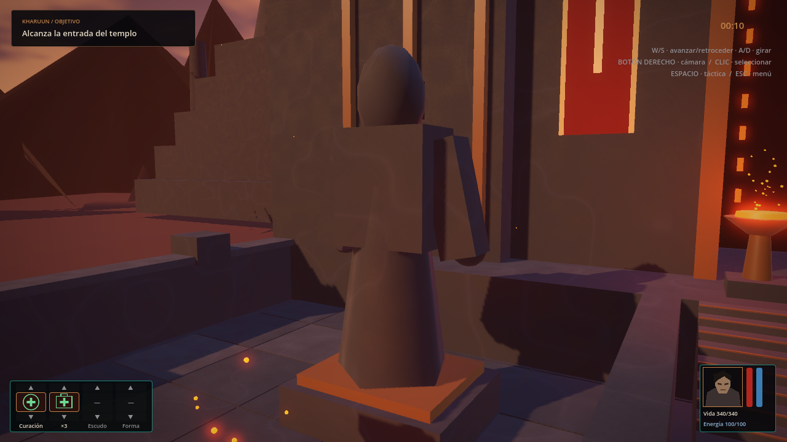
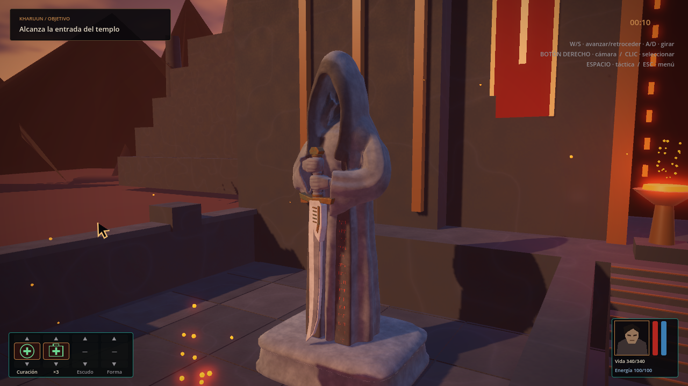
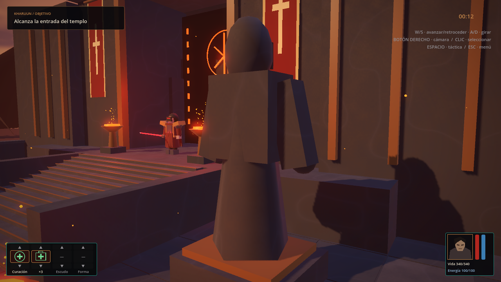
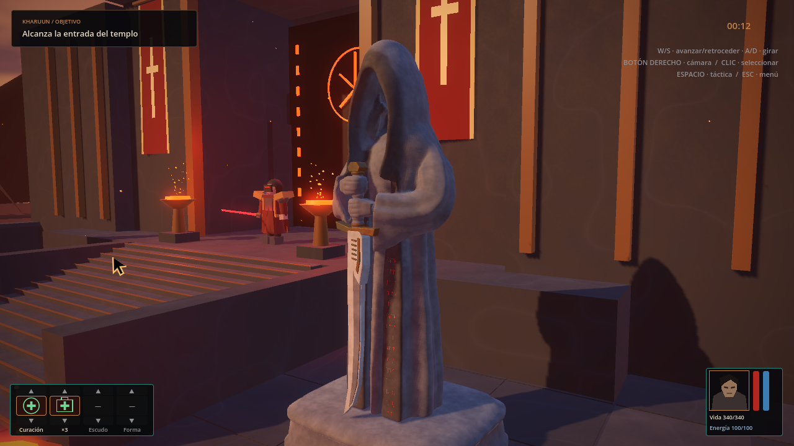
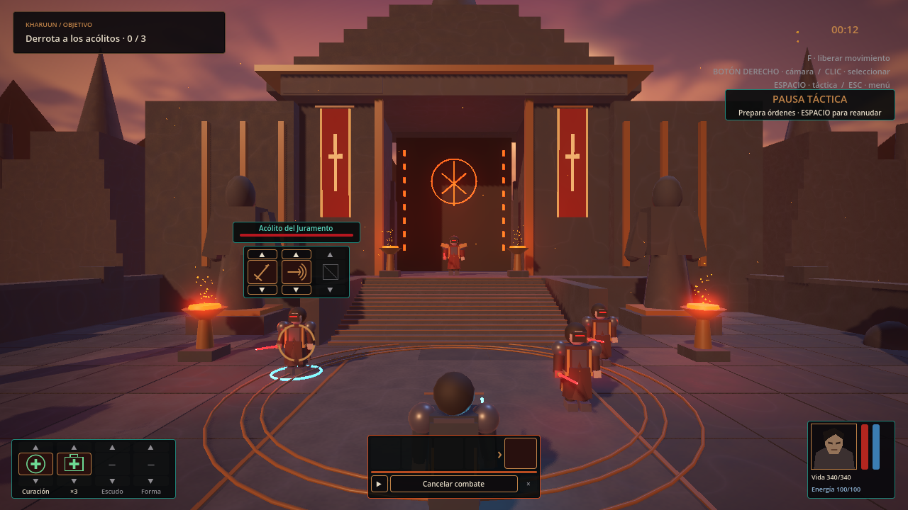
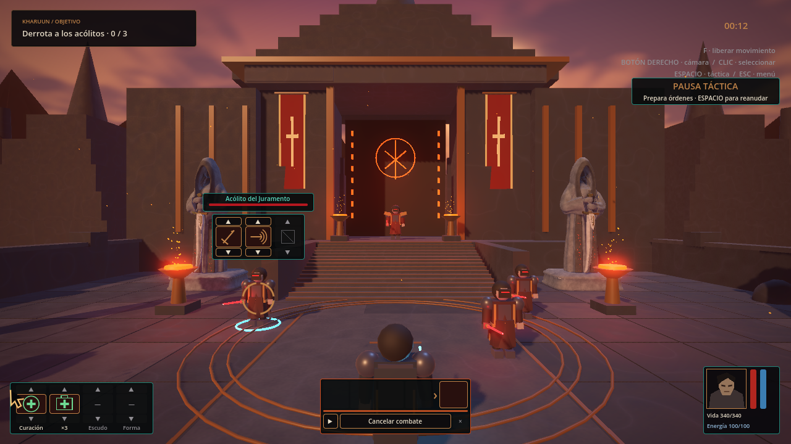

# Vigía VIII dentro de la demo

16-10-2026. Mismo GLB en las dos posiciones del nivel real, con iluminación y HUD de producción. El usuario acepta VIII para integrarlo mediante A04-12. La aceptación humana de estas vistas del nivel y el cierre de versión quedan registrados en [QA_0_4_0.md](../../../../QA_0_4_0.md).

## Comparación antes/después

Todas las imágenes proceden del viewport de Godot 4.7.2 Forward+/Vulkan en RX 6600, a **1280×720**. Se emplean las mismas cámaras/FOV, geometría del nivel y luces de entorno. La figura provisional tenía ojos emisivos y una luz propia, retirados con ella; el nuevo asset no emite luz. Las partículas son dinámicas y no se comparan píxel a píxel. Los actores se colocan/congelan en esta prueba de arte; la partida normal se verifica por separado.

| Vista | Figura provisional | Vigía VIII integrado |
|---|---|---|
| Patio / ambas instancias |  |  |
| Aproximación a escaleras |  |  |
| Cercana y lateral izquierda |  |  |
| Cercana y lateral derecha |  |  |
| Combate / espacio de juego |  |  |

## Integración comprobada

- Posiciones de módulos conservadas: `(-10.8, 0, -13.8)` y `(10.8, 0, -13.8)`. Rotaciones Y `0` y `-0.05` radianes, sin cambio. Copia visual GLB a transformación identidad, mirando a +Z hacia el patio.
- Un único recurso `assets/models/environment/vigia_umbral.glb`, precargado e instanciado dos veces. El modelo exportado no añade colisiones.
- La figura provisional solo tenía el collider de su pedestal: caja `3.7 × 0.9 × 3.1`, centro local `(0, 0.45, 0)`. Se conserva como cuerpo independiente de la malla visible.
- Las **49 formas de colisión** presentes en la escena de comparación mantienen geometría, transformaciones y estado. Las cinco cámaras/FOV coinciden en ambos informes. Cero fallos en la comprobación.
- GLB SHA-256: `192a22bc4f519bbdaa0cb594756344b0b75f055211ae4d128bec1841824b248e`; 169.352 triángulos, tres materiales, nueve mapas incrustados. La fuente y el estudio artístico se documentan en la [galería VIII](../README.md).

Informes con cámaras, hashes PNG, formas físicas y mediciones: [antes](before/report.json) y [después](after/report.json). La base anterior utiliza `scripts/architecture.gd` del commit `47364a4`; el resto del entorno se conserva en la comparación. Las capturas actuales se reproducen con:

```powershell
& tools/godot/Godot_v4.7.2-stable_win64_console.exe --path . --script res://tests/vigia_integration.gd --resolution 1280x720 --quit-after 3000 --log-file tools/logs/v040-integration.log
```

La opción `-- --before` solo sirve con el módulo provisional restaurado; el script rechaza usarla con el GLB integrado. No recrea por sí sola una versión anterior del código.

## Coste y valoración técnica

Cada vista mide 60 intervalos de presentación después de estabilizar la cámara. En esta ejecución las medianas pasan de **18,54–18,55 ms** a **17,25–18,55 ms**. Incluyen CPU, render y presentación; no son tiempos exclusivos de GPU ni un benchmark de partida. No se detecta un deterioro apreciable bajo estas condiciones; no se promete una tasa de imágenes en otros equipos.

Los contadores de llamadas de dibujo disminuyen entre **27 y 79** según la vista, al sustituir numerosas piezas/materiales provisionales y su luz local. El contador de primitivas del escenario incluye varias pasadas y aumenta; no debe confundirse con los 338.704 triángulos de dos copias completas del asset antes de LOD/culling.

La memoria de texturas del escenario pasa de aproximadamente **78 a 141 MiB**, con mapas incrustados sin pérdida. Es un coste real del acabado y del modo de importación actual. No se duplican archivos ni se descarga el recurso una vez por estatua.

Las figuras se distinguen en el patio, conservan el acceso central y muestran volumen desde ambos laterales. El arma clara se separa de la túnica y las runas son un detalle de cercanía. Las luces cálidas/frías del templo cambian su apariencia respecto al estudio; la cavidad facial mantiene sombra pero su relieve interior puede verse desde ciertos ángulos. La valoración artística corresponde al usuario.

Regresiones jugables, límites y aceptación: [QA_0_4_0.md](../../../../QA_0_4_0.md). Aprendizajes: [APRENDIZAJES_0_4_0.md](../../../../APRENDIZAJES_0_4_0.md).
