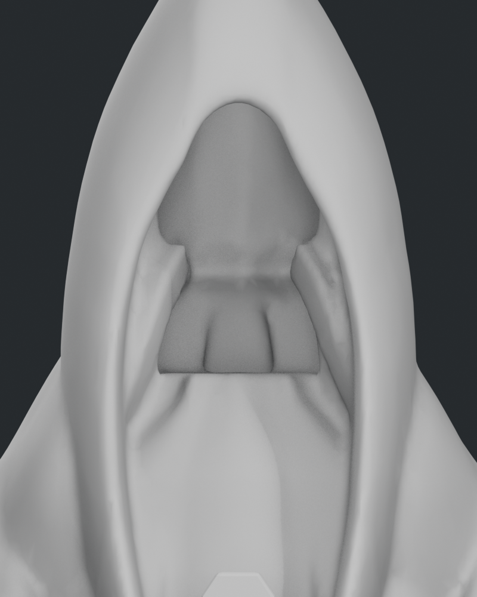
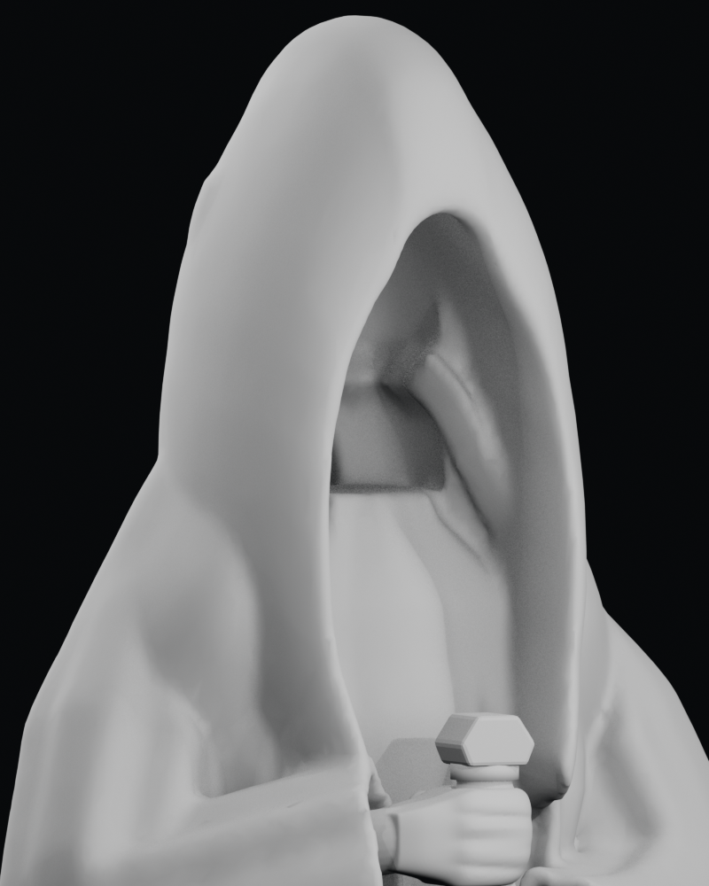
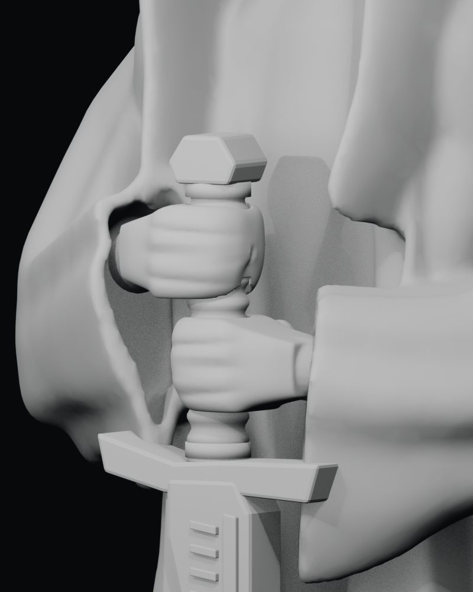

# Última revisión de retoques — Vigía VII

16-10-2026. Inspección solicitada por el usuario. **Hallazgos y propuestas; no implementadas ni aceptadas como entrega.** Se conservan la fuente y el GLB VII sin cambios. La aceptación visual final sigue pendiente.

## Método y límites

Se compararon frontal, perfil, posterior, tres cuartos y detalles Cycles con las capturas del mismo GLB en Godot. Además se abrió la fuente real en Blender y se generaron tres vistas con material neutro y luz frontal de diagnóstico. Estas vistas exponen superficies que quedan en sombra en el render artístico; no son una nueva iteración ni iluminación propuesta para el juego.

- Fuente SHA-256: `c8d04e6217c5009a173d90e6818220ab38ac0efd1242f50d4912936d47e41302`.
- GLB SHA-256: `7f7d9de5e04c08254938ec473bbdb6ed27381ab41b89bae1dddf3b79ba22e87d`.
- Cuerpo y ambas manos: cero bordes abiertos/no manifold y volumen firmado positivo. Los resultados y rayos de inspección se conservan en [inspection.json](vigia-retouch-inspection.json). Esto no certifica ausencia de intersecciones o defectos visuales locales.
- La inspección no guarda cambios en la escena ni altera los scripts del asset. El estado operativo permanece en [#26](https://github.com/Dioniss97/ShadowsOfKharuun/issues/26) y [#27](https://github.com/Dioniss97/ShadowsOfKharuun/issues/27).

## Retoques que merecen una intervención

| Prioridad | Hallazgo comprobado | Intervención propuesta y límite |
|---|---|---|
| Alta, técnica | Pequeños triángulos oscuros en el GLB, visibles en mangas, manos e interior de capucha. Ya registrados en #26. | Corregir la reproducción del sombreado/exportación conservando las formas y las runas. La causa sigue sin identificarse; no se atribuye automáticamente al mapa normal ni a la pérdida de pigmento ya corregida. |
| Alta, escultórica | El remate superior del torso forma un borde horizontal dentro de la capucha. Con luz frontal aparece como una repisa y revela un relieve central que distrae del rostro oculto. Está en la fuente real, además de en Godot. | Retraer y suavizar localmente el remate interior del torso y su encuentro con el fondo de la capucha. Preservar borde exterior, altura, apertura y estola. Revisar después bajo luz frontal y oblicua; oscurecer el material por sí solo no resolvería esa forma. |
| Media, local | En el lateral de la mano superior, junto a la empuñadura, aparece un pequeño pellizco y lóbulo en la unión del volumen palmar. Es visible desde el ángulo opuesto al render habitual. | Regularizar ese encuentro local conservando tamaño de mano/muñeca, canal de agarre, dedos unidos y pulgar detrás. Confirmar la contribución de palma/pulgar/booleano antes de intervenir; no se diagnostica una malla abierta. |

## Opcional, de menor impacto

La inscripción conserva el texto y se lee como dos columnas rituales. Cada verso comienza una fila nueva, pero la separación entre versos es igual a la de las demás filas. Un poco más de aire entre los tres versos de cada banda ayudaría a distinguir sus bloques. Es una propuesta de composición, no un error de texto ni un requisito pendiente aprobado. No se recomienda aumentar saturación o emisión para igualar la banda en sombra con la iluminada.

## Formas que funcionan

La verticalidad, proporciones globales, continuidad exterior de hombros/mangas, caída posterior, volumen de muñecas, posición y contraste del arma y frente plano de la estola permiten una pasada limitada. La revisión no identifica una razón para rediseñar esas formas ni añadir ornamentos. La apariencia deliberadamente tallada de nudillos y planos sigue siendo coherente con la simplificación 50/50 acordada.

## Vistas de diagnóstico

| Interior frontal | Interior oblicuo |
|---|---|
|  |  |

Referencias históricas de VII: [capucha Godot](../iterations/07/godot_detail_cowl.png), [manos Godot](../iterations/07/godot_detail_hands.png), [capucha Cycles](../iterations/07/detail_cowl.png) y [manos Cycles](../iterations/07/detail_hands.png). La pasada posterior autorizada se documenta en [review_08](../review_08/README.md).
