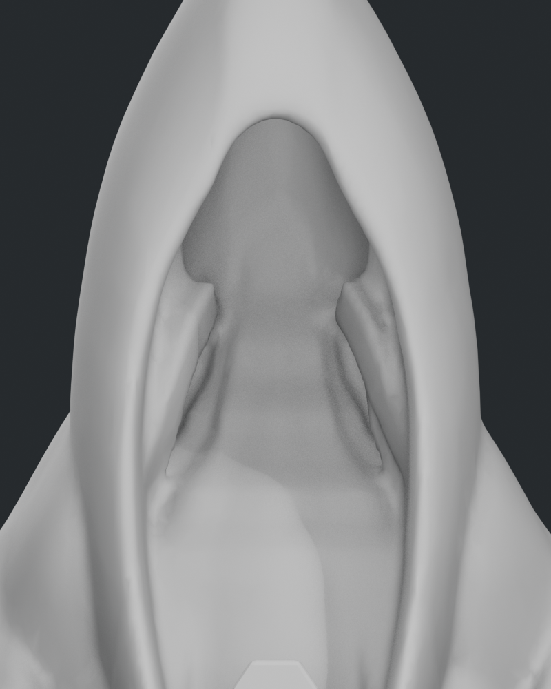
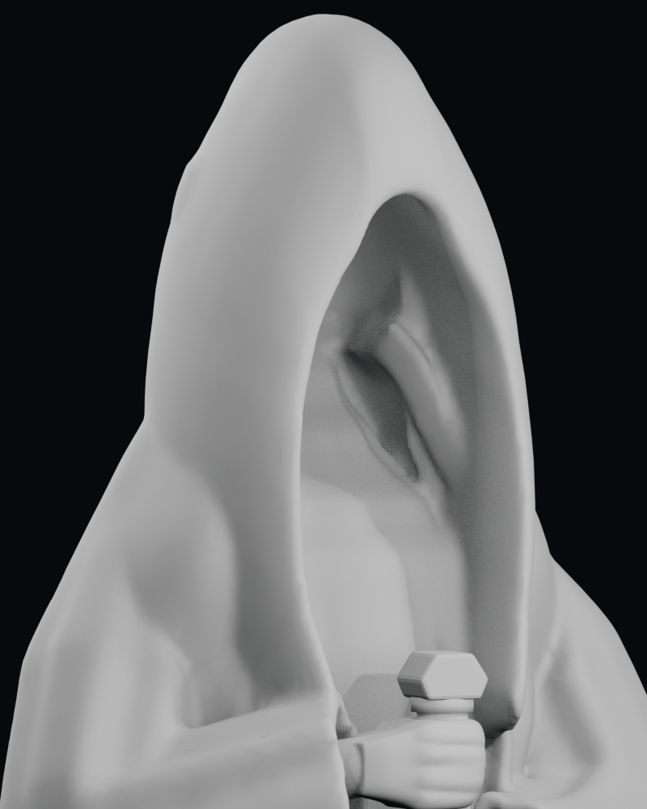
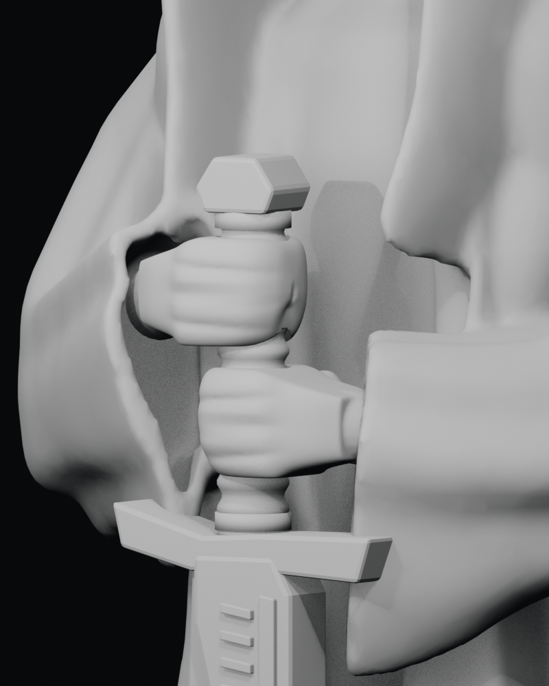
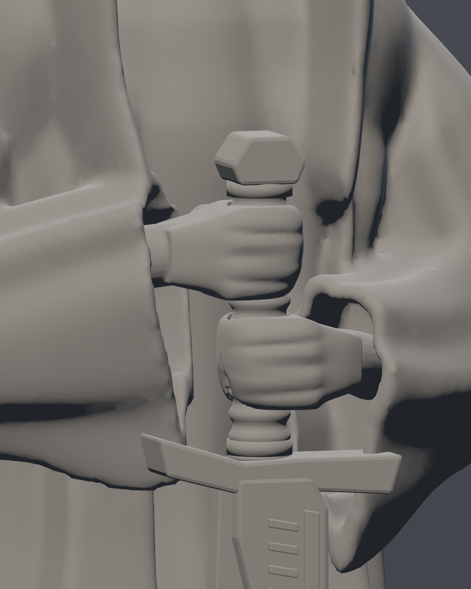
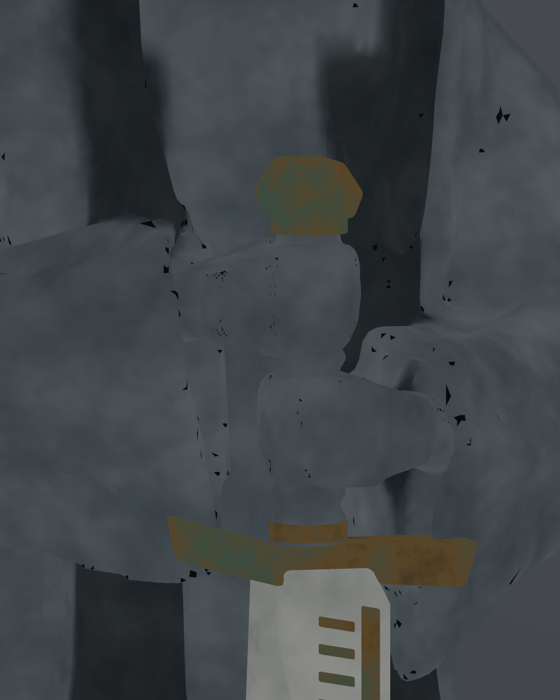
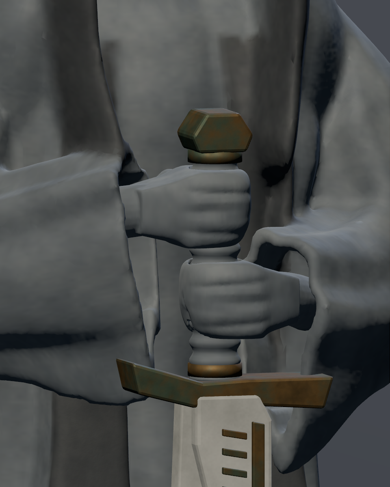

# Retoques locales — Vigía VIII

16-10-2026. Implementación local de **A04-11**, autorizada por el usuario tras la [inspección VII](../review_07/README.md). Se han intervenido tres defectos. La aceptación artística y la integración definitiva en el templo siguen pendientes.

## 1. Encuentro interior torso–capucha

El torso anterior acababa en una tapa horizontal a 6,05 m, expuesta dentro de la capucha. Ahora sus secciones superiores se estrechan y retraen hasta 6,85 m, detrás de la cavidad. Se conserva el exterior de la capucha. Su interior comparte la piedra oscura del borde; la forma se corrige antes del cambio de tono.

| VII, luz neutra frontal | VIII, misma inspección |
|---|---|
|  |  |

| VII, luz neutra oblicua | VIII, misma inspección |
|---|---|
|  |  |

El perfil central de profundidad, muestreado cada 2 cm entre 5,70 y 6,76 m, pasa de un salto máximo de **0,7511 a 0,0316 m**. Esta medida caracteriza ese perfil, no certifica toda la superficie. La luz frontal fuerte de Godot aún expone el relieve interior; su ocultación final depende de la iluminación del templo. No se ha añadido un rostro.

## 2. Unión de la mano superior

Palma, muñeca y pulgar se fusionan antes de cortar el canal definitivo de la empuñadura. La punta del pulgar queda más atrás, evitando el pequeño lóbulo pinzado que causaba la combinación anterior de canal y fusión. Se conservan dedos juntos, tamaño de palma/muñeca y posición del agarre. La mano inferior no se modifica.

| VII, ángulo opuesto | VIII, ángulo opuesto |
|---|---|
|  |  |

La hendidura normal alrededor de la empuñadura permanece. El objetivo es regularizar la transición, conservando planos tallados y fuerza del agarre.

## 3. Motas triangulares del GLB

El diagnóstico se hizo sobre el GLB VII con la misma geometría y cámara en GPU:

| Material original | Material neutro iluminado | Solo color base, sin iluminación |
|---|---|---|
|  |  |  |

Las imágenes de color incrustadas coincidían byte a byte con los PNG de horneado. Las caras UV muy finas sin muestras conservaban un relleno escrito con valores lineales en un PNG sRGB: su posterior decodificación lo acercaba al negro. El mapa normal no era la causa de estas motas.

El exportador ahora codifica el relleno a sRGB. Para evitar que un relleno constante produzca facetas claras respecto a su entorno, completa solo los texeles aún sin muestra de caras UV muy finas con el color muestreado de caras vecinas de la superficie. Respeta las máscaras de oscurecimiento y pigmento para conservar las runas. No sustituye píxeles ya horneados.

- Piedra dominante: 14.269 caras finas procesadas; 44.494 texeles completados.
- Piedra clara: 9 caras finas; 110 texeles completados.
- Bronce: sin reparación necesaria.
- Se conservan los nueve mapas y sus tamaños, tres materiales, normal a 0,25 y emisión cero.

| VII, original GPU | VIII, captura final GPU |
|---|---|
|  |  |

Las nueve capturas finales revisadas —incluyendo perfil y posterior— ya no muestran las motas negras ni las facetas claras del ensayo intermedio en las zonas inspeccionadas. El [detalle de inscripción Godot](../godot_detail_inscription.png) conserva el pigmento rojo. Esta comprobación del estudio no sustituye el recorrido y las luces del templo.

## Conservación, informes y límites

- Fuente: 19 piezas editables. Cuerpo y ambas manos: un componente cerrado cada uno, cero bordes abiertos/no manifold. Mano inferior, arma y pedestal: **17 piezas con vértices y transformaciones idénticos a VII**.
- Fuera del interior intervenido del cuerpo, 41.148 muestras: distancia media 0,0022 mm y máxima 1,70 mm respecto a VII tras fusión/decimación. Se mantienen silueta, hombros y mangas.
- Código inglés completo conservado, 17/15 filas, glifos nominales 105 mm, incisión 2 mm, rojo mate y sin emisión. No se cambia el espaciado entre versos.
- Diez renders Cycles y nueve capturas Godot 4.7.2 Forward+/Vulkan en RX 6600, todos a 960×1200. Las tres vistas neutras adicionales son de diagnóstico a 800×1000.
- GLB: **169.352 triángulos, 84.706 vértices, 18.214.180 bytes**, sin dependencias externas. Un 2,55 % menos de triángulos que VII; no es una medición de rendimiento de ambas instancias.
- Fuente SHA-256: `0a51277b706a62154cf82af036694d286300a7a4a1b278f99bcbf8ca4e87dad2`.
- GLB SHA-256: `192a22bc4f519bbdaa0cb594756344b0b75f055211ae4d128bec1841824b248e`.

Evidencia: [geometría y hashes de capturas](../geometry_review.json), [exportación y reparación de atlas](../export_report.json), [importación Godot](../godot_import_report.json), [inspección neutra](vigia-viii-inspection.json) y [galería completa](../README.md).

Estado operativo: [#26](https://github.com/Dioniss97/ShadowsOfKharuun/issues/26) y [#27](https://github.com/Dioniss97/ShadowsOfKharuun/issues/27). No se han integrado estas modificaciones definitivamente en el templo. La revisión humana y la decisión de publicación de scripts Q04-06 siguen pendientes.
